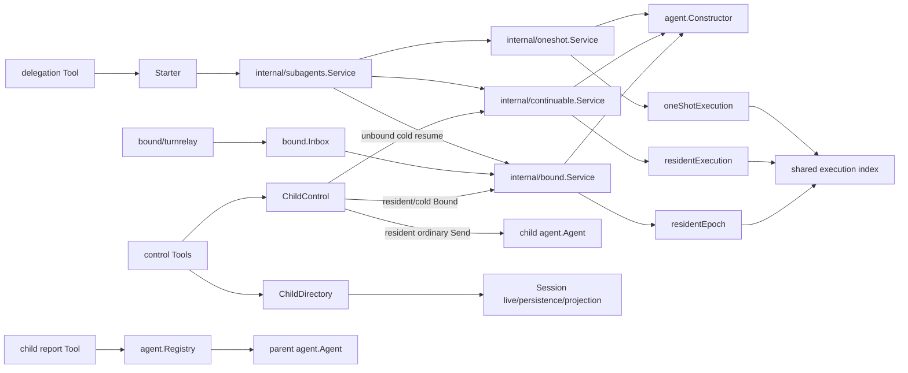

# Subagent

`subagent` 拥有委派请求、OneShot、Continuable 与 Bound 三种模式的统一生命周期契约，以及 durable child 的查询和父子通信语义。Bound 使用全局 Definition、每用户 Session Binding 和独立 Definition Store，不再保留 per-parent config 路径。设计导航见[Subagent 领域设计导航](./docs/design.zh-CN.md)，当前完成证据见[08 实施进度](../zh-CN/08-implementation-progress.md)，固定源职责证据见[源能力分析](../zh-CN/subagent/01-source-capability-analysis.md)。

局部文档包括[设计导航](./docs/design.zh-CN.md)和[术语规范](./docs/terminology.zh-CN.md)。Bound 的需求、调用链、config owner和parent interaction恢复分别由[需求](./docs/parent-bound-requirements.zh-CN.md)、[技术设计](./docs/parent-bound-design.zh-CN.md)、[config详设](./docs/bound-config-management.zh-CN.md)和[投递设计](./docs/session-event-delivery.zh-CN.md)维护；本README只说明包边界，不复制这些契约。

## 职责边界

本模块负责：

- `StartCommand` 是OneShot与Continuable的封闭显式启动命令类型族；Bound由全局Definition和用户Session一致性检查启动，不伪装成一次Tool启动命令；
- 用同一个 `Execution` 契约表示任一模式的一次 exact Agent lifetime；
- 为模型 Tool 和 Host Consumer 提供最小的 `ChildControl` 与 `ChildDirectory` 能力；
- 通过 `SeedBuilder` 生成首次创建 child Session 时使用的 detached event prefix；
- 保存 Subagent descriptor、事件、错误和模型消息来源等领域契约。

本模块不拥有 Agent lifetime、AgentLoop、Session 持久化、Plugin topology、Tool schema 或模型传输。`agent` 负责 Agent 创建、恢复、运行时父子关系和结构关闭；`agentloop` 的 Host 只执行并关闭单个 Agent 的 Scope、Inbox、turn、step、Tool 与模型循环。Session 仍是 append-only 事实来源。

## 公共契约

| 文件 | 对象是什么 | 消费者 |
| --- | --- | --- |
| `lifecycle.go` | `Mode`、`ChildRequest`、`StartCommand`、`Execution`、`Starter` | delegation Tool、Host use case |
| `control.go` | 后续消息和中断授权契约 | control |
| `seed_builder.go` | fresh child Session seed 的构造策略与注册目录 | spawn、fork、runtime |
| `directory.go` | durable child 的只读查询目录与查询结果 | list_agents、Host/UI |
| `descriptor*.go` | Session log 中可重建的 Subagent identity | Continuable resume、目录查询 |
| `extension.go` | child Agent Scope 的普通 Setup 扩展契约，以及 named Extension 只读目录 | report 等 child-scoped capability、Host 配置 UI |
| `bound/definition*.go`、`bound/events.go` | 全局 Bound Definition、管理命令和 Session Binding事件契约 | Web/API、Bound runtime |
| `bound/inbox.go`、`bound/delivery.go` | 通用Bound输入接纳边界、稳定输入身份和durable child provenance | TurnRelay、其他输入源 |
| `events.go` | 固定源兼容的组件通信事件 | Agent Event observer、Tool publication |
| `message_source.go` | 父子消息进入 Session log 时的来源描述 | Agent Inbox、重建 |
| `errors.go` | 稳定领域错误码 | 所有 Consumer |

`provider` 只保留在固定源兼容的事件名、配置字段和 descriptor 字段中；Go 对象统一称为 `SeedBuilder`。它只构造 seed，不创建 Agent，也不拥有执行生命周期。

## 模块划分

| 模块 | 负责 | 不负责 |
| --- | --- | --- |
| `plugin` | 解析依赖、构造业务对象、发布窄 capability、转接事件、注册 Projection，并装配三个模式对象 | Subagent 用例、Plugin Runtime 本身和 Agent 结构关闭策略 |
| `internal/subagents` | 统一准入、按具体 `StartCommand` variant 路由、公共中断授权、关闭编排 | 把三个模式合并成大而全的启动参数 |
| `internal/oneshot` | OneShot 创建、初始消息、结果选择和终止 | durable resume、后续消息 |
| `internal/continuable` | Continuable fresh create、cold resume 和 settlement | Agent lifetime、普通 live Inbox 投递或 Session durability |
| `internal/bound` | 全局Definition应用、用户Session Binding、create/restore、idle resident epoch、Followup、Inbox接纳与failure containment | 输入源观察/cursor、Web协议、System Prompt/Tools实现或Session EventBus |
| `bound/turnrelay` | 观察用户Session的closed turn、恢复source cursor并调用`bound.Inbox` | Definition、child生命周期或Bound内部mailbox |
| `internal/execution` | Run ID、live execution索引、发布流程、Terminal复制和输出选择纯函数 | 任何Mode的状态机或终止事务 |
| `internal/seedbuilder` | SeedBuilder 注册、查找和事件边界 | Agent 创建 |
| `internal/childdirectory` | live/persisted child 的只读合并查询 | 创建、恢复或控制 child |
| `internal/childpolicy` | child-local Persona、Tool restriction 和 delegation Setup | Plugin lifecycle 或Mode状态机 |
| `internal/projection` | Subagent identity/timing Session Projection | Registry、checkpoint 和 Session API |
| `internal/extension` | common/selected child Extension registration、per-Scope Setup、rollback和release | Plugin lifecycle、Agent creation或Bound revision |
| `tools/delegation` | 创建新 Subagent 的模型委派 Tool 适配 | Subagent 启动状态机 |
| `tools/control` | 控制和查询已有 child 的三项 Tool 适配 | child lifecycle 与 durable query |
| `tools/report` | child 向 exact parent 报告的 Tool/Extension 适配 | 父子投递业务 |
| `spawn`、`fork` | 两种 SeedBuilder 策略 | OneShot/Continuable 执行 |

## 调用关系

`plugin.Plugin`只做装配。Consumer通过`Starter`和`ChildControl`进入统一Service；ordinary resident child直接使用Agent Inbox，resident/cold Bound交给Bound owner串行化Definition revision与message admission，无binding的cold child才交给Continuable。`bound.Definitions`是独立公开契约，API Proxy只调用其`List/Create/Replace`。child-scoped report Tool直接调用exact parent Agent，不经过Mode Service。

## 生命周期

已发布的OneShot、Continuable和Bound Execution都使用`Starting -> Active -> Stopping -> Stopped`词汇，但状态分别属于`oneShotExecution`、`residentExecution`和`residentEpoch`，不是共享状态对象，也不是Agent状态的副本。一个Execution与一个exact Agent生命周期一一对应。

- OneShot 每次 `Start` 创建新 child；terminal 形成后实现自动释放 exact `agent.Handle`，调用方只等待 `Execution`，不再承担第二次 Dispose 义务。
- Continuable 的 durable child identity 可跨多个 resident epoch。cold child 收到 `Send` 时从 Session log 恢复，形成新的 mode-owned `residentExecution`；seed 只在首次创建时构造。
- Bound Definition来自独立全局Store；每个用户Session保存Definition name到direct child的Binding和materialization；具体输入源保存自己的cursor。
- Bound fresh create只复制Binding建立时冻结的完整parent prefix；安装自己的完整system prompt后保持idle，不提交initial message，也不因创建调用LLM。
- 内置TurnRelay以Binding或`turn/end` append为wakeup，从parent log fold closed direct-user turn并调用`bound.Inbox`；child receipt durable后才推进TurnRelay私有cursor，不使用公开projection event。
- Definition revision通过同一child Session的exact epoch replacement应用；disabled保留Binding和child Session，输入源保留自己的cursor与backlog。
- 普通 interrupt 取消当前 turn，但不等价于删除 durable child。
- 模块关闭先停止统一Service准入并等待已准入调用返回，再让三个Mode关闭自己持有的具体Execution。Agent模块继续拥有child-first结构关闭和Scope teardown。
- 收到 `agent/disposed` 时，Subagent 只结算与该 exact Agent 匹配的 Execution，不再次 Dispose 已由 Agent 关闭的 Handle。

所有模型可见输入必须能从 Session log 重建。`ChildDirectory` 是读取时快照，不是投递或恢复承诺；实际 `Send`、`Interrupt` 和 `Report` 会重新校验 exact live Agent 与父子授权。

`subagent.Started`和`subagent.Ended`是exact parent Agent Scope内的进程级组件通信事件，不是Session event。`Ended`允许在parent closing阶段继续派发，直到Scope真正关闭，以保证已发布Started有配对Ended。
