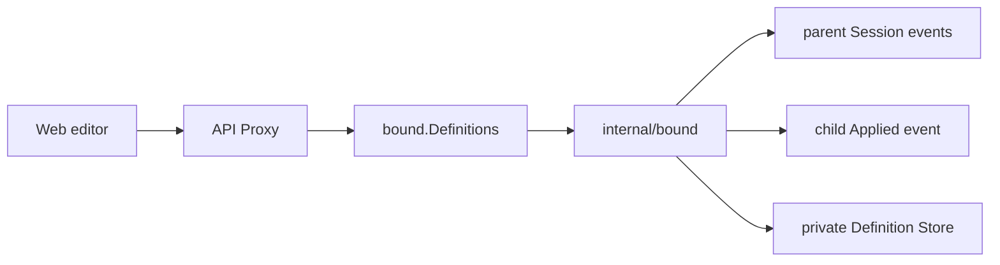

# Bound 公共契约

本包定义全局 Bound Definition 能力和每个用户 Session 中的 durable Bound event。它是 API Proxy、Web 管理入口与私有 Bound runtime 之间的稳定业务边界，不包含 SQLite、Agent 构造、Session fold或传输 DTO。

## 职责边界

- `Draft`是调用方提交的完整候选；`Definition`是带正整数`Revision`的已提交完整快照。
- `Creation`和`Replacement`分别表达创建与expected-revision CAS替换；`Definitions`只提供`List/Create/Replace`。
- Definition名称是稳定identity，不支持rename或hard delete；停用通过新revision的`Enabled=false`表达。
- JSON codec严格拒绝unknown field、`null`、多JSON值和非法数字，并在边界深复制slice与指针字段。
- `BindingEvent`、`DefinitionAppliedEvent`、`MaterializationEvent`与`CursorEvent`定义version 2的Session事实。

本包不决定Binding何时创建、child何时恢复、interaction如何fold或SQLite如何提交CAS。相关实现分别属于`subagent/internal/bound`和其`sqlite` adapter。

## 生命周期与失败

公共值本身没有goroutine或关闭语义。Provider负责在Plugin Apply期间提供`Definitions`，并在Dispose时先停止reconcile和Binding workers、最后关闭Store。业务冲突通过`Error`的稳定`ErrorCode`返回；技术I/O错误保持原错误，由API Proxy决定wire映射。

可观察要求见[Bound需求](../docs/parent-bound-requirements.zh-CN.md)，调用链见[技术设计](../docs/parent-bound-design.zh-CN.md)，Definition规则见[配置管理](../docs/bound-config-management.zh-CN.md)，完成证据见[08实施进度](../../zh-CN/08-implementation-progress.md)。
