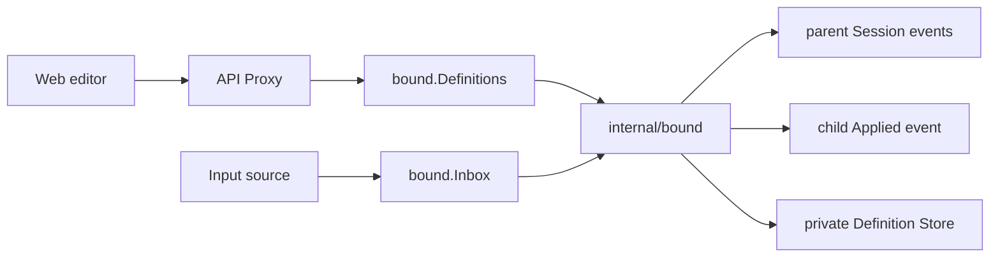

# Bound 公共契约

本包定义全局 Bound Definition、每个用户 Session 中的 durable Binding event，以及向指定 Bound 接纳输入的`Inbox`。它是管理入口、输入源与私有 Bound runtime 之间的稳定业务边界，不包含 SQLite、Agent 构造、Session fold或传输 DTO。

## 职责边界

- `Draft`是调用方提交的完整候选；`Definition`是带正整数`Revision`的已提交完整快照。
- `Creation`和`Replacement`分别表达创建与expected-revision CAS替换；`Definitions`只提供`List/Create/Replace`。
- Definition名称是稳定identity，不支持rename或hard delete；停用通过新revision的`Enabled=false`表达。
- `Address`只包含用户Session ID与该Session内唯一的Bound名称；调用方不管理child Session ID。
- `Inbox.Deliver(Address, Input)`在child Inbox durable后返回`Receipt`；稳定`InputID`用于输入源崩溃重放时去重。
- `Delivery`是child Session中保存的输入来源，保留`InputID`和输入源自己的opaque provenance。
- JSON codec严格拒绝unknown field、`null`、多JSON值和非法数字，并在边界深复制slice与指针字段。
- `BindingEvent`、`DefinitionAppliedEvent`与`MaterializationEvent`定义version 2的Bound Session事实。

本包不决定Binding何时创建、child何时恢复、输入源如何观察或checkpoint，也不决定SQLite如何提交CAS。Bound实现属于`subagent/internal/bound`；Session turn输入源属于`subagent/bound/turnrelay`；Definition Store adapter属于`subagent/internal/bound/sqlite`。

## 生命周期与失败

公共值本身没有goroutine或关闭语义。Subagent Plugin在Apply期间同时提供`Definitions`与`Inbox`，并在Dispose时先停止reconcile和Binding workers、最后关闭Store。输入源Plugin必须先停止自己的worker，再释放对`Inbox`的依赖。业务冲突通过稳定错误码返回；技术I/O错误保持原错误，由调用方决定重试或wire映射。

可观察要求见[Bound需求](../docs/parent-bound-requirements.zh-CN.md)，调用链见[技术设计](../docs/parent-bound-design.zh-CN.md)，Definition规则见[配置管理](../docs/bound-config-management.zh-CN.md)，完成证据见[08实施进度](../../zh-CN/08-implementation-progress.md)。
