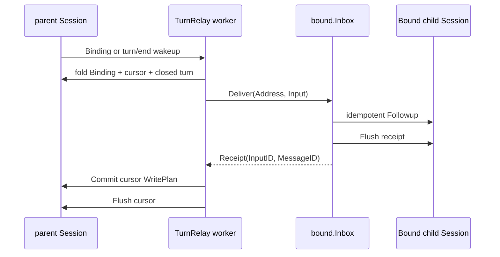

# Bound Turn Relay

本包是`bound.Inbox`的内置Session-turn输入源。它是Bound之下的Provider Plugin，而不是Bound核心生命周期的一部分：TurnRelay主动观察parent Session、恢复自己的cursor，并调用Bound公开的`Inbox.Deliver`。

## 职责边界

- 观察`agent.SessionStarted`、`agent.Disposed`与`session.EventAppended`；只有Binding和`turn/end` append用于建立或唤醒worker，其他Session事件直接忽略。
- 从用户Session的durable Binding event重建每个`Session ID + Bound name`的relay worker。
- 从Binding event后一位开始fold完整parent turn，只保留direct user输入与parent可见assistant内容。
- 过滤reasoning、tool call、tool result和内部来源；report-only turn只推进skipped cursor，避免echo loop。
- 为每个turn生成稳定`InputID`和`session-turn`来源，然后主动调用`bound.Inbox.Deliver(Address, Input)`。
- 只有取得durable child receipt后才提交并Flush私有`subagent/bound-turn-relay-cursor`。
- 同一Binding串行；不同Binding各有worker，可以并行调用Bound Inbox。

本包不创建或恢复child Agent，不解释Definition，不访问Bound内部mailbox，也不决定child Session ID。`session.EventAppended`不是事实存储；遗漏、合并或重复wakeup都由启动扫描和durable cursor恢复覆盖。

## 生命周期与恢复

Plugin Apply解析`agent.Registry`、`session.LiveStore`和`bound.Inbox`，并扫描当时已经live的用户Agent；后续`SessionStarted`、Binding append与`turn/end`也会重新fold已有Binding，因此丢失单次Binding通知不会永久漏建worker。worker归exact parent Agent epoch所有，`agent.Disposed`只取消匹配的epoch；同一用户Session恢复为新Agent epoch时建立新worker并从durable cursor继续。

worker在没有完整turn时等待合并wakeup。`Inbox.Deliver`或cursor提交失败时保留pending Input并退避重试；`BOUND_DISABLED`是正常暂停，不报告diagnostic。Definition重新启用不要求Bound反向通知输入源，pending worker最迟在退避到期后再次调用Inbox。

Dispose先撤销新worker准入并取消Plugin lifecycle context，再等待所有worker退出。Plugin Runtime因依赖更新重新激活时，会在上一轮worker完全结束后重新Apply，不复用旧worker或旧context。

## 失败语义

- malformed Binding、turn或cursor chain：保留cursor并向process diagnostics报告，不猜测修复；
- child admission失败：不推进source cursor；
- child已durable但cursor未提交：相同`InputID`重放，由Bound Inbox返回原receipt；
- cursor提交冲突：重新读取Session并重试；
- parent关闭或Plugin Dispose：取消在途读取、delivery、退避和Flush。

该机制保证durable acceptance去重，不承诺exactly-once模型调用或Tool外部副作用。完整顺序见[Parent Interaction投递设计](../../docs/session-event-delivery.zh-CN.md)，Bound生命周期见[技术设计](../../docs/parent-bound-design.zh-CN.md)，实现证据见[08实施进度](../../../zh-CN/08-implementation-progress.md)。
