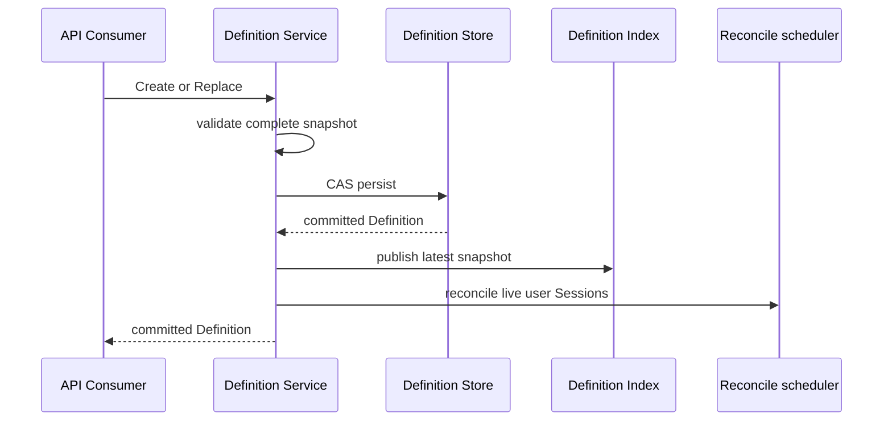

# Bound Definition 管理详细设计

> 状态：目标设计已确认，代码迁移中。Definition 替代旧的 per-parent Bound config。

## 1. 边界

Definition 是全局、版本化的 Bound 配置。它由 Bound Definition Service 决策并通过独立 SQLite/sqlc Store 持久化；Session adapter不读取其表，Definition Store也不写Session event。

| Owner | 负责 | 不负责 |
| --- | --- | --- |
| Definition Service | 业务校验、名称identity、revision CAS、索引、reconcile请求 | SQL、Web JSON、Agent构造 |
| SQLite Store | schema、sqlc映射、事务、技术错误 | revision策略、live Session扫描 |
| Binding worker | 把latest Definition应用到exact child epoch | 修改全局 Definition |
| System Prompt | 完整prompt section组合 | Definition revision |
| Tools | Tool restriction与冲突规则 | Definition持久化 |
| Extension Registry | common/selected注册、安装、rollback和release | 何时替换epoch |
| child Session | 保存Applied Definition历史 | 作为全局配置源 |

依赖方向为：Web/API → Definition Service → Store；Definition Service → reconcile scheduler → Binding worker → Agent/Session。SQLite adapter实现Service消费的Store接口，不向上暴露sqlc row或driver类型。

## 2. Definition 语义

Definition boundary data包含名称、revision、enabled、完整system prompt、可选Agent options/最大深度、Tool restriction和有序Extensions。输入在进入Store前完成：

- 名称规范化和非空校验；
- system prompt非空校验；
- Agent options与最大深度校验；
- Tool restriction深复制与Tools现有规则校验；
- Extension名称非空、无重复且按输入顺序保留；
- selected Extension在应用前可解析。

返回值和索引必须防御性复制slice、map与指针字段。Definition是完整snapshot，不是patch。

`Name`回答对象身份；`Revision`回答同一对象的版本。`Revision`不是Session seq：revision只在同名Definition替换时递增，Session seq则是某个Session append-only log中的事件位置。

## 3. Store

第一版Store保存每个名称的latest完整snapshot。最小操作是load all、create和compare-and-swap replace。Create只接受revision 1；Replace要求stored revision与expected revision一致，再写expected+1。

Store使用独立数据库文件，例如data dir下的`bound-definitions.sqlite`。migration和query文件与adapter同置，生成代码保持repository-private。Snapshot字段可以用严格JSON列保存，但adapter必须严格decode并映射为owner-defined Definition；未知字段、缺字段和非法revision都是数据完整性错误。

Store关闭只负责技术资源；Service先停止所有会使用Store的任务。

## 4. System prompt

Bound system prompt不是Persona。每个exact child Scope安装：

```go
systemprompt.PromptSection{
    Name:     "subagent:bound",
    Order:    systemprompt.PersonaOrder,
    Text:     systemprompt.StaticText(definition.SystemPrompt),
    Complete: true,
}
```

`Complete=true`表示该section构成Bound自己的完整system prompt，不继承parent的模型身份。此安装由child policy/provisioning adapter完成；Bound Definition Service不直接操作`systemprompt.Registry`。

旧`Persona`类型和`newPersona`命名应从Bound路径移除。若OneShot/Continuable仍有persona语义，应由其自己的配置和公共前缀文件保留，不能让Bound完整system prompt退化成persona别名。

## 5. Tool restriction 与 Extensions

Tool restriction继续复用Tools policy；Definition不定义任意tool参数、provider配置或第二套Tool registry。

Extension规则保持：

- 无名称registration是common Extension，每个child都安装；
- 有名称registration是selected Extension，只有Definition按顺序选择时安装；
- 安装是事务：任一安装失败，按逆序release已经取得的effects；
- Bound不负责注销registration；注册方显式注销或Plugin shutdown清空Registry。

Definition保存registration name，不保存Tool name或Plugin对象。Store CAS不依赖selected Extension当前是否live；应用到child前必须解析并失败隔离，因此暂时缺失的Extension不会破坏全局Definition持久化。

## 6. Applied Definition

每次fresh create或revision replacement都在child Session写入新版本`subagent/bound-definition-applied`事件。事件保存：

- schema version；
- Definition name和revision；
- enabled状态；
- 完整system prompt；
- 实际Agent options和最大深度；
- 实际Tool restriction；
- 按实际安装顺序保存的Extensions。

该事件是模型可见Scope的可恢复证据，不能只保存Definition name/revision或指向parent/global row。恢复child时先从child log校验历史Applied事件，再以Store latest决定是否需要新的epoch。

## 7. Create 和 Replace



顺序不能反转：Store失败不得污染索引；某个live Session reconcile失败也不得回滚已经提交的全局Definition。scheduler合并同一parent的重复请求，并保留pending直到maintenance和所有Binding最终对齐。

## 8. Disable 与 replacement

`Enabled=false`仍是一条完整revision。Binding worker看到它后停止resident epoch，但保留durable Binding、child Session、cursor和backlog。disabled期间interaction wakeup可以合并，但cursor不推进。

重新启用或配置替换时，worker等待旧epoch idle，停止旧epoch，再以同一child Session和最新exact Scope恢复。Applied event Flush完成后才允许发布新epoch；随后主动catch up。显式Send与replacement共享同一mailbox，避免消息进入旧Scope。

## 9. 迁移

删除旧的`BoundConfigInput`、`BoundConfigSnapshot`、`UpdateBoundConfigCommand`、parent `subagent/bound-config`和只引用parent seq的`BoundConfigAppliedData`。新事件提升版本并拒绝旧数据；不增加兼容wrapper、双写或silent fallback。

实现状态和测试证据只记录在[08 实施进度](../../zh-CN/08-implementation-progress.md)。
