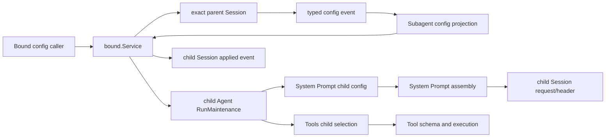
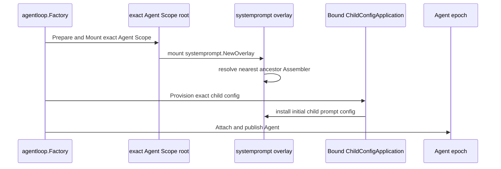
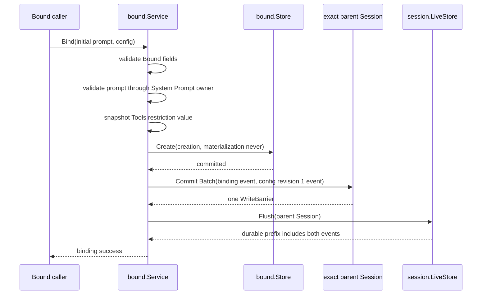
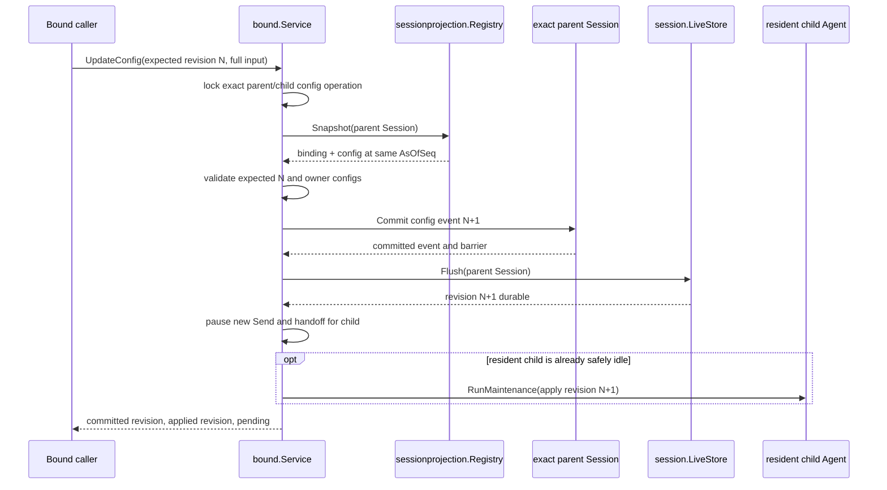

# Bound Config 管理详细设计

状态：设计已收敛，尚未实现

本文细化 [Bound Subagent 需求](./parent-bound-requirements.zh-CN.md)中的 config 持久化、投影、应用和并发语义；Bound 的整体启动、binding、materialization、cursor 与 parent close 仍见[技术设计](./parent-bound-design.zh-CN.md)。当前代码没有本文描述的 config event、projection 或 resident Bound 协调逻辑，不能把本文当作实现证据。

## 1. 已确认结论

1. config 变更写入 exact parent Session 的 typed non-surface event。Session event 是 durable truth，不能再维护一份可覆盖的 Bound config record。
2. binding event 与 config event 是两个事件类型。初次 Bind 在同一个 `session.Batch` 中提交 binding event 和 config revision 1，因此不会出现 durable binding 缺少初始 config 的中间状态。
3. Subagent 定义 config event、拥有 config projection，并协调 resident Bound child 应用 revision；Session 只负责 append、Commit 和 Flush。
4. System Prompt 拥有 prompt 配置和 prompt assembly。Subagent 不拼接 prompt，也不复制 Persona 的校验和 section 规则。
5. Tools 拥有 Tool 选择、限制校验、模型可见 schema 和执行权限。Subagent 只从 Tools 提供的能力中选择 child 可用 Tool。
6. Agent options 仍由 Agent 拥有。本设计不把 model、provider 或 maxTokens 作为可变 Bound config；它们在 `BoundCreation` 中保存为创建输入。以后若需要动态修改，必须先由 Agent 提供 owner-defined 配置接口。
7. 废除“config 必须在下一 child turn 生效”的假设。新的提交/应用边界见第 7 节：config event durable 后暂停新 Bound work；已经被 Inbox 接受的 work 使用旧 revision；在 Agent 的安全 maintenance 区间应用最新 revision，成功后恢复准入。
8. config、materialization state 和 cursor 继续分开。config 从 parent Session events 投影；materialization state 与 cursor 使用 Bound persistence port；process-local current execution 和 applied revision 不持久化为同一记录。
9. System Prompt 不通过 Bound binding event“发现”新 child。每个 Agent 创建或恢复时，AgentLoop 都先在 exact Agent Scope 安装 `systemprompt.NewOverlay`；Bound 的 child config provisioner 随后在 publication 前向这个 exact layer 安装初始 prompt 配置。
10. Bound config event 记录期望配置，`request/header` 记录真正进入模型请求的有效 System Prompt 和 Tool schema。两者不能互相替代，也不新增没有既有契约的“child added”Session event。

## 2. Owner 与非 Owner



职责如下：

- `subagent/internal/bound.Service` 主动提交 config event、读取 projection、暂停/恢复 child work 准入，并在安全区间协调配置应用；
- `session.Context` 主动执行 FIFO Commit；`session.LiveStore` 主动满足 Flush 请求，但不解释 config revision；
- `session/projection.Registry` 驱动 Subagent 注册的纯 projection；projection cache 可删除重建，不是 config truth；
- `systemprompt` 定义 child prompt config，负责 Persona section、shadow、assembly 和 prompt mutation handle；
- `tools` 定义 `ToolRestriction`，负责已知 Tool 校验、可见 schema、restriction 和实际执行权限；
- `agent.Agent` 的 `RunMaintenance` 保证 maintenance operation 与 Turn driver 互斥；
- `agentloop` 为每个 exact Agent Scope 安装 System Prompt/Tools overlay，在每次 Step 组装有效 prompt，并在模型调用前把完整有效 header 写入 child Session 的 `request/header`；
- Bound persistence adapter 不保存 config snapshot，也不从数据库 row 推导 config。

以下做法明确禁止：

- 在 Bound 再定义一套 Persona、prompt section 或 Tool allow/deny 语义；
- 把 `system-prompt/change` 当作 durable Session config event；它只是 System Prompt Registry 的 live change event；
- 为了通知 System Prompt 新建了 child 而新增一个没有既有契约的 Session event；System Prompt layer 由 Agent Scope 构造和 provision 流程建立；
- 在 config event 之外另存一个“latest config”可覆盖记录；
- 让 System Prompt 接管 model selection、Tool execution、Session append 或 Bound revision；
- config pending 时继续由统一 Service 直接调用 resident Bound Agent 的 `Followup`。

## 3. 配置数据

### 3.1 Owner-defined 配置类型

当前 `systemprompt.Config` 是 deployment root 配置，包含 Harness identity、runtime context 和 Tool order，不能直接作为 Bound child 配置。System Prompt owner 需要增加一个只表达 child prompt 覆盖的持久值：

```go
package systemprompt

type ChildPromptConfig struct {
	Persona *string
}

func ValidateChildPromptConfig(
	candidate ChildPromptConfig,
) (ChildPromptConfig, error)
```

`Persona == nil` 表示继承 ancestor prompt layer；非 nil 表示由 child layer 使用 canonical `PersonaSection` 和 `PersonaOrder` 安装覆盖。值的复制、trim/empty 规则和可扩展字段由 System Prompt owner 决定，Subagent 不重复实现。

Tools 已有 owner-defined 类型：

```go
package tools

type ToolRestriction struct {
	Allow []string
	Deny  []string
}
```

nil Tool restriction 表示不增加 child restriction；非 nil 值由 child `tools.PolicyRegistry.AddRestriction` 校验并安装。Allow/Deny 的交集、未知 Tool、reserved Tool 和 schema 可见性全部保持 Tools 当前语义。

### 3.2 BoundConfig

Bound 只组合各 owner 的配置和自己的 routing 字段：

```go
type BoundConfig struct {
	ParentSessionID session.SessionID
	ChildSessionID  session.SessionID
	Revision        int64
	Enabled         bool
	PromptConfig    systemprompt.ChildPromptConfig
	ToolRestriction *tools.ToolRestriction
	Subscriptions   []BoundSubscription
}
```

`BoundConfig` 是一个完整、detached snapshot。`PromptConfig` 的内部规则属于 System Prompt，`ToolRestriction` 的内部规则属于 Tools；`Enabled`、`Subscriptions`、child identity 和 revision 属于 Bound。

每个 revision 必须包含完整 snapshot。调用方可以使用 patch-shaped transport，但 inbound adapter 必须先交给 Bound application method；Bound 读取当前 projection、形成完整候选、调用各 owner 校验，再创建 event。Projection 和 storage adapter 都不合并局部 patch。

### 3.3 BoundCreation 调整

Agent options 不再属于可变 config，改为 immutable creation input：

```go
type BoundCreation struct {
	ParentSessionID session.SessionID
	ChildSessionID  session.SessionID
	SeedBuilder     string
	Label           string
	InitialPrompt   []llm.ContentBlock
	AgentOptions    agent.Options
}
```

Bind 时根据 exact parent 解析继承值并保存完整 `AgentOptions`。fresh create 和 existing resume 都读取同一份值，因此 parent 后续 model 变化不会暗中改变 Bound child。Agent owner 将来若增加动态配置能力，再单独设计 revision 和应用语义，不能复用 System Prompt 或 Tools config 假装修改 Agent options。

## 4. Session events 与 projection

### 4.1 Config changed event

config event 写入 exact parent Session，因为 binding 和 config 可以在 child Session 出现前存在。以下是领域 payload；canonical event name、JSON 字段拼写和 version 数值与 binding event 一起由 O12 固定：

```go
type BoundConfigChangedData struct {
	Version          int
	ChildSessionID   session.SessionID
	PreviousRevision int64
	Revision         int64
	Config           BoundConfigSnapshot
}

type BoundConfigSnapshot struct {
	Enabled         bool
	PromptConfig    systemprompt.ChildPromptConfig
	ToolRestriction *tools.ToolRestriction
	Subscriptions   []BoundSubscription
}
```

事件只保存 child-relative snapshot，不重复 parent Session ID；parent identity 来自承载该 event 的 Session。revision 规则是：

- 初始 config：`PreviousRevision=0`、`Revision=1`；
- 更新：`PreviousRevision=N`、`Revision=N+1`；
- revision 必须是正 safe integer；
- 相同 child 的 gap、倒退或 fork 是 projection error，不能 last-write-wins；
- payload 必须使用 strict codec，拒绝 unknown field、unknown version、nil required value 和不安全数值；
- event 不含 secret、credential value、runtime handle、错误文本或 process-local Agent 状态。

Binding、config changed和config applied是Bound自己的control events，不能成为`BoundSubscription.EventType`，也不能进入parent event handoff。`session.EventAppended` handoff adapter必须先按owner event key排除它们，再调用`ParentEventAppended`。这既避免配置事件反馈给child，也避免`UpdateConfig`持有per-child mutex执行Session Commit时由同步post-commit observer重入同一Bound child。

### 4.2 Config projection

Binding projection 仍只回答 parent 绑定了哪些 child。Config 使用独立 projection unit：

```go
type BoundConfigView struct {
	Children []BoundConfig
}
```

`Children` 按 child Session ID 稳定排序且无重复。读取方通过 owner helper 按 child ID 查找；不得依赖 JSON map 的顺序。

Projection fold 规则：

1. 只读取 exact parent Session 的 Bound config events；
2. 对每个 child 从 revision 1 开始严格推进；
3. 每次替换整个 detached snapshot；
4. 未知 version、缺失初始 revision、revision gap 或 owner config decode failure 都使该 projection Snapshot 失败；
5. `session.EventAppended` notification 丢失不影响恢复，`Registry.Snapshot(parentSession)` 必须能从 durable events 补 fold；
6. binding 与 config 必须从同一个 `sessionprojection.Snapshot` 读取，使用同一个 `AsOfSeq`，不能分别读取后拼出跨 prefix 状态。

### 4.3 Applied event

在 resident child 成功应用一个 revision 后，Bound 向 exact child Session 提交一条 typed non-surface applied event：

```go
type BoundConfigAppliedData struct {
	Version              int
	ParentSessionID      session.SessionID
	ParentConfigEventSeq int64
	Revision             int64
}
```

该 event 不复制 prompt 或 Tool config。`ParentSessionID + ParentConfigEventSeq` 精确引用 parent Session 中的完整 config event；child Header lineage 必须与该 parent 一致。它用于从 append-only logs 判断后续 child work 使用的 revision，不替代 parent config projection。

Applied event 必须在 owner 配置更新成功后 Commit 并 Flush，之后 Bound 才恢复新 work 准入。若 Applied Commit 失败，maintenance operation 回滚到旧 owner 配置；若 Commit 已成功但 Flush 失败，Bound 不恢复准入，并把该 child 收敛为不可运行状态，等待后续恢复重新应用 latest revision。不能在 durability 未知时继续启动新 turn。

### 4.4 System Prompt layer 与实际请求事件

System Prompt 不维护 Agent 目录，也不读取 Bound binding projection。新 child 获得 System Prompt 能力的现有主动调用链是：



对应当前实现，`agentloop.Factory.CreateAgent/ResumeAgent` 创建 unpublished Agent；`newAgentScopeRoot` 为每个 Agent Scope 声明 `systemprompt.NewOverlay` 和 `tools.NewOverlay`；`preparedAgent.publish` 先 mount Scope，再调用 Mode 提供的 `agent.Provisioner`，全部成功后才调用 `AgentEpoch.Attach`。因此：

- System Prompt 通过 exact Scope 中的 overlay 存在于 child，不通过 Session event 获知“新增 child”；
- Bound 的 `ChildConfigApplication.Provision` 必须解析并修改 exact child overlay，不能修改 root layer 或 sibling child layer；
- overlay mount、ancestor resolve 或初始 config provision 失败时，child Agent 不 publication；该失败仍不能阻止 parent Agent publication；
- binding 可以先于 child 存在，因为 parent binding/config event 不依赖 live System Prompt layer。

配置更新后存在两种不同通知：

1. `PromptRegistry` 的 add/remove 成功后发布既有 `system-prompt/change` Plugin event，用于 exact Runtime Scope 内的同步 live change 通知和失败回滚；它不是 Session event。
2. AgentLoop 在每个 Step 重新调用 `systemprompt.Assembler.Assemble`。模型调用前，`stepExecutor.buildRequest` 把有效 provider、model、System Prompt 文本和 Tool schemas canonicalize 为 `session.EpochHeader`；首次、恢复或相对上次 header 发生变化时，向 exact child Session 提交既有 `request/header` event，reason 分别为 `initial`、`resume` 或 `change`。

因此，一个 prompt config mutation 成功但尚未产生后续模型请求时，不应提前伪造 `request/header`；真正消费新配置的第一个请求负责写入它实际使用的完整 header。这个边界也覆盖非 Bound Plugin 对 System Prompt layer 的合法修改。

各记录的职责必须保持分离：

| 记录 | 所在 Session/Scope | 回答的问题 |
| --- | --- | --- |
| Bound binding event | parent Session | parent 绑定了哪个 Bound child |
| Bound config event | parent Session | child 应当使用哪个完整 config revision |
| Bound config applied event | child Session | 哪个 parent config revision 已安装到 resident child |
| `request/header` | child Session | 这次及后续可重建请求实际使用的 System Prompt、Tool schemas 与模型调用配置 |
| `system-prompt/change` | exact Plugin Runtime Scope | 某个 System Prompt layer 刚刚发生 live mutation |

其中前三个 Bound event 的 canonical name 仍由 O12 关闭；`request/header` 和 `system-prompt/change` 是当前已有契约，不在 Bound 中重新命名或复制 payload。

## 5. 对外用例与内部接口

### 5.1 UpdateConfig

在真实 Host/API caller 固定前，以下是 application 语义，不提前固定 wire schema：

```go
type UpdateBoundConfigCommand struct {
	Parent           agent.Agent
	ChildSessionID   session.SessionID
	ExpectedRevision int64
	Config           BoundConfigInput
}

type BoundConfigInput struct {
	Enabled         bool
	PromptConfig    systemprompt.ChildPromptConfig
	ToolRestriction *tools.ToolRestriction
	Subscriptions   []BoundSubscription
}

type UpdateBoundConfigResult struct {
	CommittedRevision int64
	AppliedRevision   int64
	Pending           bool
}
```

`CommittedRevision` 来自 parent config projection。`AppliedRevision` 来自 current Bound execution 的 process-local state；cold child 或无 current execution 时可以为 0。`Pending` 表示 durable revision 已存在，但 resident child 尚未在 maintenance 区间应用。返回 `Pending=true` 是成功提交，不伪装成应用失败。

### 5.2 Bound 模式接口

统一 Service 对 Bound 的消费面需要覆盖 resident/cold routing，不能只有 `Start`：

```go
type bound interface {
	implementation
	Start(
		context.Context,
		subagent.BoundStartCommand,
	) (subagent.Execution, error)
	HasBinding(
		context.Context,
		agent.Agent,
		session.SessionID,
	) (bool, error)
	Send(
		context.Context,
		agent.Agent,
		session.SessionID,
		llm.UserMessage,
	) (llm.MessageID, error)
	UpdateConfig(
		context.Context,
		UpdateBoundConfigCommand,
	) (UpdateBoundConfigResult, error)
}
```

`HasBinding` 只为 unified cold `Send` 判定 Mode：无 live execution 时先查询 exact parent 的 binding/config projection；确认是 Bound 才调用 Bound `Send`，否则才进入 Continuable cold resume。错误不能当作“不存在”后回退 Continuable。

### 5.3 Child config application

Bound 不直接依赖 concrete System Prompt Registry 或 Tools Service。`subagent/plugin` 组合层实现 Bound 消费的窄接口：

```go
type ChildConfig struct {
	PromptConfig    systemprompt.ChildPromptConfig
	ToolRestriction *tools.ToolRestriction
}

type ChildConfigApplication interface {
	agent.Provisioner
	ApplyConfig(context.Context, ChildConfig) error
}

type ChildConfigBuilder interface {
	BuildConfigApplication(ChildConfig) ChildConfigApplication
}
```

每个 Bound exact Agent epoch 使用一个 `ChildConfigApplication`：

- `Provision` 在 Agent publication 前安装初始 System Prompt 与 Tools 配置，并保存 owner handles；
- `ApplyConfig` 只允许由 Bound 在该 Agent 的 `RunMaintenance` operation 内调用；
- prompt 更新调用 System Prompt owner 的 child config API；
- Tool 更新调用 `tools.PolicyRegistry`，从当前 inherited Tools 中选择并安装 restriction；
- 任一步失败时按反向顺序恢复旧 handles；恢复也失败时返回不可继续错误，Bound 不恢复 child work 准入；
- `Dispose` 仍由 Plugin Runtime 使用各 owner handle 精确撤销，不由 Bound 越过 Scope 直接删除 entry。

最终私有类型名可以按实际 import cycle 收口，但不能把这个接口扩大成同时处理 binding、Agent options、subscriptions、cursor 或 materialization 的通用配置对象。

## 6. Bind 与 config update

### 6.1 Bind



Binding event 与 config revision 1 共用一次 Session Commit，因此 projection 在任何 committed prefix 中都不会看到只有 binding、没有 config 的状态。`bound.Store.Create` 不再接收 `BoundConfig`，只原子写 immutable creation input 和初始 materialization state。

Store 成功而 Session Commit/Flush 失败时仍可能留下孤立 creation/state record；它不构成 binding。O13 继续拥有 Bind retry 与孤立记录清理语义。

### 6.2 UpdateConfig



同一 parent/child 的 config update 使用与 Bound `Send`、handoff 和 apply 共用的 mutex，覆盖“读取 current revision -> Commit event”这一段。Session FIFO 本身不替代 expected revision 校验。

Commit 成功而 Flush 或响应失败时，caller 使用相同 `ExpectedRevision` 和相同完整 snapshot 重试：

- projection 已是 N+1 且内容相同：Bound 重新 Flush 对应 parent Session prefix并返回 N+1，不追加重复 event；
- projection 已是 N+1 但内容不同：返回 revision conflict；
- projection 仍是 N：重新执行原提交；
- projection 高于 N+1：返回 revision conflict，不覆盖较新配置。

这条规则使 config update retry 不依赖任意字符串 idempotency key；O13 仍负责初次 Bind 的 child ID 和双 event retry。

## 7. Resident child 应用语义

### 7.1 用 Inbox acceptance 定义配置边界

旧设计用“下一 turn”定义生效时间，但 AgentLoop 可以连续消费已经排入 Inbox 的消息；`WhenIdle` 不保证 Bound 能在下一次 `Inbox.Claim` 前抢占。因此改用可线性化的 work admission 边界：

- config revision N+1 durable 之前已经被 child Inbox 接受的消息，可以继续在 revision N 下执行；
- revision N+1 durable 之后，Bound 暂停该 child 的新 `Send` 和 handoff acceptance；
- Bound 不把这些新消息保存在第二条队列中。同步 caller 等待到 context 截止或收到稳定 pending error；durable parent event handoff 保持 cursor 不前进，之后从 parent Session 重试；
- 旧 Inbox work 全部结束后，Agent 到达 `RunMaintenance` 可占用的 idle 且没有 latched successor work 的状态；
- Bound 在 maintenance operation 内把 System Prompt 和 Tools 一起切换到 projection 中的最新 committed revision；
- child applied event Commit/Flush 成功后，Bound 更新 current applied revision并恢复新 work 准入；
- 多次 config event 可以折叠应用 latest revision，中间 revision 仍保留在 parent Session log 中，但不要求 resident child逐个安装。

这保证一个 model step 不会观察到新 prompt 配旧 Tool policy，也不要求取消当前 turn或修改 AgentLoop 的 Inbox claim 顺序。

### 7.2 应用流程

```mermaid
sequenceDiagram
    participant O as UpdateConfig or Agent idle observer
    participant B as bound.Service
    participant P as parent config projection
    participant A as exact child Agent
    participant C as ChildConfigApplication
    participant S as exact child Session
    participant L as session.LiveStore

    O->>B: apply latest config for child
    B->>P: read latest committed revision N
    B->>B: compare current applied revision M
    alt M equals N
        B-->>O: already applied
    else child has active or queued work
        A-->>B: RunMaintenance rejects
        B-->>O: remain pending; new work stays paused
    else safe maintenance interval
        B->>A: RunMaintenance(operation)
        A->>C: ApplyConfig(prompt and Tools from N)
        C-->>A: owner handles updated
        B->>S: Commit applied event for N
        B->>L: Flush(child Session)
        B->>B: set current applied revision N
        B-->>O: resume Bound work admission
    end
```

主动调用方向是：`UpdateConfig` 在 parent Commit/Flush 返回后、`agent.StatusChanged(idle)` observer或 Bound `Send` 触发 `bound.Service`；Bound 调用 projection 和 exact child `RunMaintenance`；maintenance callback 调用 composition-owned `ChildConfigApplication`；后者调用 System Prompt 与 Tools owner API。

Bound 不注册一个同步调用 config apply 的 `session.EventAppended` observer。Session Commit 会在返回前同步发布 post-commit notification，而 `UpdateConfig` 此时仍持有同一 child 的 config mutex；observer 回调若再次取得该 mutex会死锁。config event只由Bound application method创建，Session Projection Registry负责同步 fold；`UpdateConfig` 在Commit/Flush返回并更新pending状态后直接尝试apply。`agent.StatusChanged` 只是降低延迟的通知，不是唯一 correctness path。每次 Bound `Start`、`Send` 和 handoff 都重新比较 projection latest revision与current applied revision，发现pending时触发同一应用方法。

### 7.3 Cold、fresh 与 restart

- fresh Bound Start 从 parent projection 读取 revision 1 或更高的 latest config，在 Agent publication 前通过 `ChildConfigApplication.Provision` 安装；initial prompt 被 Inbox 接受前 config 必须成功；
- existing cold child Resume 直接使用 latest config 构造新的 child Scope，不先恢复历史 config，也不重放中间 revision；
- process restart 不恢复 process-local applied revision。Bound 根据 parent projection构造环境，并在 child publication前追加或确认对应 applied event；
- config validation/application failure只使该 child Start 失败，materialization state 记录稳定分类；parent Agent publication继续；
- disabled config 不创建或恢复 resident child，也不接受新 work。已有 resident child在旧 Inbox work排空后停止，不需要安装 prompt/Tool config。

## 8. Store 与 MaterializationState 调整

Bound persistence port 删除 config 方法：

```go
type Store interface {
	Create(
		context.Context,
		BoundCreation,
		MaterializationState,
	) error
	Creation(
		context.Context,
		session.SessionID,
		session.SessionID,
	) (BoundCreation, bool, error)
	Materialization(
		context.Context,
		session.SessionID,
		session.SessionID,
	) (MaterializationState, bool, error)
	PutMaterialization(context.Context, MaterializationState) error
	Cursor(
		context.Context,
		session.SessionID,
		session.SessionID,
		string,
	) (Cursor, bool, error)
	PutCursor(context.Context, Cursor) error
}
```

`MaterializationState` 不再保存 `AppliedConfigRevision`。最近成功应用的 revision 由 child applied events重建，process-local current execution只缓存该结果。MaterializationState 只记录 create/restore attempt：

```go
type MaterializationState struct {
	ParentSessionID session.SessionID
	ChildSessionID  session.SessionID
	AttemptCount    int64
	LastResult      MaterializationResult
	LastFailureCode string
	UpdatedAt       int64
}
```

这样 config history、最近 create/restore 结果和 handoff cursor 分别由 parent Session events、materialization record 和 cursor record拥有，不再通过一个字段交叉充当事实来源。

## 9. 失败与恢复

- prompt config decode/validation failure：config event 不提交；若来自已存在的未知版本 event，projection Snapshot 失败且对应 child 不启动；
- Tools restriction 在当前 inherited Tool set 中无效：`ChildConfigApplication` 返回 Tools owner error；revision 保持 durable pending，新 work 不恢复准入；
- `RunMaintenance` 因 active 或 queued work 拒绝：不是 config failure；等待后续 idle notification或下一次入口重试；
- owner config mutation failure：在 maintenance 内反向恢复旧 handles；applied event 不提交；
- applied event Commit failure：恢复旧 owner config，保持 pending；
- applied event Flush failure：不恢复新 work 准入；停止或保留不可运行 child由 Bound close path 收敛，restart 时从 parent projection重新应用；
- process 在 config event durable 后、apply 前退出：restart 直接应用 latest projection；
- process 在 owner config 已更新、applied event 前退出：process-local Scope 消失；restart重新应用 latest projection；
- process 在 applied event durable 后、恢复 work 准入前退出：restart从 logs确认 revision并重新构造相同 owner config；
- config pending 期间的 parent event handoff不推进 cursor，因此不会丢失事件；
- config pending 期间普通 `Send` 不进入第二条 durable queue，caller按返回结果决定等待或重试。

## 10. 验证要求

实现必须至少覆盖：

1. Bind 的 binding/config 两个 event 位于同一 atomic Session batch；任一 draft 无效时两个都不 Commit；
2. config revision projection拒绝 gap、fork、倒退、unknown version和不合法 owner config；
3. projection cache删除后从 parent Session events得到相同 latest config；
4. config event N+1 durable 后，新的 resident Bound `Send` 不再直接调用 `Agent.Followup`；
5. N+1 pending 时，已在 Inbox 的消息可完成，新的 handoff不推进 cursor；
6. `RunMaintenance` 拒绝 active/latched work 时不调用 prompt或Tools mutation；
7. maintenance 成功时，System Prompt和Tools都看到同一 revision后才恢复准入；
8. Tools apply失败时恢复旧 prompt config，且 child不接受新 work；
9. applied event Commit/Flush failure时不把 process-local applied revision标记为成功；
10. 多个 config updates在旧 work排空前提交时只应用 latest revision；
11. fresh/cold/restart均在 child work acceptance前安装 projection latest config；
12. disabled revision durable 后不接受新 work，旧 Inbox排空后 resident child停止；
13. `BoundConfig` codec不出现 secret、raw config、`map[string]any`或 Subagent 自定义 prompt/Tool 规则；
14. architecture tests禁止 `systemprompt`、`tools`、`agent` 或 `session` 反向导入 Bound。
15. binding/config/applied control events不能被subscription接受，Commit期间不会同步重入同一Bound child的handoff路径。
16. fresh create 和 cold resume 都在 Mode provisioner 运行前安装 exact child System Prompt/Tools overlay，provision失败时 child不 publication；
17. prompt或Tool配置切换使有效header相对上次请求发生变化时，第一个实际消费新配置的模型请求提交包含有效System Prompt和Tool schemas、reason为`change`的`request/header`；有效header未变化或没有模型请求时不追加冗余event；
18. Bound binding/config event不作为System Prompt的child发现机制，System Prompt和Tools package不反向依赖Bound projection。

## 11. 仍未关闭的事项

- O4：subscription filter 的 owner-defined 静态 schema；
- O5：handoff dedupe 与 cursor 在 Inbox acceptance 后的最终事务接口；
- O7：parent Session event retention 与落后 cursor/config reference 的 repair policy；
- O11：binding 数量、Start 并发和 timeout 的具体值；
- O12：binding、config changed、config applied 三个 Session event 的 canonical name、version和 migration；
- O13：Bind 在 creation/state record、双 event Commit、Flush和响应之间失败时的 retry；
- System Prompt owner需要确认 `ChildPromptConfig` 的最终公开名称、Persona nil/empty 语义和 strict codec；
- Config pending 的同步 `Send` 最终选择“等待 context”还是立即返回稳定 pending error，属于调用方可观察行为，需在 Host/Tool caller确定后关闭。

以上未决项不影响 owner 边界和 Session-event projection方向，但会影响 public contract或持久化 migration；实现前必须关闭对应项。
