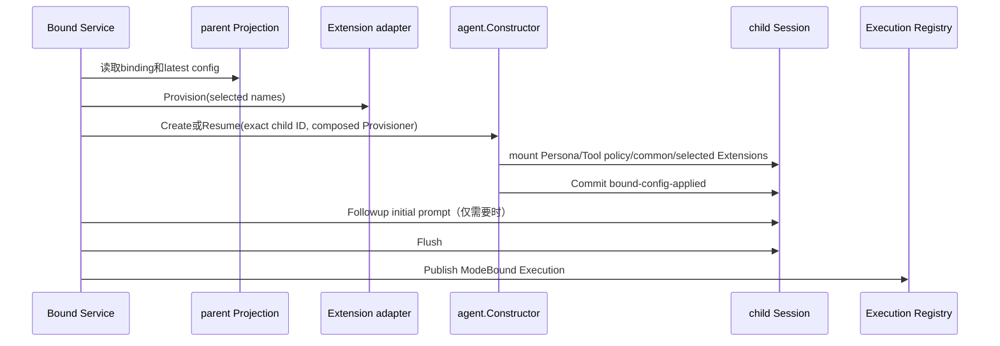
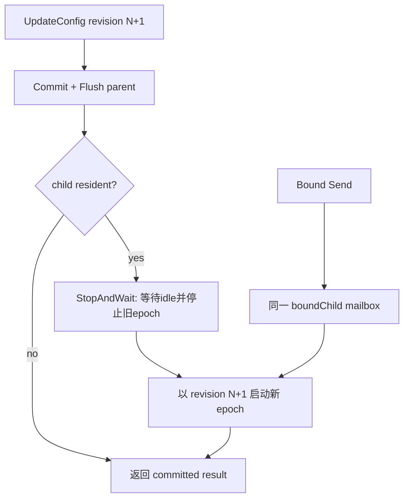

# Bound Config 管理详细设计

> 本文只描述当前实现的Bound config owner和应用机制。

## 1. Owner 与边界

| Owner | 拥有 | 不拥有 |
| --- | --- | --- |
| 配置源 Plugin | 何时调用 `Bind`/`UpdateConfig`，业务授权 | Session event格式、revision规则、child生命周期 |
| `internal/bound.Service` | config校验、revision、parent event、exact epoch replacement、Send串行化 | System Prompt或Tools注册表实现 |
| Session | append-only Commit与Flush | config业务含义 |
| Session Projection | binding/config/materialization/applied派生状态和事件不变量 | child创建、Agent resident状态 |
| System Prompt | Persona section组合 | Bound revision |
| Tools | inherited Tool restriction与同层注册冲突规则 | Bound revision |
| Extension Registry | common/selected registration、选择、安装事务和卸载 | 何时更新Bound config、何时替换Agent epoch |
| Agent Constructor | unpublished Scope provisioning、Create/Resume和publication transaction | 读取parent Bound config |

依赖方向固定为：配置源 → `BoundRegistry` → Bound → Session/projection/Agent；Bound通过消费端口 `Extensions` 使用Extension Registry，Registry不导入Bound。

## 2. 配置数据

公开输入和持久化snapshot分别是：

```go
type BoundConfigInput struct {
	Enabled         bool
	Persona         *string
	ToolRestriction *tools.ToolRestriction
	Extensions      []string
}

type BoundConfigSnapshot struct {
	Enabled         bool
	Persona         *string
	ToolRestriction *tools.ToolRestriction
	Extensions      []string
}
```

`SnapshotBoundConfig`负责深复制、严格校验并生成完整snapshot。`Extensions`是稳定registration name列表，不是Tool name，也不是Plugin name。顺序同时决定selected Extension安装顺序。

immutable creation与mutable config分开：

```go
type BoundCreation struct {
	SeedBuilder   string
	Title         string
	InitialPrompt []agentmessage.ContentBlock
	AgentOptions  agent.Options
}
```

initial prompt属于binding creation，只在child尚未提交自己的Inbox message时使用；它不是可变Persona。

## 3. Prompt 与 Tools 组合

Bound不直接操作`systemprompt.Registry`或`tools.Service`。每次创建一个exact child Agent epoch时，`bound.Service.provisioner`把latest snapshot转换为已有child policy Plugins：

```text
BoundConfig.Persona
  -> childpolicy persona Plugin
  -> systemprompt.PromptRegistry.AddSection

BoundConfig.ToolRestriction
  -> childpolicy tool-restriction Plugin
  -> tools.PolicyRegistry.AddRestriction
```

因此System Prompt只管理prompt section，Tools只管理Tool/policy；Subagent只负责按config选择和组合这些现有能力。config更新不对已发布Scope原位替换section或Tool handle，而是创建使用新snapshot的新Agent epoch。

## 4. Extension 注册与选择

公开Registry保持一个通用option参数：

```go
type ExtensionRegistry interface {
	RegisterExtension(
		Extension,
		...ExtensionOption,
	) (ExtensionRegistration, error)
}

func WithExtensionName(string) ExtensionOption
```

- 无`WithExtensionName`：common Extension，每个OneShot、Continuable和Bound child都安装。
- 有name：selected Extension，不进入common集合；只有config明确选择它的Bound epoch安装。
- 同一Registry内name必须非空、已trim且唯一。
- `NewSelectedProvisioner`在构造时验证完整名称列表，在Provision时重新解析，以覆盖构造与安装之间的registration变化。
- common和selected Provisioner由`agent.ComposeProvisioners`组合；任一安装失败，已安装effect按反序卸载。

Bound拥有的最小消费接口是：

```go
type Extensions interface {
	Validate([]string) error
	Provision([]string) (agent.Provisioner, error)
}
```

`subagent/plugin.boundExtensions`只是Registry到该接口的adapter，不读取config、不创建Agent、不协调revision。

注销链路只有两条：持有`ExtensionRegistration`的注册方显式`Unregister`，或Subagent Plugin shutdown执行`Registry.Clear`。Bound不注销Extension。当前生产代码没有有名Extension注册方；report Plugin注册的是common Extension。若将来新增可热卸载的有名provider，应先定义独立change notification和Agent一致性需求，不能预置Bound callback。

## 5. Session events 与 projection

### 5.1 Parent events

`subagent/bound-binding`保存`BoundCreation`；`subagent/bound-config`保存`PreviousRevision`、`Revision`和完整snapshot；`subagent/bound-materialization`只保存child ID、config revision和`succeeded|failed`。

### 5.2 Child event

`subagent/bound-config-applied`保存：

```go
type BoundConfigAppliedData struct {
	Version              int
	ParentSessionID      session.SessionID
	ParentConfigEventSeq int64
	Revision             int64
}
```

该event由`appliedProvisioner`在child仍未发布时提交，使模型可见配置所对应的revision可从child log重建。它不复制Persona或Tool配置。

### 5.3 Projection

`internal/projection.boundUnit`在一个state中维护四个分离view：`Bindings`、latest `Configs`、latest `Materializations`和child `Applied`历史。

projection拒绝：重复child/title、没有binding的config、非连续revision、没有matching config revision的materialization、无效result和unknown fields。它不保存resident Agent、`boundChild` mailbox或Execution状态。

## 6. Revision 1

`Bind`把binding和config revision 1放入同一个parent Session Commit batch，并在返回前Flush；完整Bind调用链只在[技术设计](./parent-bound-design.zh-CN.md#6-bind-流程)维护。Config owner额外保证selected Extension名称在Commit前通过`Extensions.Validate`。

## 7. Epoch 启动时应用配置



fresh create还安装delegation policy；cold resume沿用durable lineage，不重复seed delegation。初始prompt判断只扫描`Header.SeedLength`之后的child事件，不能把继承parent seed中的Inbox误认为child已经提交prompt。

## 8. UpdateConfig 与 Send

`UpdateConfig`的线性化顺序是：

1. 在`boundChild` mailbox外完成纯输入snapshot和Extension名称预验证；
2. 命令进入mailbox后重新校验exact parent和expected revision；
3. Commit完整revision N+1；
4. Flush parent Session；
5. cold child直接返回；
6. resident child执行`StopAndWait(StopNormal)`；统一settlement等待旧Agent idle并停止旧epoch；
7. 读取latest projection并Create/Resume新epoch；
8. 新epoch发布后返回。

`Send`使用同一个parent-child `boundChild` mailbox。它先确保latest revision有resident epoch，再向exact child `Followup`。因此revision已durable后，不会有新Bound message进入旧epoch。



`Enabled=false`在步骤6停止旧epoch，随后不创建新epoch；`Send`返回`ErrorBoundDisabled`。

## 9. 失败与恢复

- validation失败：不写event。
- parent Commit失败：不创建或替换child。
- parent Flush失败：返回错误；Session已接受event时caller必须按持久化层语义处理，不假装回滚。
- latest revision durable后replacement失败：返回`UpdateBoundConfigResult`和error；next Send/Start读取同一latest revision重试。
- create/restore失败：parent写failed materialization；若来自parent startup，failure只进diagnostics，不否决parent publication。
- child Flush或Execution publication失败：dispose unpublished/failed handle并记录failed materialization。
- module shutdown：先关闭所有Bound/Continuable/OneShot Execution，再Clear Extension Registry。

排除项、O11和验收行为只在[需求](./parent-bound-requirements.zh-CN.md)维护，实现证据只在[仓库实施进度](../../zh-CN/08-implementation-progress.md)维护。
