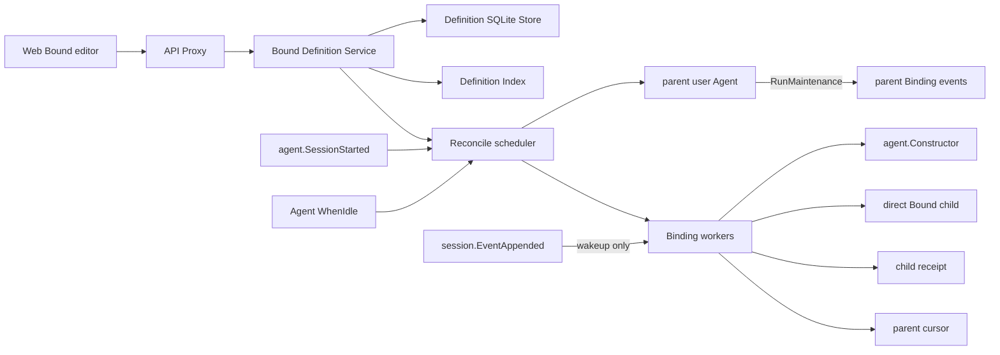
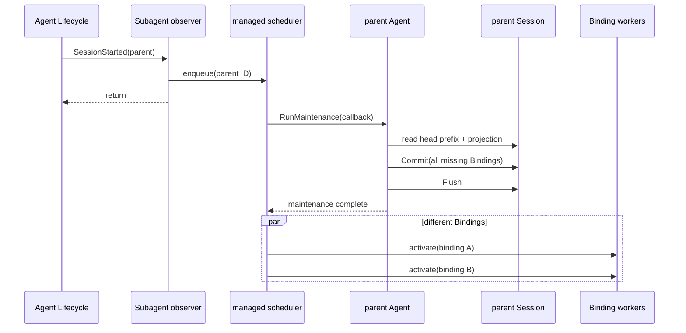

# Bound Subagent 技术设计

> 状态：目标设计已确认，代码迁移中。旧的 per-parent config 实现将在迁移中删除。

## 1. 所有权

Bound 是独立 Mode，但其 Definition 是全局配置能力，不属于任一 Session。每个用户 Session 只持久化该 Session 自己的 Binding、materialization 和 delivery cursor；每个 child Session 持久化实际应用的 Definition 快照和 delivery receipt。

| Owner | 负责 | 不负责 |
| --- | --- | --- |
| Bound Definition Service | Definition 校验、CAS revision、索引、live reconcile | parent Session event、Agent epoch |
| Definition SQLite Store | sqlc 读写、事务和技术持久化 | revision 决策、reconcile |
| `internal/bound.Service` | 用户 Session 一致性、Binding、激活、replacement、interaction | 通用 EventBus、Web DTO、System Prompt/Tools实现 |
| parent projection | Binding 和 materialization 派生状态 | Definition 配置、resident Agent |
| Binding worker | 单 Binding 命令串行、resident epoch、receipt/cursor恢复 | 跨 Binding 串行化 |
| Agent lifecycle | Agent publication、idle/maintenance、结构关闭 | 建立 Binding、解释 Definition |
| API Proxy / Web | 严格管理协议与用户输入 | Definition 持久化或运行时协调 |

## 2. 依赖与主动调用方向



谁主动调用谁：

1. Web 通过 API Proxy 主动调用 Definition Service 的 `List/Create/Replace`。
2. Definition Service 先调用 Store 完成 CAS，再更新索引并请求 live reconcile。
3. Agent lifecycle 发布 `SessionStarted`；Subagent observer 只向受管 scheduler 投递用户 Session ID。
4. scheduler 解析 exact parent Agent 并主动调用 `RunMaintenance`；maintenance callback 读取 Definition index 和 parent projection，原子提交缺失 Bindings。
5. maintenance 返回后 scheduler 为每个 Binding 请求激活；每个 Binding worker 主动调用 Constructor 创建或恢复 child。
6. parent Session 提交 `turn/end` 后发布 `session.EventAppended`；observer 只合并 wakeup，Binding worker 随后主动读取 durable log。
7. worker 先让 child 接受 receipt/input，再提交 parent cursor。

注册监听不是运行时处理本身；事件也不是消息历史或订阅事实。

## 3. 全局 Definition

Definition Service 对外提供稳定、传输无关的能力：

```go
type BoundDefinitions interface {
    List(context.Context) ([]BoundDefinition, error)
    Create(context.Context, CreateBoundDefinition) (BoundDefinition, error)
    Replace(context.Context, ReplaceBoundDefinition) (BoundDefinition, error)
}
```

`Create`要求不存在同名 Definition；成功 revision 为 1。`Replace`要求名称存在且 expected revision 匹配；每次保存完整 snapshot。Store 是 Service 消费的最小接口，SQLite adapter 实现它，composition root 负责路径、迁移和关闭装配。

Definition 名称是 identity，不提供 rename/delete。进程索引只保存 Store 已提交的最新快照；它不是第二持久化来源。

## 4. Parent projection

新 Binding event 使用新版本，至少表达：

```go
type BoundBindingData struct {
    Version        int
    Name           string
    ChildSessionID session.SessionID
    ContextNextSeq uint64
}
```

`ContextNextSeq` 在 maintenance 的 Session FIFO head 上，从同一 committed prefix 计算“最后完整 turn 之后的位置”。同一 batch 可写入多个缺失 Binding；projection 拒绝重复 Name、重复 child ID、无效 floor 和旧事件版本。

Materialization 保存 Name、child ID、Definition revision 和稳定结果。Cursor 继续是 Bound 私有 fold 的 parent event，不进入公共 projection value。

## 5. SessionStarted 和 maintenance



observer 不启动不受控 goroutine，也不在 lifecycle dispatch 栈中做 SQLite、Session 或 Agent I/O。scheduler 由 Plugin 拥有 context、queue 和 wait group，关闭时停止准入、取消并等待。

`RunMaintenance` 是最终原子准入：parent busy 时返回拒绝。scheduler 保留 pending 标记并在 `WhenIdle`、后续启动或 Definition 变更时重试。`WhenIdle` 不能代替 maintenance，因为从观察 idle 到写入之间仍可能开始新 turn。

只对用户 Session reconcile。检查必须同时验证 Session header 与 runtime parent；任何 child Session 都不能进入该流程。

## 6. 激活和 idle

maintenance 成功后才允许激活。Binding worker按 frozen `ContextNextSeq` materialize：

1. fresh create：构造 `parentEvents[:ContextNextSeq]` 的 detached seed；
2. cold restore：复用同一 child Session ID并核对 direct parent、descriptor 和 seed boundary；
3. 安装完整 system prompt、Tool restriction、common 与 selected Extensions；
4. 在未发布 child 中提交完整 Applied Definition并 Flush；
5. 发布 Execution；
6. 不调用 Inbox，不产生初始 turn，resident Agent 保持 idle；
7. 主动 catch up Binding 后已经闭合的 interaction。

延迟激活不得重新计算 seed prefix。Definition revision 变化时也不得重建 child Session或改变 Binding floor。

## 7. Binding worker

每个 Binding 有一个业务含义明确的串行执行对象。它拥有该 Binding 的：

- resident child Agent epoch；
- Definition revision replacement；
- 显式 `Send` admission；
- interaction delivery 与 cursor恢复；
- 失败隔离和关闭。

串行入口优先使用 mailbox channel；registry mutex 只保护 parent/name 到 worker 的短索引和关闭准入，不覆盖 child I/O。不同 Binding 使用不同 worker，因此 child create/restore、delivery 与 stop可以并行。

worker 与 resident epoch 是两个概念：worker 跨多次 Definition replacement长期存在；epoch 是某一 revision 对应的一次 exact Agent execution。

## 8. Definition replacement

Definition Store CAS 成功后，各 Binding worker 串行处理 latest revision：

1. 如果 disabled，等待 current epoch idle并停止，但保留 worker、Binding、cursor和backlog；
2. 如果 enabled 且 current 已应用 latest revision，直接返回；
3. 否则等待旧 epoch idle、Flush并停止；
4. 以同一 child Session恢复新的 exact epoch，重新安装完整 Scope；
5. child Session写入完整 Applied Definition并 Flush后发布；
6. catch up backlog。

失败只影响该 Binding；latest Definition 保持 durable，worker 保留 pending并重试。显式 `Send` 必须经过同一 worker，因此不会在 replacement 中投给旧 epoch。

## 9. Interaction 和恢复

具体 fold、receipt 和 cursor 顺序由[投递设计](./session-event-delivery.zh-CN.md)定义。运行链只使用既有 `session.EventAppended` 作为 wakeup；通知可以重复、合并或丢失，启动、启用和显式操作都会主动 catch up。

## 10. 关闭

Definition Service 停止 reconcile/activation admission后，scheduler取消并等待全部任务。Binding registry随后并行关闭 workers；每个 worker取消在途操作、等待/停止 resident epoch并完成必要 Flush。最后才关闭 Definition Store和Extension Registry依赖。

不得通过关闭 parent Agent 的 SessionStarted observer泄露 goroutine，也不得让一个慢 child 串行拖住其他 child 的关闭。

## 11. 迁移

旧的 `BoundRegistry.Bind/UpdateConfig`、parent `subagent/bound-config`、Title、Persona、InitialPrompt 和 config-applied parent引用全部删除。新 projection 明确拒绝旧事件版本，不提供双读路径。迁移期间文档状态保持“代码迁移中”；完成证据只更新到[08 实施进度](../../zh-CN/08-implementation-progress.md)。
