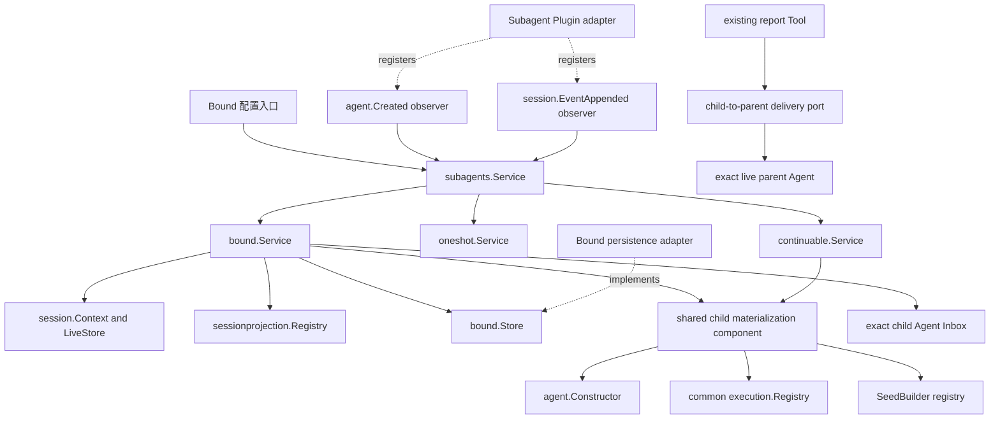
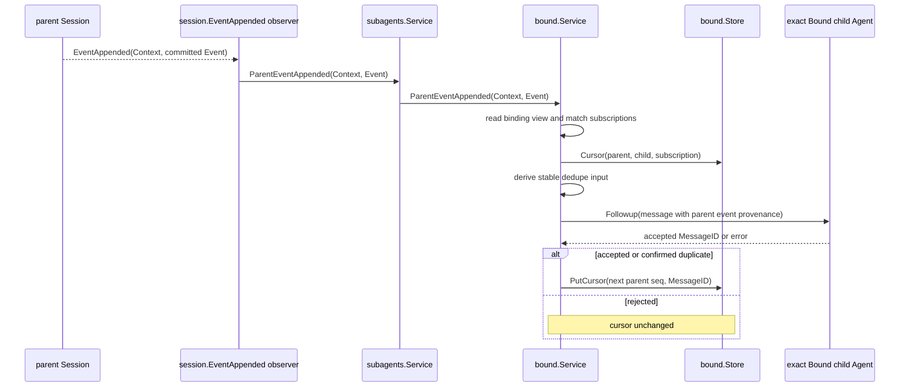
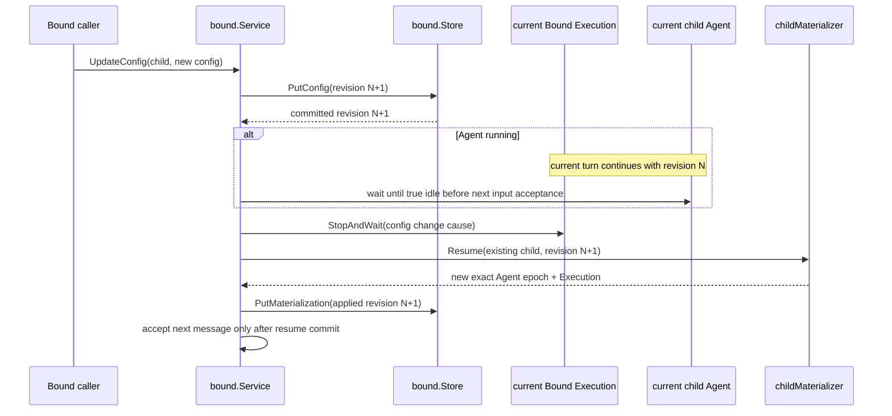
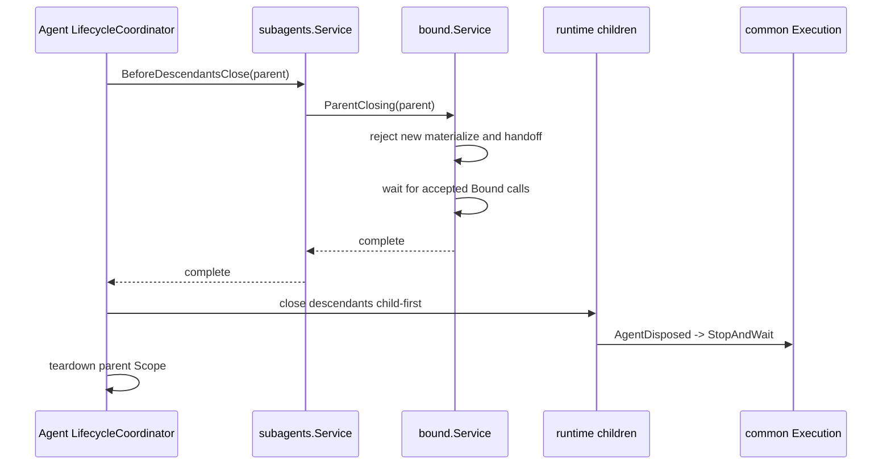

# Bound Subagent 技术设计

状态：进行中；Mode、命令类型族、descriptor/projection/listing 与 Bound Service 骨架已实现，`Bound.Start` 和 binding/config source 仍待实现

> 文件名保留 `parent-bound` 以维持已有链接。类型、Mode 和文中简称统一使用 `Bound`。

## 1. 设计边界与命名规则

本文把[Bound Subagent 需求](./parent-bound-requirements.zh-CN.md)落实为 Go 模块边界、接口、数据结构、方法和上下游调用流程。当前代码只支持 Bound 的结构与分派，不支持创建或恢复 Bound child。

当前事实来源：

- OneShot、Continuable 和 common `Execution`：[Subagent 技术方案](../../zh-CN/Subagent架构与生命周期重构技术方案.md)；
- Agent create/resume/publication：[Agent 构造事务](../../zh-CN/Agent构造事务与调用流程设计.md)；
- Agent exact epoch、runtime parent 和 close：[Agent 生命周期](../../zh-CN/Agent生命周期与运行期父子所有权设计.md)；
- 当前实现状态：[Subagent 进度矩阵](../../zh-CN/Subagent重构进度矩阵.md)。

本文遵守以下命名约束：

1. 只把用户已确认的独立模式命名为 `Bound` / `ModeBound`。
2. 新 Go 名称必须紧邻声明解释调用者、状态归属和失败语义。
3. binding event 的 canonical name 尚未确认，因此本文不臆造常量值。
4. O4 未关闭，因此本文不臆造 filter AST、表达式或 JSON 字段。
5. O5 未关闭，因此本文不臆造 cursor/dedupe 事务 API。
6. 不再使用没有对应声明的 `Activation`、`ResidentChild`、`installation`、`lease`、`gate`、`bootstrap intent`、`BindingDirectory`、`ParentEventRouter` 或 `HandoffWorker`。

## 2. 当前代码事实与必须修改的边界

### 2.1 当前 Mode 和 descriptor

当前 [`subagent/lifecycle.go`](../lifecycle.go) 已有：

```go
const (
	ModeOneShot     Mode = "one-shot"
	ModeContinuable Mode = "continuable"
	ModeBound       Mode = "bound"
)
```

[`subagent/descriptor_codec.go`](../descriptor_codec.go) 和 identity projection 已接受独立 `BoundDescriptor`；ChildDirectory 与 `list_agents` 也能识别 Bound identity。尚未实现的 binding projection 与现有 child identity projection 不是同一个 read model。

### 2.2 当前统一 Subagent Service

当前 [`subagent.StartCommand`](../lifecycle.go) 是封闭接口，合法 variant 是 `OneShotStartCommand`、`ContinuableStartCommand` 和 `BoundStartCommand`。统一 Service 按具体 variant 分派，不使用一个包含所有模式可选字段的大结构体。

[`subagent/internal/subagents/ports.go`](../internal/subagents/ports.go) 定义三个完整模式接口：

```go
type implementation interface {
	Mode() subagent.Mode
	Interrupt(context.Context, session.SessionID) error
	Close(context.Context) error
}

type oneShot interface {
	implementation
	Start(context.Context, subagent.OneShotStartCommand) (subagent.Execution, error)
}

type continuable interface {
	implementation
	Start(context.Context, subagent.ContinuableStartCommand) (subagent.Execution, error)
	Resume(context.Context, agent.Agent, session.SessionID, llm.UserMessage) (llm.MessageID, error)
}

type bound interface {
	implementation
	Start(context.Context, subagent.BoundStartCommand) (subagent.Execution, error)
}
```

`BoundStartCommand` 只携带 exact live parent 和已提交 binding 中的 child Session ID。它不携带 initial prompt、SeedBuilder、Persona、Tool filter 或 Agent options；`bound.Service.Start` 必须从 Bound-owned source 读取这些数据。当前 `Start` 明确返回 `ErrStartNotImplemented`。`Service.Send` 仍只有 resident Agent direct delivery 和 cold Continuable resume，Bound config revision 对 resident Send 的处理尚未实现。

### 2.3 当前 Continuable

[`subagent/internal/continuable`](../internal/continuable) 当前同时拥有：

- `Start` fresh create；
- `Resume` cold restore + first message acceptance；
- per-child `childSlot` 串行化；
- Agent Constructor create/resume；
- common `Execution` create/publish；
- idle settlement watcher；
- Continuable terminal summary。

Bound 可以复用其中的 child ID 检查、Session inspect、Agent Constructor、per-child 串行化和 common `Execution` 装配代码。Bound 不能调用 `continuable.Service.Start/Resume`，也不能运行 Continuable idle watcher 或 Continuable settlement summary。

### 2.4 当前 Session event 与 projection

Session 已提供实现 Bound binding event 所需的基础能力：

- `session.DefineEvent[D]` 声明 typed non-surface event；
- `session.Context.Commit` 把 `EventDraft` 放入 exact Session FIFO；
- `WriteResult.Barrier` 标识 committed prefix；
- `session.LiveStore.Flush` 等待该 Session 当前 committed prefix durable；
- `sessionprojection.Unit` 从 Session events 计算 owner-defined view；
- `sessionprojection.Registry.Snapshot` 对 exact live Session 读取 projection。

`session.EventAppended` 是 post-commit best-effort notification，能降低 handoff 延迟，但不能替代 durable Session event 和 cursor。

### 2.5 当前 Agent publication 和 close

parent create/resume 的主动调用方向是：

```text
Agent caller
  -> agent.RegistryService.Create/Resume
  -> registered agent.Factory
  -> LifecycleCoordinator publication
  -> LifecycleCoordinator dispatches agent.Created
  -> Bound observer reads binding projection
  -> for each binding: NewBoundStart(parent, child ID)
  -> subagents.Service.Start
  -> bound.Service.Start
```

`agent.Created` 是 vetoable publication edge。Bound observer 必须包含每个 child Start error并返回 `nil`，因此 child failure 不会拒绝 parent publication。

当前 parent close 在关闭 runtime descendants 前，没有 Bound 可调用的“停止新 materialize/handoff/report 并等待已接受调用”的明确方法。该调用点是实施前置条件，见 7.5；不能假设 `agent.Disposed` 或 Scope disposer 足够早。

## 3. 目标责任和依赖方向



依赖规则：

- `agent`、`session`、`llm` 和 `tools` 不导入 Bound；
- `bound.Service` 是状态和用例 owner，不实现 Plugin；
- Plugin adapter 只注册 observer、解析 Service 和释放 registration；
- 持久化 adapter 只实现 `bound.Store`，不决定 Bind 顺序、materialize retry 或 cursor 推进条件；
- Bound 和 Continuable 依赖共享的低层 child materialization 组件，Bound 不依赖 `continuable.Service`；
- exact runtime parent/children 仍只由 Agent LifecycleCoordinator 管理。

## 4. 数据结构

本节区分“已经确认的领域字段”和“尚未确认的 wire 名称”。Go 类型名可以在实施 review 时按实际包可见性收口，但字段含义不能被 adapter 改写。

### 4.1 Mode 与 descriptor

公共 `subagent` package 增加：

```go
const ModeBound Mode = "bound"

type BoundDescriptor struct {
	Version  int
	Mode     Mode
	Provider string
	Label    string
}
```

`Provider` 保持现有 descriptor 语义：fresh create 使用的 registered `SeedBuilder` 名称。`BoundDescriptor` 只保存 child 身份恢复必须的稳定字段。Agent model、persona、Tool restriction 和 subscription 属于可变 `BoundConfig`，不能复制进 descriptor 形成两个事实来源。

`Descriptor` sum、`DescriptorData.MarshalJSON/UnmarshalJSON`、`SnapshotDescriptor`、`FoldDescriptor` 和 child projection 都必须增加 `BoundDescriptor` branch。

### 4.2 Binding event payload

binding event 写在 exact parent Session 中。payload 的最小领域结构是：

```go
type BindingEventData struct {
	Version        int               `json:"version"`
	ChildSessionID session.SessionID `json:"childSessionId"`
}
```

该 event 只回答“这个 parent 绑定哪个 Bound child ID”。它不保存 config、materialization phase、cursor、initial prompt、runtime Agent 状态或错误。

event canonical name、payload version 数值以及 binding 是否需要独立 disable/remove event 由 O12 决定。未关闭 O12 前不得在 production code 调用 `session.DefineEvent`。

### 4.3 BoundCreation

`BoundCreation` 是 binding 建立时写入、之后不修改的创建输入：

```go
type BoundCreation struct {
	ParentSessionID session.SessionID
	ChildSessionID  session.SessionID
	SeedBuilder     string
	Label           string
	InitialPrompt   []llm.ContentBlock
}
```

initial prompt 必须非空。`Bound.Start` 只在 fresh child create 时读取并提交它；恢复已有 child 时不得重复提交。该记录与可变 config、尝试结果和 cursor 分开，避免一次失败改写创建输入。

### 4.4 BoundConfig

`BoundConfig` 是独立记录，revision 单调递增：

```go
type BoundConfig struct {
	ParentSessionID session.SessionID
	ChildSessionID  session.SessionID
	Revision        int64
	Enabled         bool
	AgentOptions    agent.Options
	Persona         *string
	ToolFilter      *tools.ToolRestriction
	Subscriptions   []BoundSubscription
}

type BoundSubscription struct {
	ID        string
	EventType string
}
```

`BoundSubscription` 这里只固定 subscription identity 和 Session event type。O4 关闭后再增加严格类型的 filter 字段；不得先用 `map[string]any`、脚本、Goja 或字符串表达式占位。

每次 config update 必须写完整 snapshot，不允许 adapter 在读取时把若干局部 patch 猜成最终配置。

### 4.5 MaterializationState

`MaterializationState` 是独立记录。它描述 durable child create 结果，不声称进程内 Agent 当前 resident：

```go
type MaterializationResult string

const (
	MaterializationNever     MaterializationResult = "never"
	MaterializationSucceeded MaterializationResult = "succeeded"
	MaterializationFailed    MaterializationResult = "failed"
)

type MaterializationState struct {
	ParentSessionID       session.SessionID
	ChildSessionID        session.SessionID
	AttemptCount          int64
	LastResult            MaterializationResult
	AppliedConfigRevision int64
	LastFailureCode       string
	UpdatedAt             int64
}
```

Bind 初始化为 `AttemptCount=0`、`LastResult=never`、`AppliedConfigRevision=0`。一次 `Bound.Start` 成功后增加 attempt 并写 `succeeded`；失败则增加 attempt、写 `failed` 和稳定分类。该状态描述最近一次启动尝试，不表示 binding 是否存在、child Session 是否存在或当前进程是否 resident；这些事实分别由 parent binding event、Session persistence 和 live registries 判断。原始 provider error、credential 或 prompt 内容不能复制进 diagnostic 字段。

以上是 Bound domain record，不是数据库 row。持久化 adapter 必须用 owner-defined strict codec 映射 `llm.ContentBlock` variants；不能把 Go interface、sqlc row 或任意 JSON 直接暴露为 Store contract。

### 4.6 Cursor

cursor 按 parent/child/subscription 分开记录：

```go
type Cursor struct {
	ParentSessionID session.SessionID
	ChildSessionID  session.SessionID
	SubscriptionID string
	NextParentSeq  int64
	LastMessageID  llm.MessageID
}
```

`NextParentSeq` 使用 half-open 语义：小于该值的匹配 parent events 已经完成 Inbox acceptance 或确认先前已接受。`LastMessageID` 用于诊断和 O5 的去重修复，不把 cursor 本身当成唯一去重事实。

### 4.7 Process-local state

以下数据只属于当前进程，不持久化：

- exact parent/child `agent.Agent`；
- common `Execution` 和 `RunID`；
- per-child mutex 和 current execution pointer；
- observer registration；
- 当前正在处理的 parent event；
- shutdown wait group；
- current exact Agent epoch 已应用的 config revision。

## 5. 接口与方法

### 5.1 对外用例输入和结果

公共 `subagent` package 只在真实调用方确定后暴露以下同等语义的类型。这里先固定字段责任：

```go
type BindCommand struct {
	Parent           agent.Agent
	RequestedChildID *session.SessionID
	SeedBuilder      string
	Label            string
	InitialPrompt    []llm.ContentBlock
	Config           BoundConfigInput
}

type BoundConfigInput struct {
	Enabled       bool
	AgentOptions  agent.Options
	Persona       *string
	ToolFilter    *tools.ToolRestriction
	Subscriptions []BoundSubscription
}

type BoundBinding struct {
	ParentSessionID session.SessionID
	ChildSessionID  session.SessionID
	ConfigRevision  int64
}
```

启动命令是封闭类型族，而不是一个汇总所有模式字段的结构体：

```go
type StartCommand interface {
	Mode() Mode
	startCommand()
}

type BoundStartCommand struct {
	parent  agent.Agent
	childID session.SessionID
}

func NewBoundStart(
	parentAgent agent.Agent,
	boundChildID session.SessionID,
) (BoundStartCommand, error)
```

`BindCommand` 负责建立 durable binding 和配置源；它不是启动命令。只有 binding projection 已经返回 child ID 后，上游才能调用 `NewBoundStart`。`BoundStartCommand` 不复制配置，`bound.Service.Start` 根据 parent/child identity 从 Bound-owned source 读取 immutable creation input 和最新 config。

### 5.2 Unified Service 的 Mode contracts

当前代码把 common lifecycle 和三个完整模式接口分开：

```go
type implementation interface {
	Mode() subagent.Mode
	Interrupt(context.Context, session.SessionID) error
	Close(context.Context) error
}

type oneShot interface {
	implementation
	Start(context.Context, subagent.OneShotStartCommand) (subagent.Execution, error)
}

type continuable interface {
	implementation
	Start(context.Context, subagent.ContinuableStartCommand) (subagent.Execution, error)
	Resume(
		context.Context,
		agent.Agent,
		session.SessionID,
		llm.UserMessage,
	) (llm.MessageID, error)
}

type bound interface {
	implementation
	Start(context.Context, subagent.BoundStartCommand) (subagent.Execution, error)
}
```

`continuable` 同时包含 `Start` 与 cold `Resume`，因为两者由同一个 Mode owner 实现，没有独立实现或替换点。接口名不加 `Starter`/`Implementation` 后缀；所在包和注释已经说明它们是统一 Service 消费的模式契约。Bind、config update、parent event 和 parent closing 是后续独立用例方法，不塞进启动命令，也不要求 OneShot/Continuable 实现。

调用分派：

| `subagents.Service` method | 主动调用者 | 分派 |
| --- | --- | --- |
| `Start` | delegation Tool 或 `agent.Created` Bound observer | 按具体 command variant 调用 `oneShot`、`continuable` 或 `bound` |
| `Bind` | Bound 配置入口 | 建立 durable binding；不创建 child |
| `agent.Created` Bound observer | Agent publication transaction | 读取 binding projection；逐条构造 `BoundStartCommand` 并调用 `Start`；包含 per-child error并返回 `nil` |
| `ParentEventAppended` | `session.EventAppended` observer | 只调用 Bound `ParentEventAppended` |
| `Send` | existing `ChildControl` | resident Bound 也必须分派给 Bound `Send`；不能直接绕过 config revision 检查 |
| `UpdateBoundConfig` | Bound 配置入口 | 更新 Bound-owned config source |
| `Interrupt` | existing control callers | 按 current `Execution.Entry.Mode` 分派 |
| `ParentClosing` | Agent close 调用点 | 停止该 parent 的新 Bound 调用并等待已接受调用 |
| `Close` | Subagent Plugin Dispose | 关闭统一准入，再反向关闭三个 Mode implementation |

### 5.3 Bound persistence port

`bound.Service` 消费一个 owner-defined `Store`。adapter 可以用 SQLite 或其他存储，但不得暴露 sqlc row：

```go
type Store interface {
	Create(
		context.Context,
		BoundCreation,
		BoundConfig,
		MaterializationState,
	) error
	Creation(
		context.Context,
		session.SessionID,
		session.SessionID,
	) (BoundCreation, bool, error)
	Config(
		context.Context,
		session.SessionID,
		session.SessionID,
	) (BoundConfig, bool, error)
	PutConfig(context.Context, BoundConfig) error
	Materialization(
		context.Context,
		session.SessionID,
		session.SessionID,
	) (MaterializationState, bool, error)
	PutMaterialization(context.Context, MaterializationState) error
	Cursor(
		context.Context,
		session.SessionID,
		session.SessionID,
		string,
	) (Cursor, bool, error)
	PutCursor(context.Context, Cursor) error
}
```

`Create` 原子写入三条独立 record：immutable creation input、config revision 1 和 `never` materialization state。它不写 parent Session event。`Bind` application method 决定 `Store.Create -> parent Session Commit -> Flush` 的顺序，并处理 event 未成功时的孤立 record。

O5 关闭后，`PutCursor` 可能被一个更窄的“确认 Inbox 已接受后推进”方法替换；当前签名不能作为最终去重事务承诺。

### 5.4 共享 child materialization 组件

Continuable 当前把 create/resume/publish 代码与自身 `Start/Resume/settlement` 混在同一个 Service。实施 Bound 时，把下列无 Mode 决策的代码提取为内部 named struct：

```go
type childMaterializer struct {
	Agents       agent.Registry
	Constructor  agent.Constructor
	Sessions     session.LiveStore
	Persistence  persistence.Persistence
	SeedBuilders SeedBuilders
	Executions   *execution.Registry
}

func (owner *childMaterializer) Create(
	context.Context,
	createRequest,
) (materializedChild, error)

func (owner *childMaterializer) Resume(
	context.Context,
	resumeRequest,
) (materializedChild, error)
```

该组件只完成：validate exact parent、create/inspect Session、调用 Agent Constructor、构造 unpublished common `Execution`、注册 exact execution entry 和回滚失败资源。调用它的 Mode 仍负责：

- OneShot/Continuable/Bound descriptor；
- 是否必须先接受消息；
- `Execution.Activate` 的业务提交点；
- idle 或 terminal 条件；
- settlement message；
- config revision 和 Bound persistence。

内部路径和私有 request type 由实施时根据 import cycle 决定，不预建 placeholder package。

### 5.5 common Execution 修改

当前 `Execution.Activate` 注释写成“commits initial Inbox acceptance”。Bound existing-child materialize 不接受消息，因此该 invariant 必须改为：Mode 的 initial publication transaction 已完成，`Execution` 可以进入统一 registry 可见状态。

- OneShot/Continuable 仍在 initial Inbox acceptance 成功后调用 `Activate`；
- fresh Bound 在 child create 和 initial prompt acceptance 成功后调用 `Activate`；
- existing Bound 在 exact Agent resume、最新 config provision 和 Bound current-entry commit 成功后调用 `Activate`。

这只扩展 common `Execution` 的发布前置条件，不增加第四套 execution state。

### 5.6 Child-to-parent report delivery

当前 report Tool 在 `Registry.Get(parentID)` 后直接调用 `parentAgent.Inject/Steer`。lookup 和 delivery 之间，parent 可能已经进入 Closing；Bound `ParentClosing` 也不能拦截一条绕过 Bound 的 report 调用。

report package 因此需要消费一个窄接口，把 exact child authorization、parent Closing 检查和 Inbox acceptance 放在同一个 Agent lifecycle admission 内：

```go
type parentDelivery interface {
	DeliverChildMessage(
		context.Context,
		agent.Agent,
		session.SessionID,
		llm.UserMessage,
		agent.InboxTarget,
	) error
}
```

参数依次是 exact child Agent、expected parent Session ID、message 和 `NextStep`/quiet target。该接口由 report package 作为 consumer 拥有，由能读取 Agent Registry exact epoch 和 LifecycleCoordinator Closing 状态的 adapter 实现。实现必须在同一个受控调用中：

1. 验证 child 是 exact live Agent；
2. 从 child Header 验证 expected parent；
3. 验证 exact parent epoch 仍允许 child message；
4. 调用 parent Agent `Steer` 或 `Inject`；
5. 与 parent Closing 的 cutoff 线性化。

该接口适用于所有 Subagent Mode，不是 Bound-specific report API。它不修改 report wire schema、Tool name 或 scheduling semantics。

## 6. Binding projection

Bound 注册一个 `sessionprojection.Unit`，只 fold 本 owner 的 binding events：

```go
type BindingView struct {
	Children []session.SessionID `json:"children"`
}
```

projection 规则：

1. input 只来自 exact parent Session events；
2. 按 event seq fold；
3. 输出稳定排序且无重复的 child Session IDs；
4. unknown version 返回 projection error，不静默跳过 required event；
5. projection checkpoint 可删除后重建，不是 relationship truth；
6. parent publication 调用 `sessionprojection.Registry.Snapshot(parent.SessionValue())`，不能扫描全部 Sessions；
7. enabled、revision 和 subscriptions 从 `bound.Store.Config` 读取，不复制到 projection。

O12 决定 disable/remove relationship 的 event 语义前，projection 不声明 last-write-wins、tombstone 或 replacement 行为。

## 7. 关键流程

### 7.1 Bind

```mermaid
sequenceDiagram
    participant C as Bound caller
    participant U as subagents.Service
    participant B as bound.Service
    participant R as bound.Store
    participant S as exact parent Session
    participant P as session.LiveStore

    C->>U: Bind(BindCommand with initial prompt)
    U->>B: Bind(command)
    B->>B: validate parent, child ID, config, limits
    B->>R: Create(creation input, config revision 1, never state)
    R-->>B: committed
    B->>S: Commit(binding EventDraft)
    S-->>B: WriteResult.Barrier
    B->>P: Flush(parent Session)
    P-->>B: durable prefix includes binding event
    B-->>U: BoundBinding
    U-->>C: binding success
    Note over B,S: child Start is now allowed; Bind itself does not create child
```

谁主动调用谁：caller 调用 unified Service；unified Service 调用 Bound；Bound 先调用自己的 Store，再调用 parent Session，最后调用 `LiveStore.Flush`。Bind 不调用 Agent Constructor。只有 Bind 成功后，`agent.Created` observer 才能根据 projection 构造 `BoundStartCommand`。

如果 `Store.Create` 成功而 parent Commit/Flush 失败，该 child ID 没有 binding truth，`Bound.Start` 必须拒绝。孤立 record 的清理不得删除后来已经出现对应 binding event 的记录。

### 7.2 Parent publication 中启动 Bound

```mermaid
sequenceDiagram
    participant A as Agent LifecycleCoordinator
    participant O as agent.Created Bound observer
    participant U as subagents.Service
    participant B as bound.Service
    participant P as sessionprojection.Registry

    A->>O: agent.Created(exact parent Agent)
    O->>P: Snapshot(parent Session)
    P-->>O: bound child IDs
    loop within O11 limits
        O->>O: NewBoundStart(parent, child ID)
        O->>U: Start(BoundStartCommand)
        U->>B: Start(command)
        alt Start succeeds
            B-->>O: current Execution
        else Start fails
            B-->>O: error
            O->>O: contain and report child error
        end
    end
    O-->>A: nil; parent publication continues
```

`bound.Service.Start` 内部读取 BoundCreation、最新 config 和 materialization state，再决定 fresh create、existing resume 或返回 current Execution。单个 child error 由 `agent.Created` observer 包含，observer 返回 `nil`。O11 的同步预算耗尽时，剩余 child 留待后续有界重试，不能拒绝 parent publication。

### 7.3 Parent event handoff



`session.EventAppended` observer 不能把已经 committed 的 parent event 回滚。observer 只调用 Bound；Bound failure 进入 retry/diagnostic，并由 durable parent events + cursor 修复。O5 关闭前，上图中的 dedupe check 与 cursor write 是 required semantics，不是最终接口承诺。

### 7.4 Config update 与下一 turn



`Agent.Followup` 不能在 pending revision 时被 unified Service 直接调用。`subagents.Service.Send` 看到 current entry 的 Mode 是 Bound 时，必须调用 Bound `Send`；Bound 在自己的 per-child mutex 内完成 wait/stop/resume/message acceptance 顺序。

这套方案通过新 exact Agent epoch应用 model/persona/Tool policy，不要求 AgentLoop 原地修改配置。current turn 不变，next turn 使用最新 revision。

### 7.5 Parent close

要求 Agent owner 在 close descendants 前提供一个 consumer-neutral 调用点。其最小语义是：

```go
type BeforeDescendantsClose interface {
	BeforeDescendantsClose(context.Context, Agent) error
}
```

这是待 Agent owner review 的接口形状，不是已实现 API。LifecycleCoordinator 主动调用它；Subagent adapter 实现时只转调 `subagents.Service.ParentClosing`。report 使用 5.6 的 child-to-parent delivery port 读取同一个 Closing cutoff 并拒绝，不经过 Bound Service。



如果 Agent owner 不接受该接口，应提供同等时序保证的现有方法；不能改用较晚的 `agent.Disposed` 猜测 cutoff。

## 8. Bound Service 内部方法责任

| Method | 前置条件 | 负责 | 不负责 |
| --- | --- | --- | --- |
| `Bind` | exact live parent；initial prompt 非空 | records -> binding event -> Flush；返回稳定 IDs | child create |
| `Start` | exact live parent；binding event durable；`BoundStartCommand` 来自 binding projection | 读取 creation/config/state；per-child serialization；fresh Create 或 existing Resume；发布 Bound Execution | 建立 binding；Continuable `Resume` |
| `ParentEventAppended` | committed event + exact Session | subscription match、cursor read、handoff、cursor advance | 把 runtime event当 durable fact |
| `Send` | authorized exact parent | pending config revision 收敛；必要时构造 Bound Start；Inbox acceptance | 绕过 Agent Inbox |
| `UpdateConfig` | binding exists | revision compare-and-write；disabled 后拒绝新 work | 修改当前 running turn |
| `ParentClosing` | exact parent epoch entering close | 拒绝新 Bound materialize/handoff 并等待已接受调用 | report Tool admission；遍历或关闭 Agent descendants |
| `Interrupt` | current Bound Execution exists | cancel current turn 并保留已接受 Inbox | 删除 binding 或 Session |
| `Close` | unified Service closing | 停止全部新 Bound calls；请求 current executions 收敛；等待到 deadline | Runtime Scope teardown |

create/restore 是 `bound.Service.Start` 的内部步骤，不是第四个外部 capability。per-child mutex 必须同时覆盖 Start、config switch、Bound Send 和 stop，避免同一个 child 发布两个 current executions。

## 9. Bound settlement 和 terminal

Bound 复用 common `Execution` 的 `Stop/Wait/Result/StopAndWait`，但实现自己的 `execution.Terminator`：

- idle 不调用 `Execution.Stop(StopIdle)`；
- config revision 切换增加 internal `StopReconfigured`，binding disabled 增加 internal `StopBindingDisabled`；parent close、module shutdown 和 external Agent close 继续使用现有明确 stop cause；
- final flush 仍由 child Session owner 执行；
- Bound stop 不向 parent 发送 Continuable 的“finished and can be resumed by another message”summary；
- 是否发送 Bound-specific terminal notification 必须由产品需求另行确认，未确认前不臆造消息；
- terminal 完成后从 common execution registry 删除 exact entry，并清理 Bound process-local current pointer；
- binding、config、materialization state 和 cursor 保留，除非显式删除用例另有决定。

## 10. O11 的配置结构

O11 关闭后，typed config 至少需要表达以下字段：

```go
type MaterializationLimits struct {
	MaxBindingsPerParent      int
	MaxConcurrentPerParent    int
	MaxSynchronousAttempts    int
	SynchronousTimeBudget     time.Duration
	PerAttemptTimeout         time.Duration
}
```

语义：

- `MaxBindingsPerParent` 在 `Bind` admission检查；
- `MaxConcurrentPerParent` 限制同一 parent 的 create/restore 并发；
- `MaxSynchronousAttempts` 和 `SynchronousTimeBudget` 共同限制一次 `agent.Created` observer 的同步工作；先到任一上限就停止同步尝试；
- `PerAttemptTimeout` 包住单个 child create/restore；
- 同步预算耗尽不是 parent publication error；未尝试 child 保持原 materialization state，交给后续重试；
- 所有字段必须有明确正值范围、默认值和 strict config validation。

具体数值和 retry trigger 仍为 O11，不在本文中假设。

## 11. Failure mapping

| Source | `bound.Service` action | Upstream result |
| --- | --- | --- |
| `Store.Create` failure | 不 Commit binding event，不 create child | `Bind` error |
| parent Session Commit/Flush failure | 不 create child；记录可清理的孤立 records | `Bind` error |
| fresh child create failure | last materialization result 写 `failed`，保留 same child ID | `Bind` 已成功；Bound Start diagnostic |
| existing child inspect/descriptor failure | 记录稳定 failure code，不创建替代 child | parent observer continues |
| child timeout | 取消该 attempt，释放 unpublished resources | sibling 和 parent continue |
| `Agent.Followup` rejection | cursor unchanged | retryable handoff/send error |
| cursor persistence failure | 保留 Inbox provenance，恢复时先 dedupe | diagnostic + retry |
| stale parent Agent | 拒绝 exact-parent authorization | stable unauthorized/unavailable error |
| config revision conflict | reload latest revision，不能覆盖较新 config | stable conflict error或 bounded retry，待 API review |
| parent close timeout | 返回未收敛 exact child IDs | Agent close 聚合 error但继续结构关闭 |

## 12. 实施切片与验证

### 12.1 实施顺序

1. 已完成：增加 `ModeBound`、`BoundDescriptor`、strict codec、identity projection、listing 和 fixtures。
2. 已完成：把 `StartCommand` 改成封闭接口与三个具体命令；统一 Service 使用 `oneShot`、`continuable`、`bound` 三个完整模式接口。
3. 已完成：实现并装配 `bound.Service` 骨架；`Start` 返回明确的 `ErrStartNotImplemented`。
4. 关闭 O12/O13，实现 `BoundCreation`、`BoundConfig`、`MaterializationState`、`Cursor`、`bound.Store` 和 binding projection。
5. 实现可重试的 Bind 顺序：Store records -> parent Session event -> Flush；Bind 不创建 child。
6. 从 Continuable 提取无 Mode 决策的 child create/restore 组件；保持 OneShot/Continuable tests 不变。
7. 实现 `Bound.Start` 的 fresh/existing 分支、common `Execution` publication和 failure recording。
8. 实现 `agent.Created` observer：projection -> `BoundStartCommand` -> `Starter.Start`，包含 per-child error，并应用 O11 限制。
9. 关闭 O4/O5/O7 后实现 subscription、dedupe、cursor recovery 和 retention repair。
10. 实现 config next-turn exact epoch switch，并让 unified resident `Send` 对 Bound 分派。
11. 与 Agent owner 实现 pre-descendant-close 调用点，完成 parent close concurrency tests。
12. 让 report Tool 使用 5.6 的 child-to-parent delivery port，并验证与 parent Closing cutoff 的竞态。
13. 增加 SQLite adapter 时，使用 sqlc、owner-defined records 和 architecture tests。

### 12.2 必须验证的接口行为

- descriptor golden fixtures 对三个 Mode 严格 round-trip，unknown fields/version/mode 明确失败；
- `BoundStartCommand` 只含 exact parent 和 child ID，不能携带或覆盖配置；
- binding projection 未确认 child ID 前不能构造并提交有效 Bound Start；
- binding event 未 durable 前，Agent Constructor 调用次数为 0；
- single Bound Start failure 由 `agent.Created` observer 包含并返回 `nil`，parent publication 继续；
- existing Bound restore 不运行 `SeedBuilder` 且不新增 user message；
- enabled Bound idle 不 settle，Continuable 原测试仍通过；
- config N+1 在 turn N 期间提交，turn N 仍使用旧 config，下一 turn 使用 N+1；
- resident Bound `Send` 不绕过 pending config revision；
- crash 位于 Inbox acceptance 与 cursor write 之间时不重复模型消息；
- parent close 与 concurrent materialize/handoff/report 测试不遗留 live child execution；
- Bound child `ask_user_question` 继续被 UserQuestions owner 拒绝；
- memory/SQLite adapter contract 验证 creation/config/materialization/cursor 四类 record 独立更新且不修改 Session Header；
- architecture test 禁止 `bound` 导入 concrete Continuable 或 adapter types。

### 12.3 文档与实现映射

| Requirement | Design section | Future implementation evidence |
| --- | --- | --- |
| 独立 Mode | 2.1、4.1、5.2 | `subagent/lifecycle.go`、descriptor codec/tests |
| binding-first | 7.1 | `bound.Service.Bind` tests |
| initial prompt required | 4.3、7.1 | Bind validation + recovery tests |
| failure不阻止 parent publication | 7.2、11 | `agent.Created` observer integration test |
| records分离 | 4.3-4.6、5.3 | Store adapter contract tests |
| next-turn config | 7.4、8 | Bound Send/config integration tests |
| resident idle | 9 | Bound settlement tests |
| handoff dedupe/cursor | 7.3 | O5 contract + crash recovery tests |
| parent close | 7.5 | Agent/Bound concurrency tests |

## 13. 未关闭事项

- O4：subscription filter 的 exact typed schema；
- O5：Inbox dedupe truth、cursor 原子推进和 retry storage；
- O7：parent event retention 与 cursor 落后后的 repair；
- O11：limits 数值、retry trigger、超限 error；
- O12：binding event canonical name、version 和 relationship disable/remove event 语义；
- O13：`Bind` 在 parent event Commit 成功但 Flush/响应失败时，caller retry 如何复用同一 child ID 并避免语义重复 event；
- Bound 配置入口的真实 caller/API 尚未进入默认 scope，公共 interface 只能在该 caller 确认时导出；
- Agent pre-descendant-close 接口的最终名字和注册方式必须由 Agent owner review。

以上事项必须保持显式 Open。不得用临时 `map[string]any`、随机 event name、best-effort listener、无限 goroutine 或 Continuable flag 替代。
