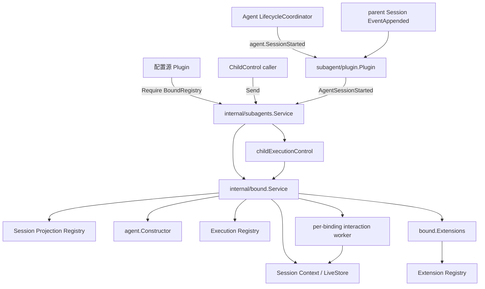
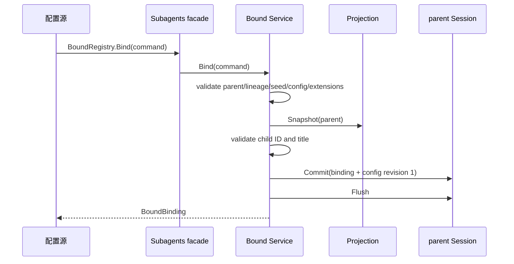
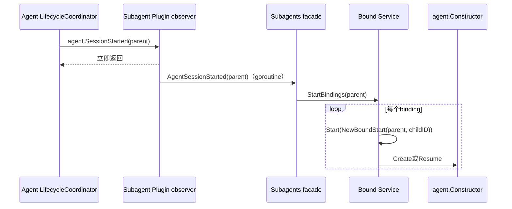
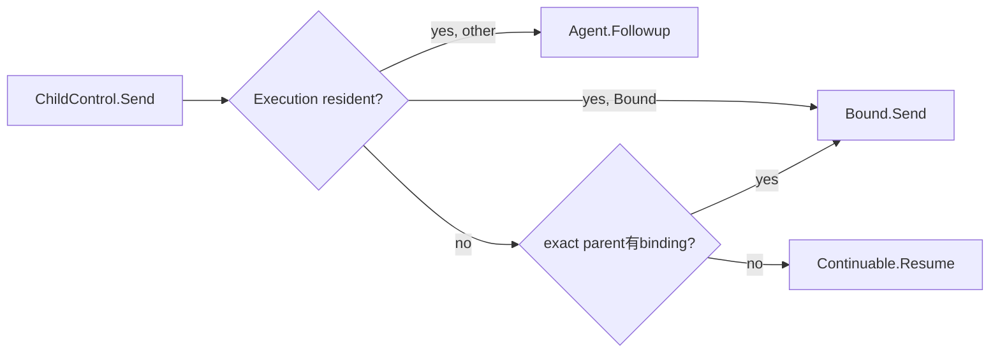

# Bound Subagent 技术设计

> 状态：当前实现设计。Bound 是Goren扩展，不属于固定DeepSeek Harness兼容基线。

## 1. 设计目标

Bound在exact parent Session中持久化child binding和配置，并在parent Agent启动或parent向child发送消息时创建/恢复一个resident child Agent。它是独立Mode，不是Continuable的配置开关。

核心规则见[需求](./parent-bound-requirements.zh-CN.md)，config组合细节见[Bound Config管理](./bound-config-management.zh-CN.md)，实现进度以[仓库实施进度](../../zh-CN/08-implementation-progress.md)为准。

## 2. 职责分配

| 组件 | 职责 | 不负责 |
| --- | --- | --- |
| `subagent.BoundRegistry` | 对配置源公开`Bind`和`UpdateConfig` | 公开内部projection或Store |
| `internal/subagents.Service` | admission、Start command dispatch、公开capability facade | 解释Bound config |
| `childExecutionControl` | resident/cold Send路由、interrupt授权、Agent disposed路由 | Bound revision和epoch replacement |
| `internal/bound.Service` | binding/config用例、create/restore、resident epoch、materialization、parent interaction workers | Plugin dependency lookup、System Prompt/Tools实现、通用EventBus |
| `internal/projection.boundUnit` | 从Session event重建可信Bound view | 创建Agent、保存进程内resident状态 |
| `internal/extension.Registry` | common/selected Extension注册、选择、安装事务、释放 | Bound config和revision |
| `subagent/plugin.Plugin` | 解析依赖、注册projection、发布capability、桥接Agent与Session wakeup event | 业务config与interaction规则 |
| `agent.LifecycleCoordinator` | Agent publication与`SessionStarted`时序 | 启动Bound child |

## 3. 依赖与主动调用方向



谁主动调用谁：

- 配置源主动调用`BoundRegistry.Bind/UpdateConfig`；仓库当前不内置特定配置源。
- `LifecycleCoordinator`主动dispatch `agent.SessionStarted`；Subagent observer异步调用`Service.AgentSessionStarted`。
- parent Session提交`turn/end`后主动发布既有`session.EventAppended`；Subagent observer只通知Bound，worker随后主动读取log。
- parent发送方主动调用`ChildControl.Send`；router根据resident Execution和parent binding选择Bound或Continuable。
- Bound主动调用Session、projection、Constructor和Execution Registry。
- Plugin只注入`bound.Extensions` adapter；它不读取`BoundConfigSnapshot`。

## 4. 公共数据与接口

### 4.1 Start command

```go
type StartCommand interface {
	Mode() Mode
	startCommand()
}

type BoundStartCommand struct {
	parent  agent.Agent
	childID session.SessionID
}
```

`StartCommand`是OneShot、Continuable、Bound的closed family。每个Mode实现自己的`Start`接口；不存在大而全的通用command。Bound command不复制creation/config，只定位exact parent和已提交binding child ID。

### 4.2 Bound use cases

```go
type BoundRegistry interface {
	Bind(context.Context, BindCommand) (BoundBinding, error)
	UpdateConfig(
		context.Context,
		UpdateBoundConfigCommand,
	) (UpdateBoundConfigResult, error)
}
```

`BindCommand`携带parent、可选child ID、SeedBuilder、title、initial prompt、Agent options、MaxDepth和revision 1 config。`UpdateBoundConfigCommand`携带exact parent、child ID、expected revision和完整config。

### 4.3 Persisted event payloads

```go
type BoundBindingData struct {
	Version        int
	ChildSessionID session.SessionID
	Creation       BoundCreation
}

type BoundConfigData struct {
	Version          int
	ChildSessionID   session.SessionID
	PreviousRevision int64
	Revision         int64
	Config           BoundConfigSnapshot
}

type BoundMaterializationData struct {
	Version        int
	ChildSessionID session.SessionID
	ConfigRevision int64
	Result         BoundMaterializationResult
}

type BoundConfigAppliedData struct {
	Version              int
	ParentSessionID      session.SessionID
	ParentConfigEventSeq int64
	Revision             int64
}
```

这些payload有严格JSON codec、unknown-field拒绝和version检查。Session header不变。

`subagent/bound-cursor`另存每个binding的half-open parent cursor与`delivered|skipped` disposition。它由Bound私有fold读取，不加入公共`subagent-bound` projection value。child Inbox receipt使用`subagent-delivery` message source保存parent、turn、seq range和稳定outcome。

### 4.4 Projection view

```go
type Bound struct {
	Bindings         []BoundBinding
	Configs          []BoundConfig
	Materializations []BoundMaterialization
	Applied          []BoundApplied
}
```

binding immutable；Configs与Materializations各保留每个child的latest值；Applied保留child Session中的历史引用。resident Agent不进入projection。

## 5. 内部接口与方法

`internal/subagents`消费三个Mode-owned接口：`oneShot`、`continuable`和`bound`。Bound接口包含：

```go
Start(context.Context, subagent.BoundStartCommand) (subagent.Execution, error)
StartBindings(context.Context, agent.Agent) error
HasBinding(context.Context, agent.Agent, session.SessionID) (bool, error)
Send(context.Context, agent.Agent, session.SessionID, agentmessage.UserMessage) (agentmessage.MessageID, error)
Bind(context.Context, subagent.BindCommand) (subagent.BoundBinding, error)
UpdateConfig(context.Context, subagent.UpdateBoundConfigCommand) (subagent.UpdateBoundConfigResult, error)
```

Bound Service按文件拆分职责：

| 文件 | 方法/对象 | 职责 |
| --- | --- | --- |
| `configuration.go` | `Bind`、`UpdateConfig`、`HasBinding` | parent event、revision、唯一性、durability |
| `start.go` | `Start`、`StartBindings`、`create`、`resume` | 读取binding/config，创建或恢复exact child |
| `provisioner.go` | `provisioner` | 组合Persona、Tool restriction、common/selected Extension |
| `applied.go` | `appliedProvisioner` | child未发布时提交applied event |
| `messaging.go` | `Send` | latest epoch保证与message admission |
| `execution.go` | `publish`、`Interrupt`、`Close` | resident Execution生命周期 |
| `interaction.go` | parent interaction与cursor fold | 纯重建、filter和连续性校验 |
| `interaction_delivery.go` | worker、receipt对账、cursor WritePlan | 通知合并、投递、恢复和生命周期 |
| `terminator.go` | `executionTerminator` | idle、flush、event、registry removal和Handle dispose |
| `service.go` | dependencies、operation locks、authorization | 共享状态和不变量 |

`internal/childseed`不存在；descriptor append由`internal/seedbuilder.AppendDescriptor`承担，因为它属于SeedBuilder结果装配，而不是独立业务上下文。

## 6. Bind 流程



parent lock保护同一parent内title分配；parent-child lock同时保护该child的Bind。Commit和Flush完成前没有child Constructor调用。

## 7. Parent publication 与启动



`LifecycleCoordinator`在dispatch前已经使exact Agent可被Registry解析。observer使用goroutine，所以create/restore错误不会变成parent publication错误。`StartBindings`逐child containment并记录failure。

## 8. Create、restore 与 publication

`Start`持有parent-child lock并读取latest projection：

1. 已有同revision active epoch时直接返回；
2. revision变化时等待旧Agent idle并停止旧epoch；
3. `Enabled=false`时返回disabled；
4. Persistence中没有child时fresh create；存在时cold restore并核对parent、seed boundary和descriptor；
5. 组合config Provisioner和`appliedProvisioner`；
6. Constructor在unpublished Scope安装所有effect并提交applied event；
7. 必要时Followup initial prompt，随后Flush child Session；
8. 发布Execution Registry entry和`subagent.Started`；
9. parent写succeeded materialization并Flush。

任何步骤失败都dispose未成功发布的Handle，写failed materialization并交给diagnostics。initial prompt是否需要根据child自己的seed boundary之后是否已有Inbox splice判断。

## 9. 消息路由

Config revision的提交和epoch replacement由[Bound Config管理](./bound-config-management.zh-CN.md#8-updateconfig-与-send)定义。这里仅定义统一Service的Send分派：



## 10. Parent interaction 投递

Plugin Manifest监听现有`session.EventAppended`。当committed event是`turn/end`时，Bound按parent Session ID通知已有binding workers；observer调用栈不读Session、不Followup也不Flush。worker从parent snapshot fold完整turn，先Flush source prefix，再在parent-child operation lock内确认latest enabled config和exact resident epoch。

需要投递时，worker扫描child Session中的exact `agent/inbox/spliced` receipt；缺失才调用Followup。child Flush完成后，worker使用自定义`session.WritePlan`在FIFO head校验expected cursor，并向parent提交和Flush `subagent/bound-cursor`。恢复时若receipt已存在，只补cursor。

该路径没有projection event。完整floor、filter、调用顺序与失败语义见[Parent Interaction投递设计](./session-event-delivery.zh-CN.md)。

## 11. Settlement、close 与 report

Bound ordinary idle不settle。Interrupt只Cancel当前turn并`KeepInbox=true`。config replacement使用`StopNormal`结束旧epoch；module shutdown使用`StopModule`；Agent外部关闭使用`StopExternal`并避免重复Dispose Handle。

terminator等待idle、Flush child Session、发布`subagent.Ended`、移除Execution Registry entry并清除current epoch。final Flush failure进入diagnostics。

child向parent report只发生在report Tool显式执行时；Bound生命周期不隐式report。

## 12. 并发与一致性

- parent lock：同一parent内binding title和child ID分配。
- parent-child operation lock：Bind、UpdateConfig、Start、Send和interaction admission的线性化。
- parent route index与one-slot dirty mailbox：只合并唤醒，不保存durable delivery state。
- binding worker：跨child config epoch保留；parent disposed或module shutdown时先于Execution停止。
- operation current mutex：Execution close goroutine与用例读取current的并发安全。
- Session Commit batch：binding+revision 1原子追加。
- Flush：Bind/config对外成功和child publication前的durability边界。
- projection：拒绝不完整event chain，不修复或猜测业务事实。
- child receipt与parent cursor：先Flush receipt，再以expected cursor推进；crash恢复扫描receipt去重。

排除项与O11只在[需求](./parent-bound-requirements.zh-CN.md#8-未关闭事项)维护，验收行为见同文档第9节，实现证据只在[仓库实施进度](../../zh-CN/08-implementation-progress.md)维护。
