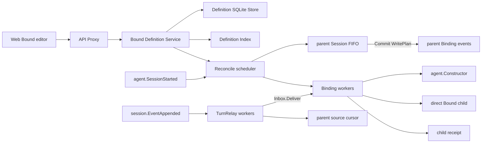
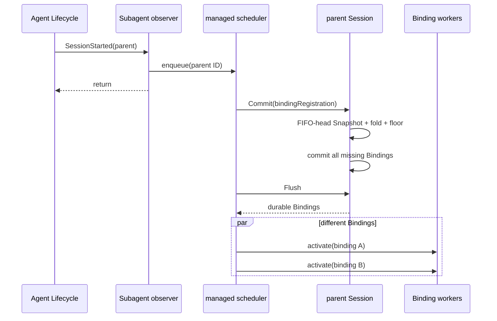

# Bound Subagent 技术设计

> 状态：Accepted / Implemented。旧的 per-parent config 实现已经删除。

## 1. 所有权

Bound 是独立 Mode，但其 Definition 是全局配置能力，不属于任一 Session。每个用户 Session 只持久化该 Session 自己的 Binding、materialization 和 delivery cursor；每个 child Session 持久化实际应用的 Definition 快照和 delivery receipt。

| Owner | 负责 | 不负责 |
| --- | --- | --- |
| Bound Definition Service | Definition 校验、CAS revision、索引、live reconcile | parent Session event、Agent epoch |
| Definition SQLite Store | sqlc 读写、事务和技术持久化 | revision 决策、reconcile |
| `internal/bound.Service` | 用户 Session 一致性、Binding、激活、replacement、`Inbox.Deliver` | 输入源观察与cursor、Web DTO、System Prompt/Tools实现 |
| `bound/turnrelay.Plugin` | Session turn观察、fold、worker、重试和source cursor | child生命周期、Definition、Bound内部mailbox |
| parent projection | Binding 和 materialization 派生状态 | Definition 配置、resident Agent |
| Binding worker | 单 Binding生命周期命令串行、resident epoch、显式Send和input receipt | source观察与cursor、跨 Binding 串行化 |
| Agent lifecycle | Agent publication、resident epoch idle、结构关闭 | 建立 Binding、解释 Definition |
| API Proxy / Web | 严格管理协议与用户输入 | Definition 持久化或运行时协调 |

## 2. 依赖与主动调用方向



谁主动调用谁：

1. Web 通过 API Proxy 主动调用 Definition Service 的 `List/Create/Replace`。
2. Definition Service 先调用 Store 完成 CAS，再更新索引并请求 live reconcile。
3. Agent lifecycle 发布 `SessionStarted`；Subagent observer 只向受管 scheduler 投递用户 Session ID。
4. scheduler解析exact parent Agent并向其Session提交`bindingRegistration`；该`WritePlan`在FIFO队首重新fold projection、计算context floor并原子提交缺失Bindings。
5. Binding batch提交并Flush后，scheduler为每个Binding请求激活；每个Binding worker主动调用Constructor创建或恢复child。
6. parent Session提交事件后发布`session.EventAppended`；独立TurnRelay Plugin建立或唤醒该Session的source workers并读取durable log。
7. TurnRelay主动调用`bound.Inbox.Deliver(Address, Input)`；Bound解析Binding，在同一Binding mailbox中收敛epoch并durable接纳输入。
8. TurnRelay取得Receipt后才提交自己的parent source cursor。

注册监听不是运行时处理本身；事件也不是消息历史或订阅事实。

## 3. 全局 Definition

Definition Service 对外提供稳定、传输无关的能力：

```go
type Definitions interface {
    List(context.Context) ([]Definition, error)
    Create(context.Context, Creation) (Definition, error)
    Replace(context.Context, Replacement) (Definition, error)
}
```

`Create`要求不存在同名 Definition；成功 revision 为 1。`Replace`要求名称存在且 expected revision 匹配；每次保存完整 snapshot。Store 是 Service 消费的最小接口，SQLite adapter 实现它，composition root 负责路径、迁移和关闭装配。

Definition 名称是 identity，不提供 rename/delete。进程索引只保存 Store 已提交的最新快照；它不是第二持久化来源。

## 4. Parent projection

新 Binding event 使用新版本，至少表达：

```go
type BindingData struct {
    Version        int
    Name           string
    ChildSessionID session.SessionID
    ContextNextSeq int64
}
```

`ContextNextSeq`在Session FIFO队首的原子Snapshot上计算，指向同一committed prefix中“最后完整turn之后的位置”。同一batch可写入多个缺失Binding；projection拒绝重复Name、重复child ID、无效floor和旧事件版本。

Materialization保存Name、child ID、Definition revision和稳定结果。Bound公共event不包含delivery cursor；TurnRelay将`subagent/bound-turn-relay-cursor`作为输入源私有parent event，且不进入公共projection value。

## 5. SessionStarted 和 Session FIFO



observer不启动不受控goroutine，也不在lifecycle dispatch栈中做SQLite、Session或Agent I/O。scheduler由Plugin拥有context、level-triggered task和wait group，关闭时停止准入、取消并等待。

Session `WritePlan`是Binding的原子边界：候选可以在入队前计算，但是否仍缺失、队首committed prefix和`ContextNextSeq`只能在`Build(snapshot)`中决定，整个Binding batch不能被其他Session写入穿插。Bound不调用parent `RunMaintenance`，因此不会与manual compaction竞争Agent activity。失败task保留为dormant pending，后续启动、Definition变更或显式操作可以重新激活。parent turn事件只唤醒TurnRelay，不反向驱动Bound reconcile scheduler。

只对用户 Session reconcile。检查必须同时验证 Session header 与 runtime parent；任何 child Session 都不能进入该流程。

## 6. 激活和 idle

Binding batch提交并Flush成功后才允许激活。Binding worker按frozen `ContextNextSeq` materialize：

1. fresh create：构造 `parentEvents[:ContextNextSeq]` 的 detached seed；
2. cold restore：复用同一 child Session ID并核对 direct parent、descriptor 和 seed boundary；
3. 安装完整 system prompt、Tool restriction、common 与 selected Extensions；
4. 在未发布 child 中提交完整 Applied Definition并 Flush；
5. 发布 Execution；
6. 不调用 Inbox，不产生初始 turn，resident Agent 保持 idle；
7. 返回idle；输入源随后可通过公开Inbox投递Binding后已经闭合的输入。

延迟激活不得重新计算 seed prefix。Definition revision 变化时也不得重建 child Session或改变 Binding floor。

## 7. Binding worker

每个 Binding 有一个业务含义明确的串行执行对象。它拥有该 Binding 的：

- resident child Agent epoch；
- Definition revision replacement；
- 显式 `Send` admission；
- `deliveryCommand`与durable child receipt；
- 失败隔离和关闭。

串行入口优先使用 mailbox channel；registry mutex 只保护 parent/name 到 worker 的短索引和关闭准入，不覆盖 child I/O。不同 Binding 使用不同 worker，因此 child create/restore、delivery 与 stop可以并行。

worker 与 resident epoch 是两个概念：worker 跨多次 Definition replacement长期存在；epoch 是某一 revision 对应的一次 exact Agent execution。

## 8. Definition replacement

Definition Store CAS 成功后，各 Binding worker 串行处理 latest revision：

1. 如果disabled，等待current epoch idle并停止，但保留worker、Binding和child Session；输入源自己保留cursor和backlog；
2. 如果 enabled 且 current 已应用 latest revision，直接返回；
3. 否则等待旧 epoch idle、Flush并停止；
4. 以同一 child Session恢复新的 exact epoch，重新安装完整 Scope；
5. child Session写入完整 Applied Definition并 Flush后发布；
6. 后续`Inbox.Deliver`在同一mailbox中使用新epoch接纳输入。

失败只影响该 Binding；latest Definition 保持 durable，worker 保留 pending并重试。显式 `Send` 必须经过同一 worker，因此不会在 replacement 中投给旧 epoch。

## 9. Interaction 和恢复

具体fold、receipt和cursor顺序由[投递设计](./session-event-delivery.zh-CN.md)定义。Bound核心不观察`session.EventAppended`，只公开`Inbox.Deliver(Address, Input)`。内置TurnRelay拥有事件观察、source workers与cursor；其他输入源可以实现自己的触发、恢复与checkpoint策略并调用同一Inbox。

## 10. 关闭

Definition Service 停止 reconcile/activation admission后，scheduler取消并等待全部任务。Binding registry随后并行关闭 workers；每个 worker取消在途操作、等待/停止 resident epoch并完成必要 Flush。最后才关闭 Definition Store和Extension Registry依赖。

TurnRelay因依赖`bound.Inbox`而在Subagent Plugin之前关闭：它先停止新source worker、取消并等待在途`Deliver`与cursor Flush；Bound随后才关闭Inbox准入和resident epochs。

不得通过关闭 parent Agent 的 SessionStarted observer泄露 goroutine，也不得让一个慢 child 串行拖住其他 child 的关闭。

## 11. 迁移

旧的 `BoundRegistry.Bind/UpdateConfig`、parent `subagent/bound-config`、Title、Persona、InitialPrompt 和 config-applied parent引用已经全部删除。当前projection明确拒绝旧事件版本，不提供双读路径。完成证据只更新到[08 实施进度](../../zh-CN/08-implementation-progress.md)。
