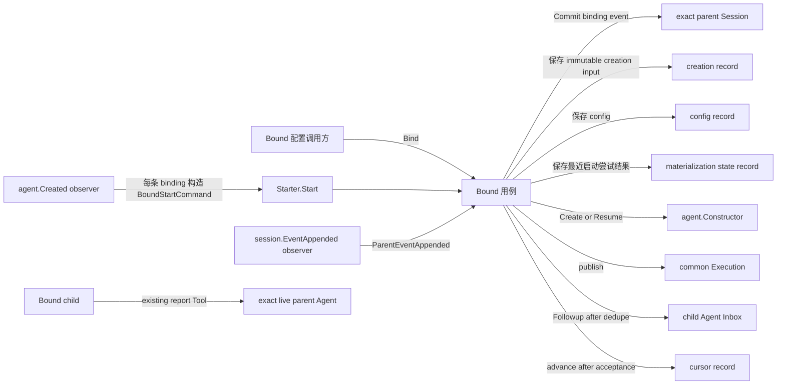

# Bound Subagent 需求

状态：进行中；Mode、启动命令和 descriptor/projection 骨架已实现，`Bound.Start` 与 binding/config source 尚未实现

> 文件名保留 `parent-bound` 以维持已有链接。本文中的能力名称统一为 `Bound`，不再把 `Parent-bound` 当作另一个类型或 Mode 名称。

## 1. 文档边界

本文只记录 Bound Subagent 的产品行为、职责和验收条件。Go 接口、数据结构和真实调用方向见[Bound Subagent 技术设计](./parent-bound-design.zh-CN.md)。当前已经实现的 OneShot、Continuable 和 common `Execution` 仍以[Subagent 技术方案](../../zh-CN/Subagent架构与生命周期重构技术方案.md)及代码为准。

Bound 不在固定 DeepSeek Harness 基线内。当前默认 composition 已装配返回明确 TODO 错误的 Bound 模式对象，但还不能创建或恢复 Bound child。本文会明确区分已实现骨架和目标行为。

本文只使用以下与本设计直接对应的词：

- `ModeBound`：独立 Subagent Mode，持久值为 `"bound"`；
- binding：parent Session 与 Bound child Session ID 的持久关系；
- materialize：`Bound.Start` 内部根据 binding 创建 fresh Bound child或恢复已有 child 的过程，不是另一个公开入口；
- resident：当前进程中存在该 child 的 exact live Agent 和 common `Execution`；
- config：Bound child 下一 turn 使用的可变配置；
- materialization state：fresh child 是否已经创建、最近一次 materialize 是否失败等持久状态；
- cursor：某个 subscription 已处理到的 parent Session event 位置；
- handoff：把匹配的 parent Session event 转换为 child Inbox 输入。

除非在技术设计中给出声明和责任，不再使用 `Activation`、`ResidentChild`、`installation`、`lease`、`gate`、`bootstrap intent`、`BindingDirectory`、`ParentEventRouter` 或 `HandoffWorker` 等名称。

## 2. 已确认决策

1. Subagent 有三个 Mode：OneShot、Continuable 和 Bound。Bound 不是 Continuable 的配置或 residency policy。
2. Bound 可以复用 Continuable 使用的 Session create/restore、Agent Constructor、common `Execution` 和 per-child 串行化组件，但不能复用 Continuable 的完整 `Start`、cold `Send` 和 idle settlement 用例。
3. 一个 Bound child 只有一个 direct parent。Session Header 的 `ParentSession`、exact runtime parent、控制授权和 report destination 必须一致。
4. binding 可以先于 child Session 存在。fresh 流程必须先完成 binding，再创建 child；两者不是一个原子用例。
5. 初次建立 binding 必须提供 initial prompt。initial prompt 必须在 fresh child create 前持久化，并在重试时保持同一内容。
6. binding 成功后，child create 或 restore 失败不撤销 binding，也不阻止 parent Agent publication。
7. canonical binding relationship 是 exact parent Session 中的 typed non-surface event。Session Header 不增加 bound child 字段。
8. immutable creation input、config、materialization state 和 cursor 分开持久化，不写入 binding event，也不混成一条可变记录。initial prompt 属于 creation input，不属于可变 materialization state。
9. resident child 当前 turn 使用一个不变的 config revision。已提交的新 revision 在下一 child turn 开始前生效；cold child 在下一次 materialize 时使用最新 revision。
10. enabled Bound child 在 idle 时保持 resident；Continuable 的 idle settlement 不适用于 Bound。
11. Bound child 仍使用 Agent Inbox 和 child Session 的现有 durable path，不增加第二条模型输入队列。
12. 同一个 parent event 对同一个 subscription 至多产生一条模型可见 child Inbox 消息；处理动作可以重试。
13. 所有 `OriginSubagent` Session 都不能直接调用 `ask_user_question`。Bound 不增加例外。
14. Agent 继续唯一拥有 exact Agent epoch、runtime parent/children、descendant admission、child-first close 和 Scope teardown。

## 3. 三种 Mode 的行为边界

| 行为 | OneShot | Continuable | Bound |
| --- | --- | --- | --- |
| 创建入口 | `OneShotStartCommand -> Start` | `ContinuableStartCommand -> Start` | parent 从已提交 binding 构造 `BoundStartCommand -> Start` |
| fresh initial prompt | `Start` 输入 | `Start` 输入 | `Bind` 必填并先持久化 |
| cold child 收到普通消息 | 不支持 | `Send` 原子完成 restore + message acceptance | Bound 先按最新 config materialize，再接受消息 |
| 无消息 cold restore | 不支持 | 当前用例不支持 | `Bound.Start` 在 parent create/resume 后执行 |
| idle 后行为 | 结束 | 满足 settlement 条件后结束当前 `Execution` | enabled 时保持 resident |
| 可变 config | 不属于本能力 | descriptor 决定 cold restore 配置 | revision 在下一 child turn 生效 |
| 关系来源 | child Session lineage | child Session lineage | parent Session binding event + child Header lineage |

Bound 与 Continuable 共享 Agent 和 `Execution` 基础设施，不共享业务触发和结束条件。不得把 `ModeBound` 编码成 `ModeContinuable` 后再读取额外 flag。

## 4. 上下游关系

调用方向必须保持：上游 observer 或配置调用方主动调用 Bound；Bound 主动调用 Session、自己的持久化端口、Agent Constructor 和 common `Execution`。Session 和 Agent 不反向导入 Bound 类型。

## 5. 职责分配

| Owner | 负责 | 不负责 |
| --- | --- | --- |
| Bound | `Bind`、`Start` 内部的 create/restore、Bound config、materialization state、cursor、subscription matching、handoff、Bound idle 行为 | Agent runtime child graph、Session Header、Session persistence 实现、Continuable 用例 |
| Session | parent/child append-only event、typed binding event、Commit 顺序、`WriteBarrier` 和 `Flush` | binding 的业务解释、child create、cursor 或 config |
| Agent | exact epoch、runtime parent/children、Inbox、turn 执行、descendant admission、child-first close 和 Scope teardown | binding 查询、subscription matching、Bound config persistence |
| common `Execution` | 每个 exact child Agent epoch 的状态、停止和 terminal result | 决定 Bound 是否保持 resident、读取 binding 或修改 config |
| Continuable | `ContinuableStartCommand`、带消息的 cold `Resume`、Continuable idle settlement | Bound binding、`BoundStartCommand`、Bound config 和 cursor |
| `SeedBuilder` | fresh child 的 Session seed | existing child restore、binding、config 或 handoff |
| Session Projection | 从 exact parent Session event 重建 binding read view | 成为 binding 事实源或创建 child |
| Plugin adapter | 注册 `agent.Created`、`session.EventAppended` 等 observer，装配依赖和释放注册 | 保存 Bound 业务状态或直接创建 child |
| UserQuestions | 对所有 Subagent Session 执行 delegated-caller 禁令 | Bound materialization 和 subscription |

## 6. 用例需求

### 6.1 Bind

`Bind` 为 exact parent 建立一个 Bound child identity。调用必须包含 initial prompt 和第一版 config。

顺序是：

1. 验证 exact parent、Bound 配置和资源限制；
2. 生成或接受一个稳定 child Session ID；
3. 原子保存 immutable creation input、config revision 1 和初始 materialization state；
4. 向 exact parent Session Commit 一条 typed non-surface binding event；
5. 调用 Session `Flush`，确认包含该 event 的 committed prefix 已持久化；
6. 返回 binding 成功；
7. parent 后续发现该 binding 时，才能构造 `BoundStartCommand` 并调用统一 `Starter.Start`。

第 4 或第 5 步失败时，binding 未成功，不能创建 child。前面已写入但没有对应 binding event 的独立记录不构成 binding，恢复和清理规则必须由持久化设计明确。

### 6.2 Fresh Bound Start

fresh `Bound.Start` 读取已提交 binding、immutable creation input 和最新 config，并使用命令中的同一 child Session ID 创建 `ModeBound` child。create/restore 的内部过程可以称为 materialize，但不提供第二个公开 `Materialize` 方法。

- 必须运行一次 `SeedBuilder`；
- child descriptor 必须是 `BoundDescriptor`，不能写成 `ContinuableDescriptor`；
- initial prompt 必须进入 child Agent 的普通 Inbox/Session path；
- initial prompt acceptance 覆盖的 child Session prefix 必须 Flush 成功，才能把 materialization state 的最近结果写成 succeeded；
- create 失败时 materialization state 记录失败，binding 保持成功；
- 重试不得生成第二个 child identity，也不得重复接受 initial prompt；
- 单个 child 失败由 `agent.Created` observer 包含并返回 `nil`，不能拒绝 parent publication。

### 6.3 Existing child Bound Start

child Session 已存在时，Bound 使用原 child Session ID、`BoundDescriptor`、Inbox 和 direct parent 恢复 exact Agent/Execution。

- 不运行 `SeedBuilder`；
- 不重新提交 initial prompt；
- 不伪造 user message、report 或 handoff 作为唤醒输入；
- 如果同一 child 已有 current `Execution`，返回或保留该 `Execution`，不能发布第二个 epoch；
- descriptor 或 lineage 不一致时记录失败，不能创建替代 child。

### 6.4 Parent Agent create/resume

parent publication 事务分发 `agent.Created` 时，observer 从 exact parent Session 的 binding projection 读取 enabled child，按稳定顺序和 O11 限制逐条构造 `BoundStartCommand`，再主动调用统一 `Starter.Start`。统一 Service 按具体 command variant 分派到 `bound.Service.Start`。

任一 child 的 create、restore、config 或 dependency failure 都写入该 child 的 materialization state，并由 observer 包含；observer 对 Agent publication owner 返回 `nil`，所以 parent publication 继续。剩余 child 是否继续尝试或延后，受 O11 限制决定。

### 6.5 Parent event handoff

`session.EventAppended` 已经表示 committed parent event。observer 把 exact parent Session 和 committed event 交给 Bound。Bound：

1. 从 binding projection 读取 enabled subscriptions；
2. 校验 child 的 direct parent 与 exact live parent 一致；
3. 按 subscription filter 判断是否匹配；
4. 以 parent Session ID、parent event seq、child Session ID 和 subscription ID 组成稳定去重输入；
5. 先让 child Inbox 接受消息，再推进对应 cursor；
6. crash 后从 durable parent events 和 cursor 继续，不能只依赖 live notification。

O5 未关闭前，不固定 Inbox 去重与 cursor 写入的事务接口。

### 6.6 Config update

config update 创建递增 revision。提交后立即停止已禁用 binding 的新 handoff；对仍 enabled 的 resident child：

- running turn 继续使用旧 revision；
- 新 revision 不能在当前 turn 中途修改 model、persona 或 Tool policy；
- 下一条会启动 child turn 的消息被接受前，Bound 必须让旧 `Execution` 收敛，并以最新 revision 恢复新的 exact Agent epoch；
- cold child 在下一次 `Bound.Start` 时直接使用最新 revision；
- 多次更新可以折叠为最新 committed revision，但每个 turn 只能使用一个 revision。

这里不要求同一 Agent epoch 原地修改配置。若未来要支持原地切换，Agent/AgentLoop 必须先提供可证明位于“上一 turn 完成之后、下一 Inbox claim 之前”的配置接口。

### 6.7 Idle 与 stop

enabled Bound child 在 Agent idle、Inbox empty 且没有 runtime descendants 时仍保持 current `Execution`。以下条件触发 Bound 请求停止：

- binding disabled；
- parent closing；
- Subagent module closing；
- Runtime shutdown；
- 无法继续使用的持久数据错误。

Bound 只请求 managed Agent close 或停止自己的 `Execution`，不直接关闭 Agent Scope 或遍历 runtime descendants。

### 6.8 Child report

Bound child 复用现有 report Tool，向 exact live direct parent 调用 `Inject` 或 `Steer`。report 不经过 parent event handoff，也不把 report 自动再投递给发送它的 child。

parent 已进入 Closing 后，新的 report 必须返回稳定失败；已经被 Agent 接受的 report 按 Agent 现有语义完成。

### 6.9 Parent close 与进程重启

parent close 时先停止新的 Bound materialization、handoff 和 report，再由 Agent owner 按现有 child-first 顺序关闭 runtime children。Bound 必须等待自己已接受但尚未提交到 child Inbox 的处理结束，之后才允许 common `Execution` 完成 terminal result。

进程重启后，从 parent binding event、Bound config、materialization state、cursor、child Session 和 descriptor 恢复；process-local Agent、Handle、`Execution` 和 observer registration 不持久化。

## 7. Invariants

- I1：`ModeBound` 是 descriptor sum 和 Mode dispatch 中的独立 variant。
- I2：同一 Bound child 同时至多有一个 direct parent 和一个 current `Execution`。
- I3：Session Header 不因 binding 建立、更新或禁用而改变。
- I4：binding event durable 之前不得创建 fresh child。
- I5：fresh binding 必须能在进程重启后取回同一 child ID 和 initial prompt。
- I6：Bound Start 内部 create/restore failure 不撤销 binding，也不影响已经完成的 parent Agent publication。
- I7：existing child materialize 不运行 `SeedBuilder`，也不制造模型输入。
- I8：enabled Bound child 不执行 Continuable idle settlement。
- I9：一个 child turn 只使用一个 config revision。
- I10：config、materialization state 和 cursor 分开记录、独立更新。
- I11：同一 parent event/subscription 至多产生一条模型可见 child message。
- I12：cursor 只能在 child Inbox 已接受消息或确认该消息先前已接受后推进。
- I13：旧 Agent 或旧 `Execution` 不能操作同 Session ID 的新 epoch。
- I14：parent release 完成时不存在 live Bound child `Execution`。
- I15：Bound child 不能直接调用 `ask_user_question`。
- I16：secrets 不进入 binding event、config、materialization error、cursor、Inbox provenance 或 telemetry。

## 8. Failure semantics

| Failure | Required result |
| --- | --- |
| creation/config/materialization record write failure | binding 不成功，不创建 child |
| binding event Commit/Flush failure | binding 不成功，不创建 child |
| fresh create failure | binding 保留；materialization state 记录失败；复用同一 child ID 重试 |
| existing restore failure | child identity 和 binding 保留；不创建替代 Session |
| single child Bound Start failure during parent publication | observer 包含该失败并返回 `nil`；parent publication 继续 |
| subscription decode/filter failure | 只影响对应 binding/subscription，不推进 cursor |
| child Inbox rejection | 不推进 cursor |
| cursor write failure | recovery 先检查去重事实，再决定只补 cursor 或重试 delivery |
| parent unavailable/closing | 新 handoff/report/materialize 返回稳定失败或进入已定义重试状态 |
| shutdown timeout | 报告未完成的 exact parent/child，不把它记录为成功关闭 |

## 9. O11：Bound Start 限制

O11 要求配置并验证以下四个不同上限，不能只用一个 timeout 代替：

| Limit | 含义 | 保护对象 |
| --- | --- | --- |
| per-parent binding count | 一个 parent 最多拥有多少 enabled bindings | 常驻 Agent 和内存规模 |
| start concurrency | 同一 parent 同时运行多少个 child create/restore | CPU、I/O 和 provider 资源 |
| synchronous attempt budget | 一次 `agent.Created` observer 最多尝试多少个 child 或消耗多少时间 | parent publication latency |
| per-attempt timeout | 单个 child create/restore 最长允许多久 | sibling 隔离和故障恢复 |

具体数值、超限错误和剩余 child 的重试时机仍为 Open。无论最终数值如何，单个 Bound Start 失败都不能改变 parent 已发布事实。

## 10. 决策清单

| ID | 状态 | 决策 |
| --- | --- | --- |
| O1 | Resolved | binding 与 fresh child create 是两个有序用例；binding 先成功 |
| O2 | Resolved | child materialization failure 不阻止 parent Agent publication |
| O3 | Resolved | 一个 child 只有一个 direct parent |
| O4 | Open | subscription filter 的静态 schema 和版本迁移 |
| O5 | Partially resolved | Inbox 必须按稳定输入去重；cursor/dedupe 的原子机制和 retry storage 未定 |
| O6 | Resolved | resident child 下一 turn 使用最新 config revision；当前 turn 不变 |
| O7 | Open | parent event retention 与落后 cursor 的 repair policy |
| O8 | Resolved | Bound 不获得直接 `ask_user_question` 权限 |
| O9 | Resolved | 初次 Bind 必须提供并持久化 initial prompt |
| O10 | Resolved | binding 使用 exact parent Session typed non-surface event；Header 不变，config/state/cursor 分开记录 |
| O11 | Open | binding 数量、并发、同步尝试预算和单次 timeout 的具体值与超限行为 |
| O12 | Open | binding event canonical name、payload version、disable/remove event 语义和已有数据 migration |
| O13 | Open | Commit 成功但 Flush/响应失败时，`Bind` retry 如何复用同一 child ID 并避免重复 binding event |

O4、O5、O7、O11、O12 和 O13 会改变持久化、delivery 或资源语义。关闭这些事项前不得添加 production event name、placeholder package 或数据库 migration。

## 11. Acceptance scenarios

1. Mode codec 对 `one-shot`、`continuable` 和 `bound` 有三个独立 descriptor variant，Bound 不走 Continuable dispatch。
2. binding event 和独立记录持久化失败时不创建 child；全部成功后才允许 fresh materialize。
3. fresh create 失败后 binding 仍可查询；重试使用相同 child ID 和 initial prompt。
4. parent restart 后 existing Bound child 使用原 Session、descriptor 和 Inbox 恢复，不运行 `SeedBuilder`，不注入伪造消息。
5. 任一 child materialize 失败或 timeout 时，parent `agent.Created` 仍成功完成，siblings 互不影响。
6. enabled Bound child idle 后保持 resident；Continuable 在原 settlement 条件下仍结束当前 `Execution`。
7. running child 的 config 更新不改变当前 turn；下一 turn 之前切换到最新 revision。
8. 同一 parent event 在 crash recovery 后只产生一条对应 child Inbox 消息。
9. cursor 只在 Inbox acceptance 成功或确认已接受后推进。
10. parent close 与并发 handoff/report 收敛后，parent release 不留下 live Bound child。
11. Session Header 在 binding 建立、更新和禁用前后完全相同。
12. Bound child 不能直接向用户提问，只能通过 existing report Tool 请求 parent 协调。
