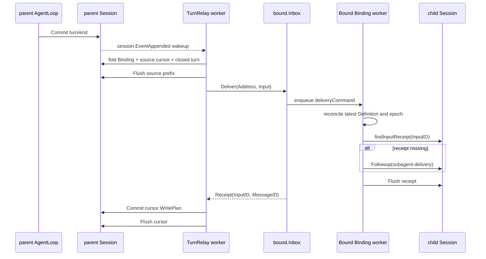

# Bound Parent Interaction 投递设计

> 状态：Accepted / Implemented。本文是TurnRelay的turn fold、durable receipt和cursor恢复的单一设计来源。

本文只说明Binding建立后，内置`subagent/bound/turnrelay`如何把用户与parent的完整交互投给通用Bound Inbox。Definition、Binding与child生命周期分别以[需求](./parent-bound-requirements.zh-CN.md)、[配置管理](./bound-config-management.zh-CN.md)和[技术设计](./parent-bound-design.zh-CN.md)为准。

## 1. 所有权与原则

- Bound核心公开`Inbox.Deliver(Address, Input)`，只负责child生命周期、串行输入接纳和durable receipt。
- TurnRelay是Bound之下的独立输入源Plugin，负责Session事件观察、turn fold、worker、重试与source cursor。
- 核心Subagent Plugin与`internal/bound`都不观察`session.EventAppended`。
- Session不增加per-Session EventBus，也不保存listener registration；`EventAppended`只提供可重复、可合并、可丢失的wakeup。
- parent Session append-only log是turn事实来源；cursor和child receipt是恢复事实，不创建interaction projection event。
- 同一Binding由一个TurnRelay worker串行处理，不同Binding可以并行。

## 2. 冻结上下文和delivery floor

Binding创建发生在parent Session唯一FIFO的队首。`bindingRegistration.Build(snapshot)`保存`ContextNextSeq`，它指向最后一个完整parent turn之后的位置；fresh child只复制：

```text
parentEvents[:ContextNextSeq]
```

这段prefix只作为模型上下文，不产生child Inbox任务。materialization即使延迟，也不能重新计算当前parent的最新prefix。

TurnRelay的首次source cursor从Binding event后一位开始，而不是从`ContextNextSeq`开始。这样Binding前的历史不会作为任务重放，Binding后闭合的新交互也不会被延迟materialization吞入seed。

## 3. 主动调用链



谁主动调用谁：TurnRelay主动调用公开`bound.Inbox`；Bound从不反向订阅或轮询TurnRelay。`deliveryCommand`只是Bound内部Binding mailbox的同步投递命令，结果通道让`Inbox.Deliver`等待child Flush并返回Receipt。parent经`ChildControl.Send`发起的显式后续指令则进入`followupCommand`；两者只共享同一个Binding串行边界，不共享幂等协议。

## 4. Interaction fold

cursor使用half-open `NextSeq`。TurnRelay从cursor寻找下一条完整`turn/start ... turn/end`：

- 只有source kind为direct user的`user/message`使turn可投递；
- parent回复使用canonical `assistant/message`；
- relay保留direct user content和parent可见assistant content；
- reasoning、tool-call、tool-result、assistant chunk与内部协调消息全部过滤；
- 没有direct user输入的closed turn直接写skipped cursor，不生成Input；
- 未闭合turn不推进cursor；
- cursor落在partial turn中时，该partial turn只能skipped，不能拼接成新任务；
- failed、aborted、blocked只保留稳定outcome kind，不复制provider error或原始event JSON。

因此child显式report触发的parent turn不会被再次投给同一child形成echo loop。

## 5. Input、receipt与cursor

TurnRelay为一个closed turn生成：

- 稳定`InputID = session:<parent>:seq:<from>-<through>`；
- 模型可见`Content`；
- `session-turn`来源，保存parent Session、turn、seq range与outcome。

Bound把它包装成通用`subagent-delivery`来源。该来源保存`InputID`与输入源opaque provenance，不要求Bound理解`session-turn`。

child Session中的`agent/inbox/spliced`是acceptance receipt。`findInputReceipt`按`InputID`扫描child log：不存在才Followup；存在一个则返回原`MessageID`；重复receipt或同ID不同content/provenance视为invariant failure。

TurnRelay私有`subagent/bound-turn-relay-cursor`保存Binding name、child ID、expected previous `NextSeq`、new `NextSeq`、through turn与delivered flag。它不属于Bound公共event或projection。

effect顺序固定为：

1. 从parent committed log fold当前cursor和下一条closed turn；
2. Flush读取所依赖的parent source prefix；
3. 调用`Inbox.Deliver`；Bound在Binding mailbox内应用latest enabled Definition；
4. child已有receipt则复用，否则Followup；
5. Flush child receipt并返回Receipt；
6. TurnRelay通过parent Session FIFO head上的WritePlan校验expected cursor并Commit；
7. Flush parent cursor。

若进程在child receipt durable后、parent cursor durable前崩溃，TurnRelay重放相同`InputID`，Bound返回原receipt，然后只补cursor。若source Flush、Followup或child Flush失败，cursor不推进。

## 6. Disable、恢复和重试

disabled Bound由`Inbox.Deliver`返回`BOUND_DISABLED`，TurnRelay保留pending Input和cursor并退避重试；该状态不报告diagnostic。重新启用不要求Bound反向通知TurnRelay，pending worker最迟在退避到期后继续。

TurnRelay worker属于exact parent Agent lifetime。`SessionStarted`扫描已有Binding，Binding event append建立新worker；`agent.Disposed`只取消匹配lifetime。Definition replacement不改变Binding、child Session或source cursor，下一次`Deliver`由Bound mailbox先完成lifetime replacement再接纳输入。

启动扫描与durable cursor保证正确性不依赖每次wakeup。parent恢复、新事件append和退避到期都可触发继续处理。

## 7. 失败与关闭

- malformed Binding、cursor chain、parent turn或child receipt：保留cursor并报告diagnostics，不猜测修复；
- parent source Flush失败：不产生child effect；
- child acceptance失败：不推进source cursor；
- cursor提交冲突：重新读取durable Session后重试；
- parent Agent关闭：取消该exact epoch的workers；
- TurnRelay Dispose：停止新worker准入、取消并等待所有workers，再释放Inbox依赖；
- Bound Dispose：在依赖顺序上发生于TurnRelay之后，因此不会留下调用已关闭Inbox的worker。

该设计提供durable acceptance去重，不承诺exactly-once模型调用或Tool外部副作用。

## 8. 验证重点

- `TestBoundRelaysCompletedParentTurnToChild`：通过真实parent AgentLoop验证frozen seed之后的首个closed turn、direct user与visible assistant relay，以及隐藏reasoning过滤；
- `TestMultipleBoundsReceiveParentTurnIndependently`：验证同一parent的多个Binding独立投递，不共享cursor或worker串行边界；
- `TestBoundReportOnlyParentTurnDoesNotEchoToChild`：验证report-only turn推进skipped cursor且不形成echo；
- `TestBoundDisabledTurnIsDeliveredAfterDefinitionIsEnabled`：验证disabled期间不推进cursor，enable后原Input只接纳一次；
- `TestBoundTurnRelayCatchesUpAfterPluginReload`：验证缺失`EventAppended` wakeup时，Plugin重新挂载依靠durable log和cursor追赶；
- `TestBoundRelayReusesReceiptWhenCursorFlushRetries`：验证child receipt已durable、parent cursor Flush失败的crash window只补cursor，不重复模型请求；
- `TestBoundChildExecutionStopsWhenParentCloses`：验证parent disposal取消阻塞中的child execution并释放Agent与Session。

这些测试位于`subagent/bound_*_integration_test.go`，并通过公开Bound能力、真实Plugin Runtime、AgentLoop、Session持久化、SQLite Definition Store和TurnRelay运行；只有LLM transport使用可控测试adapter。包内单元测试继续负责malformed chain、partial turn、Flush顺序和单worker状态机分支。

包级运行模型见[TurnRelay README](../bound/turnrelay/README.zh-CN.md)，实现证据只记录在[08实施进度](../../zh-CN/08-implementation-progress.md)。
