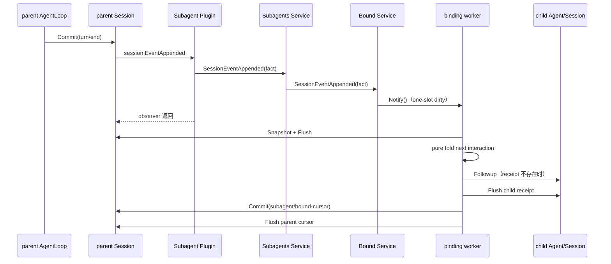

# Bound Parent Interaction 投递设计

状态：当前实现设计，已实现

本文只说明 Bound 如何把 direct user 与 parent 的完整交互投递给已绑定 child，以及如何恢复投递水位。binding、materialization 和 config 分别以[Bound 需求](./parent-bound-requirements.zh-CN.md)、[Bound 技术设计](./parent-bound-design.zh-CN.md)和[Bound Config 管理](./bound-config-management.zh-CN.md)为准。

这项能力是 Goren 扩展，不属于固定 DeepSeek Harness 兼容基线。

## 1. 结论

- Session 不增加 per-Session EventBus，也不拥有 Bound subscription。
- Subagent Plugin 复用现有 runtime-wide `session.EventAppended`。它只把已提交事件作为轻量唤醒信号转给 Bound，不读取 Session，不做 child 投递。
- Bound 不注册新的 `session/projection.Unit`，也不消费 `session/projection`。父交互由 Bound 私有纯 fold 从 parent Session log 重建。
- binding 本身就是 parent 到 child 的观察关系，不再定义通用 `SubscriptionID`、predicate 或 source selector。
- 每个 binding 由一个 Bound-owned worker 串行投递。通知可以重复或合并，durable Session log、child Inbox receipt 与 parent `subagent/bound-cursor` 才是恢复事实。

这里的“fold”是普通纯函数，不发布 projection event，也不把内部 cursor 暴露给 API Proxy。

## 2. Owner

| Owner | 负责 | 不负责 |
| --- | --- | --- |
| Session | append-only event、FIFO Commit、`session.EventAppended`、Flush barrier | subscription、child 路由、Bound cursor |
| Subagent Plugin | 声明并转发 `session.EventAppended` | Session 读取、消息组装、Followup、cursor |
| `internal/subagents.Service` | Plugin event 到 Bound 的窄转接和关闭准入 | 解释交互内容 |
| `internal/bound.Service` | binding worker、parent route index、生命周期与失败隔离 | 通用 EventBus 或公开 projection |
| Bound interaction fold | 从一个 parent committed prefix 形成下一条完整 interaction | I/O、通知和写入 |
| Agent Inbox | `Followup` 的 durable acceptance receipt | parent cursor |

## 3. 注册与运行调用链

注册阶段，Subagent Plugin 的 Manifest 声明监听既有 `session.EventAppended`。没有第二套 Session listener registry。

谁主动调用谁：

1. parent AgentLoop 提交 `turn/end`；Session 主动发布既有 `session.EventAppended`。
2. Plugin Runtime 主动调用 Subagent Plugin observer；observer 同步转交一个无 I/O 的通知。
3. Bound 主动把 exact parent ID 路由到该 parent 的 binding workers。
4. worker 主动读取 parent log并调用纯 fold；fold 不发布任何事件。
5. worker 主动调用 exact child Agent `Followup`；Agent Inbox 提交 `agent/inbox/spliced`。
6. worker 先 Flush child receipt，再向 parent Session提交并 Flush `subagent/bound-cursor`。

## 4. Interaction fold

cursor 使用 half-open `NextSeq`。fold 从该位置寻找下一条 closed `turn/start ... turn/end`：

- 只有 `user/message` 的 source kind 为 `user` 才算 direct user 输入；plugin、coordinator、tool、subagent report 和 `subagent-delivery` relay 都不算。
- 使用 canonical `assistant/message`，不重放 `assistant/chunk`，不复制 AgentLoop 的流式组装逻辑。
- relay 保留 direct user content 和 parent 的可见 assistant content；reasoning、tool-call 和 tool-result block 不进入 child。
- turn 已闭合但没有 direct user 输入时写 `skipped` cursor，不向 child 生成消息。因此 child report 驱动的 parent turn 不会形成 report echo loop。
- turn 尚未闭合时返回 NeedMore，cursor 不推进。
- cursor floor 落在一个已开始 turn 的中部时，fold 只把该 partial turn推进为 `skipped`，不会把 binding 建立前或 fork 已继承的半条交互投给 child。
- failed、aborted、blocked 等 turn只携带稳定 outcome kind，不复制 provider error 或原始事件 JSON。

## 5. Receipt 与 cursor

投递消息使用 `subagent-delivery` source，包含 parent Session ID、turn、parent seq range 与稳定 outcome。child Session中的 `agent/inbox/spliced` 是 acceptance receipt；target child 由承载该 receipt 的 Session identity确定，不在 source 中重复。

cursor 由 parent Session的 `subagent/bound-cursor` 事件表达。它按 child ID 保存 expected previous `NextSeq`、new `NextSeq`、through turn 和 `delivered|skipped` disposition。它不进入公共 Bound projection，也没有独立 cursor Store。

worker 的 effect 顺序固定为：

1. 从 parent snapshot fold current cursor 和下一条完整 interaction；
2. Flush parent source prefix；
3. 在 parent-child operation lock 内确认 latest config enabled 且 exact resident epoch仍有效；
4. 扫描 child log 中 exact receipt；唯一 receipt 已存在时不再 `Followup`，不存在时提交一次；多个 receipt 是 invariant failure；
5. Flush child Session；
6. 通过 Session FIFO head 上执行的 `WritePlan` 校验 expected cursor并提交新 cursor；
7. Flush parent Session。

因此 crash 发生在 child receipt durable 之后、parent cursor durable 之前时，恢复只修复 cursor，不重复 child Inbox acceptance。该设计不承诺 exactly-once 模型调用或 Tool 副作用。

## 6. Floor、暂停与生命周期

首次 cursor floor 取 binding event 后一位与 child `Header.SeedLength` 的较大值。前者排除 binding 建立前的 parent history，后者排除 fork 已复制给 child 的 parent prefix；spawn 的 seed floor 为零。

worker 属于 binding，不属于某个 child Agent epoch。config revision replacement 更新 resident epoch但不替换 worker；`Enabled=false` 时 worker保留 backlog且不推进 cursor，再次启用并 materialize child 后主动 catch-up。

parent exact Agent disposed 时同步移除并停止其 workers。Bound Service关闭时先取消并等待所有 workers，再停止 resident Executions，避免 worker向正在拆除的 child投递。

## 7. 失败语义

- 通知重复、丢失或合并：worker按 durable cursor重读，启动、恢复和重新启用都会主动 catch-up。
- parent source Flush失败：不产生新的 child effect。
- child Followup或receipt Flush失败：不推进 parent cursor。
- cursor Commit或Flush失败：报告 diagnostics；恢复重新对账 child receipt。
- malformed parent turn、cursor chain或child receipt：停止该次 catch-up并报告，不猜测或跳过损坏事实。
- disabled、nonresident或revision replacement中的 child：本次 catch-up暂停，cursor保持不变。

## 8. 实现与验证证据

- 纯 fold与cursor验证：`subagent/internal/bound/interaction.go`、`interaction_test.go`
- worker、receipt恢复与 CAS WritePlan：`subagent/internal/bound/interaction_delivery.go`
- live delivery与crash-window测试：`subagent/internal/bound/runtime_test.go`
- Plugin wakeup接线：`subagent/plugin/plugin.go`、`events.go`
- 当前完成状态：[08 实施进度](../../zh-CN/08-implementation-progress.md)

未实现通用 Session subscription API、独立 cursor database、`session/projection.Changed` 触发链、任意 event predicate、assistant chunk重组和 child processing watermark。
