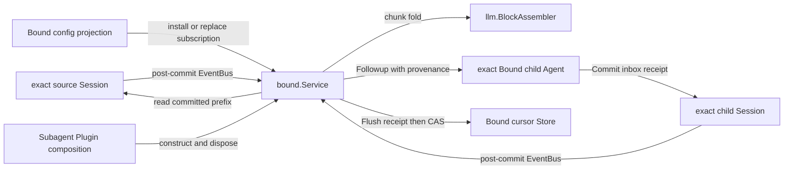
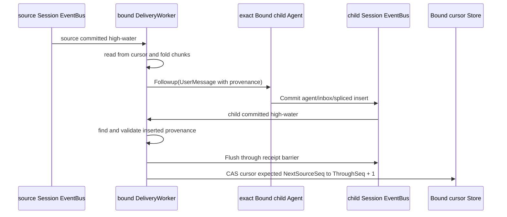

# Subagent Session Event 订阅与投递设计

状态：临时设计草案，尚未并入现有权威文档，尚未实现

本文细化 Subagent 如何直接订阅 exact Session event、把通知路由给指定 child、由 Bound 把 `assistant/chunk` 恢复为一条消息，并通过 child Session receipt 推进 cursor。Bound binding、materialization 和 config 仍分别以 [Bound 需求](./parent-bound-requirements.zh-CN.md)、[Bound 技术设计](./parent-bound-design.zh-CN.md)和[Bound Config 管理详细设计](./bound-config-management.zh-CN.md)为准。

## 1. 修正后的结论

当前实现由 Session Plugin 把 committed event 发布为 runtime-wide `session.EventAppended`，消费端再按 `Conversation.ID()` 二次路由。这个全局 Plugin event 适合跨 Session 的 runtime observer，但不应成为 Bound 订阅 exact Session 的中转层。

新设计是：

1. 每个 `session.Context` 拥有一个 Session-owned `EventBus`，Commit 成功后由该 Session 直接发布 committed event；
2. `bound.Service` 直接订阅 exact source Session，不经过 Subagent Plugin observer，也不需要 runtime-wide Session ID dispatcher；
3. Bound 根据自己的 binding/config 将 source 通知投递给指定 child；Session EventBus 不理解 Subagent、binding 或 target child；
4. Bound 同时直接订阅 exact child Session，从 `agent/inbox/spliced` 等 durable child event 确认 acceptance receipt，Flush receipt 后推进 cursor；
5. EventBus 只是 process-local post-commit notification seam，durable Session log 和 Bound cursor 仍是恢复与去重事实；
6. Plugin 只在 composition 时构造 Bound Service 并释放其订阅，不转发 Session event、不匹配 event type、不推进 cursor。

这不是固定 DeepSeek Harness 基线中的兼容能力。实现不得把本文的 Planned 行为写成 Harness parity 证据。

## 2. Owner 与主动调用链



运行时“谁主动调用谁”如下：

1. source Session `Commit` 成功后主动向自己的 EventBus 发布 committed event；
2. source EventBus 主动唤醒 Bound 的 source subscription handler；
3. Bound 主动从 durable cursor 读取 source Session committed prefix，恢复一条 delivery；
4. Bound 主动调用 exact child Agent `Followup`；
5. child Agent Inbox 主动向 child Session Commit acceptance receipt；
6. child Session EventBus 主动唤醒同一 Bound 的 receipt handler；
7. Bound 主动校验并 Flush child receipt，然后 CAS 推进自己的 cursor。

Session 拥有 event publication order、subscriber registration 和 disposer 生命周期。Bound 拥有业务 subscription、source-to-child route、event filter、chunk fold、receipt 和 cursor。Agent 只拥有 Inbox acceptance、turn 消费与 exact epoch。Plugin 只拥有装配与 teardown。

## 3. Session EventBus 边界

### 3.1 实例边界

`EventBus` 属于一个 exact Session，不是 Runtime 全局 bus。订阅时已经由 `session.Context` 确定 Session identity，因此 handler 不再接收全局 `Conversation` 后按 ID 重新分发。

以下只表达责任，不预先冻结为最终公开 Go API：

```go
type EventNotice struct {
    Committed Event
    Barrier   WriteBarrier
}

type EventSubscriber interface {
    SessionEvent(context.Context, EventNotice) error
}

type EventSubscription interface {
    Dispose(context.Context) error
}

type EventBus struct {
    // private Session-owned state
}

func (owner *EventBus) Subscribe(
    subscriber EventSubscriber,
) (EventSubscription, error)
```

`session.Context` 提供对自己的 EventBus 的订阅入口；不提供按 Session ID 订阅的全局 registry。`EventNotice.Barrier.NextSeq` 是该 event Commit 后的 committed high-water，不表示已经 Flush。

### 3.2 发布语义

- 只有整个 `WritePlan` 校验并 Commit 成功后才发布；失败 batch 不发布；
- 同一 batch 的 events 按 `seq` 发布，同一 Session 对一个 subscriber 不并发回调；
- publication 发生在 Session log mutex 释放之后，subscriber 可以安全读取 detached Snapshot；
- EventBus 在 Commit 的 post-commit 阶段按 registration order 串行调用 subscriber；Commit 等待短小的通知回调返回，但 subscriber error、panic 或取消不能回滚已 committed event；
- Bound 的 EventBus handler 只调用 `DeliveryWorker.Notify`，不能在 Commit 调用栈中执行 fold、`Followup`、Flush、cursor CAS 或获取 Bound per-child mutex；
- 有界 mailbox、dirty high-water、单一 drain worker和 retry 属于 `DeliveryWorker`，不属于 Session EventBus。EventBus 保持通用的 exact-event fan-out，不把自己变成第二条业务队列；
- disposer 必须幂等，停止新回调准入，并按 close context 等待已准入回调结束。

EventBus 本身不解释 `Event.Type`。若提供 exact event-type filter，它也只能是技术上的 key 匹配，不能承载 Bound 的 subscription schema 或 control-event 规则。

### 3.3 订阅与 catch-up 的竞态

EventBus 不负责重放订阅前的 event。Bound 必须使用“先订阅，再 catch-up”的顺序：

1. 对 exact Session 安装 EventBus subscription；
2. 读取 detached `Session.Snapshot()` 及其 barrier；
3. 从 durable `NextSourceSeq` catch-up 到 snapshot barrier；
4. 处理订阅安装后合并到的更高 high-water。

这个顺序不会丢失“安装订阅与读取 snapshot 之间”的 Commit。重复通知只会造成再次 catch-up，不会造成重复 child message。

## 4. Bound 的订阅与路由

Bound 的每个 resident child 拥有一个具名 subscription owner，而不是全局 `sessionevents.Dispatcher`：

```go
type DeliveryRoute struct {
    SourceSession session.Context
    TargetSession session.Context
    Child         agent.Agent
    Subscription  BoundSubscription
}

type DeliveryWorker struct {
    // route, source/target handles, dirty high-water and serial state
}
```

`DeliveryWorker` 拥有两类 Session subscription：

- source subscription：任何新 committed prefix 只标记 source dirty，由 worker 从 cursor 重放；
- target subscription：只将 child Session 的新 committed prefix 标记为 receipt dirty，由 worker 扫描并验证已插入 message provenance。

两个 EventBus handler 都只执行 non-blocking `Notify`。worker 的有界 mailbox 合并同一方向的最大 committed high-water；worker 正在处理时到达的新通知只提高 high-water，不为每个 event 创建 goroutine。mailbox 已满时覆盖旧的较低 high-water，而不是阻塞 Session Commit。

Bound config revision 以 target child 为 identity 原子替换整组 `DeliveryWorker`。旧 revision 的 disposer 不能删除新 revision 的订阅。disabled binding 不再保留 source subscription，但在旧 receipt 尚未对账完成前可以保留短暂的 target subscription。

同一 child 的 source fold、receipt reconciliation、config apply、Send 和 cursor CAS 进入 Bound-owned 串行区间。Session EventBus 只提高 dirty high-water，不进入该串行区间长时执行。

## 5. Bound 的 event-to-message fold

### 5.1 Processor 边界

Bound subscription 不把任意 JSON、脚本表达式或单个 raw event 直接暴露给模型。每种可投递语义由编译进仓库、owner-defined 的 processor 解释：

```go
type ProcessResult struct {
    SkippedThrough int64
    Delivery       *Delivery
    NeedMore       bool
}

type Delivery struct {
    FromSeq    int64
    ThroughSeq int64
    Content    []agentmessage.ContentBlock
}
```

processor 是 deterministic、无 I/O 的策略。它读取从 `NextSourceSeq` 开始的 detached source snapshot，返回“可安全跳过到哪里”“形成一条 delivery”或“等待更多 event”。EventBus 不调用 processor；`bound.Service` 在 per-child 串行区间调用它。

subscription 只能引用编译期已知 processor 及其 owner-defined 严格配置，不能引用脚本、Goja、`map[string]any` 或自由 event predicate。processor canonical name 与首版静态 schema 仍需在实现前固定。

### 5.2 Assistant message processor

首个内建 processor 负责把模型 stream 恢复为消息：

1. 从 cursor 开始按 seq 读取 source Session events；
2. 按 `(turn, step)` 收集 `assistant/chunk`，使用 `session.AssistantChunk` strict decode 和 `llm.DecodeStreamChunk` 恢复 chunk；
3. 按原 seq 把 chunk 推入 `llm.BlockAssembler`，不在 Bound 复制 text/tool/reasoning 拼装规则；
4. 遇到有效 `FinishChunk` 时闭合当前输出，从 assembler 产生一条 delivery；
5. 遇到 `assistant/message` 时，校验其 `SourceEventSeqs` 都指向同一 `(turn, step)` 的早期 chunk，并重放这些 chunk；结果与 committed message 不一致时报 corrupt source；
6. 如果已按 `FinishChunk` 投递，后到的 `assistant/message` 只作为同一 fold 的闭合与校验事实，不产生第二条 child message；
7. 空 assistant anchor 不投递；Bound control events、Inbox events、request headers 和其他未被 processor 拥有的 event 只按明确 skip 规则推进；
8. 只有 chunk 而没有 finish 或 `assistant/message` 时返回 `NeedMore`，cursor 停在该 open group 之前。

正常流和恢复流使用同一条 `chunk -> BlockAssembler -> message` 路径。是否在永久缺少 closure 的 terminal boundary 后投递 partial text 仍是 Open 决定；未确认前不得静默截断、跳过或制造 partial message。

### 5.3 Child message provenance

Bound 把 delivery 包装为一条 `agentmessage.UserMessage` 并调用 exact child 的 `Followup`。message source 必须持久化足够的稳定 provenance：

```go
type SessionEventSource struct {
    Kind            string
    Form            agentmessage.ContextForm
    SourceSessionID session.SessionID
    SubscriptionID  string
    FromSeq         int64
    ThroughSeq      int64
}
```

canonical `Kind` 在实现时与 strict codec fixture 一起固定。`Form` 使用 relay 语义。target child ID 来自承载 receipt 的 child Session，不在 source 中重复。稳定 delivery identity 由 source Session、target child、subscription 和 half-open seq range 共同确定。

secrets、raw credential、provider error 和整个 source event JSON 不能复制到 provenance。模型只接收 processor 明确产生的 content。

## 6. Child receipt 与 cursor

delivery cursor 使用 half-open 语义：`NextSourceSeq` 之前的 source prefix 已被明确 skip，或对应 delivery 已由 child Inbox durable 接受。它不是“child 已开始 turn”或“child 已完成处理”的水位。



Bound 只把 child Session 中的 `agent/inbox/spliced` inserted message 当作 acceptance receipt。它必须 strict decode `agent.InboxSplice`、验证 message source、exact target、binding、subscription 和 seq range，再等待 child Session Flush 覆盖该 receipt，最后以 expected cursor 执行单调 CAS。

不能只在 `Agent.Followup` 返回 nil 后直接写 cursor；crash 可能发生在 child Inbox Commit 与 cursor write 之间。也不能在只收到 child post-commit notification 时先写 cursor；cursor durability 不能跑在 child receipt durability 之前。

如果 crash 发生在 receipt durable 之后、cursor CAS 之前，恢复先扫描 child Session 中相同 delivery identity：找到唯一 receipt 时只补 cursor，不再调用 `Followup`。发现多个 receipt 是 invariant failure；找不到 receipt 才允许重投。child 后来 claim 或 discard 该消息不回退 delivery cursor。

若产品需要知道 child 处理进度，应另建 processing watermark 并从 `user/message`、`turn/end` 等 child 事实推导；不能改变 delivery cursor 的去重含义。

## 7. 建立、更新与恢复

fresh/existing `Bound.Start` 在 child publication 和新 work 准入前执行：

1. 从同一 parent projection snapshot 读取 binding 和 latest config；
2. 恢复或创建 exact child；
3. 扫描 child durable Session，先对账未推进 cursor 的 receipts；
4. 为 enabled subscriptions 创建 `DeliveryWorker`，先安装 source Session 和 child Session 两个 EventBus subscription；
5. 主动 catch-up source 到当前 snapshot barrier，不等待新 live event；
6. 完成 latest config apply 后才开放普通 Send 和 event delivery。

config revision 改变 subscriptions 时，Bound 在 per-child 串行区间暂停新 delivery，Flush config 事实，安装新 `DeliveryWorker` 和两组 Session subscriptions，原子切换 generation，然后 dispose 旧 registration 并按 durable cursor catch-up。删除 subscription 前如何保留或归档 cursor 属于 O7 retention policy，不能由 EventBus 静默删除。

source 或 child 不 resident 时无法对其 process-local EventBus 保留订阅。durable log 仍是待处理事实，cursor 保持不变；Session 重新 materialize 后，Bound 对 exact Context 重新订阅并 catch-up。EventBus 不建立第二条 durable 消息队列。

## 8. 失败与一致性

- EventBus 通知重复、合并或处理延迟：Bound 只提高 dirty high-water，按 Session seq 和 cursor 重放；
- process crash 或 process-local notification 丢失：`Bound.Start`、Session rematerialization、config update 或后续通知的显式 catch-up 补偿；
- chunk decode、provenance 或 committed message 校验失败：隔离对应 subscription，cursor 停在失败 prefix 并报告稳定 diagnostic；
- child Inbox 拒绝：不产生 receipt，不推进 cursor；
- child receipt Flush 失败：不推进 cursor；恢复后重新验证 durability；
- cursor CAS 失败：重新读取 cursor 和 child receipt；已推进视为幂等成功，冲突或回退拒绝；
- subscription replacement 与 in-flight delivery 并发：per-child epoch 和 registration generation 共同校验；旧 worker 不能向新 epoch 投递，也不能推进新 revision 的 cursor；
- shutdown：Bound 先停止新 work 准入，dispose source/child Session subscriptions，等待已准入 handler 结束，再关闭 child execution；Plugin 只调用 Bound `Close`。

本设计提供 at-least-once 处理尝试与 effectively-once child Inbox acceptance，不承诺 exactly-once 模型调用、Tool 副作用或跨 Session 数据库事务。

## 9. 实施与验证映射

| 行为 | 计划实现位置 | 必须验证的证据 | 状态 |
| --- | --- | --- | --- |
| exact Session EventBus 与幂等 disposer | `session` | post-commit order、batch failure、reentry isolation、dispose race tests | Planned |
| source/child 直接订阅与 generation replacement | `subagent/internal/bound` | subscribe-before-catch-up、replacement、shutdown race tests | Planned |
| chunk 恢复与 message 校验 | `subagent/internal/bound` | `llm.BlockAssembler` replay、finish/message duplicate、corrupt provenance tests | Planned |
| child receipt 与 cursor CAS | `subagent/internal/bound` + Bound Store adapter | crash-window、Flush-before-cursor、receipt reconciliation tests | Planned |
| cold/restart catch-up | `subagent/internal/bound` | dropped notification、restart、nonresident Session integration tests | Planned |
| Plugin 仅装配 Bound | `subagent/plugin` | Apply/Dispose 不声明 Session append observer 的 architecture test | Planned |

实现 EventBus 时必须先盘点当前 `session.EventAppended` 的 Persistence、Projection、Title 等全局消费者，明确哪些仍需 runtime-wide lifecycle discovery，哪些应迁移到 exact Session subscription。不得为了兼容同一业务消费者而同时经过 Plugin event 和 EventBus 处理一次 append。

在真实包实现前不创建 placeholder 目录或 package README。实现落地后必须增加 colocated `README.zh-CN.md`，并把本表链接到实际 tests 和[08 实施进度](../../zh-CN/08-implementation-progress.md)。

## 10. 尚未关闭的决定

- O4：首版 processor canonical name、subscription 严格 schema 以及除 assistant output 以外是否准入其他 Session 语义；
- O5：cursor Store 的 CAS 接口、receipt 扫描索引和 SQLite transaction 边界；
- O7：source retention 超过 cursor、subscription 删除和永久 poison prefix 的 repair/隔离策略；
- DeliveryWorker 的有界 mailbox 上限、调度公平性与 retry/diagnostic；
- Session release 时 EventBus drain 与 Flush/lifecycle event 的最终顺序；
- open chunk group 在 terminal boundary 后的 partial output 策略。

这些事项没有关闭前，不能以任意 event predicate、best-effort cursor write、无限 goroutine 或跳过损坏 prefix 代替。
