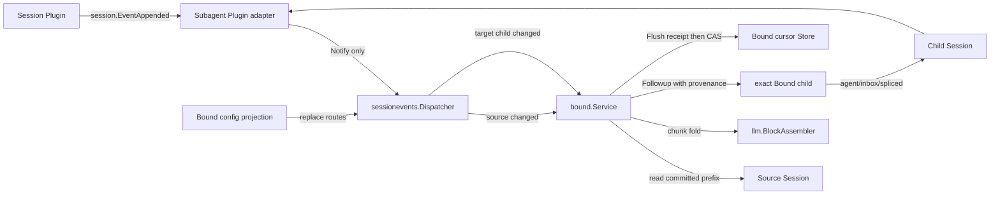
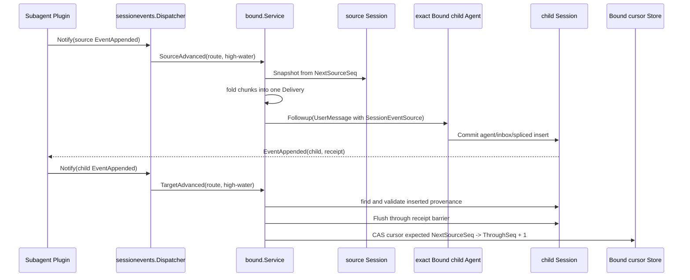

# Subagent Session Event 订阅与投递设计

状态：临时设计草案，尚未并入现有权威文档，尚未实现

本文细化 Subagent 如何订阅 Session event、把通知路由给指定 child、由 Bound 把 `assistant/chunk` 恢复为一条消息，并通过 child Session receipt 推进 cursor。Bound binding、materialization 和 config 仍分别以 [Bound 需求](./parent-bound-requirements.zh-CN.md)、[Bound 技术设计](./parent-bound-design.zh-CN.md)和[Bound Config 管理详细设计](./bound-config-management.zh-CN.md)为准。

## 1. 当前事实、目标与缺口

当前 `session.EventAppended` 是 `DeliveryBestEffort` 的 post-commit Plugin event。它携带 exact `session.Context` 和已经进入内存日志的 `session.Event`，但不表示该 event 已经 Flush，也不保存 subscription、retry 或 cursor。Session Plugin 从 runtime root scope 发布该事件，因此 Plugin scope 不能自动筛选某个 Session；消费端仍必须按 `Conversation.ID()` 路由。

当前 Subagent Plugin 只订阅 `agent.Disposed`。`internal/bound.Service` 仍是明确返回 `ErrStartNotImplemented` 的骨架；代码中没有 Session event route、chunk fold、delivery receipt 或 cursor recovery。

目标行为是：

1. Subagent Plugin 静态订阅 `session.EventAppended`，只把它交给一个 Subagent-owned dispatcher；
2. dispatcher 根据 process-local source/target route，把“source 有新 committed prefix”通知指定的 Mode consumer；
3. Bound consumer 从 durable source prefix 和自己的 cursor 重放，而不是把单条 live event直接变成消息；
4. Bound 使用 LLM owner 的 `llm.BlockAssembler` 把一个已闭合 step 的 `assistant/chunk` 恢复为完整 content，再构造一条模型可见 child `UserMessage`；
5. child Inbox 接受该消息后，child Session 中的 durable receipt 推进 delivery cursor；
6. Plugin notification 丢失、重复、乱序或进程重启都不能改变最终投递结果。

这不是固定 DeepSeek Harness 基线中的兼容能力。实现不得把本文的 Planned 行为写成 Harness parity 证据。

## 2. Owner 与非 Owner



`subagent/internal/sessionevents.Dispatcher` 是计划中的进程内路由 owner。它负责 active route registration、按 source Session ID 查找指定 child、source/target 通知合并、每条 route 串行执行，以及 Plugin Dispose 时停止准入和排空已接受工作。

dispatcher 不拥有 durable subscription 定义、event filter、chunk 语义、cursor、dedupe、Agent Inbox 或 Session persistence。它的 route index 可以删除重建，不能成为 binding 或 subscription 真相。

`subagent/internal/bound.Service` 负责从 exact parent 的 binding/config projection重建 route，解释自己的 subscription，读取和推进 cursor，把 Session event prefix转换成 child message，并从 child Session receipt完成去重对账。Bound 不重新实现 LLM chunk codec或 block assembly。

`subagent/plugin.Plugin` 只声明 Event subscription、构造 dispatcher、连接 Bound consumer并释放这些 registration。它不读取 Bound config、不匹配 event type、不构造消息，也不直接推进 cursor。

Session 只拥有 append-only event、Commit、barrier和Flush。Agent只拥有 Inbox acceptance、turn消费与exact epoch。两者都不反向导入 Subagent。

## 3. 两种 subscription 不得混淆

Plugin subscription 与业务 subscription 是两种不同对象：

- Plugin subscription 是 `Manifest.Events` 中静态声明的 `plugin.EventOf[session.EventAppended]()`。它决定 Runtime 把哪一种 Go event交给 Subagent Plugin；生命周期跟随 Plugin Apply/Dispose。
- Bound subscription 是 exact parent Session config 中的 durable业务规则。它决定哪个 source Session 的哪些语义输出进入哪个 Bound child；生命周期跟随 config revision和binding。

不能为每条 Bound subscription动态 mount一个 Plugin，也不能把 Bound subscription写进 Plugin Manifest。Plugin Runtime 不保存事件历史；重启恢复必须读取 Session log和Bound cursor。

## 4. Dispatcher 边界

以下接口只表达私有责任，不预先冻结为公共 Go API：

```go
type Route struct {
	SourceSessionID session.SessionID
	TargetSessionID session.SessionID
}

type Consumer interface {
	SourceAdvanced(context.Context, Route, session.Context, int64) error
	TargetAdvanced(context.Context, Route, session.Context, int64) error
}
```

`SourceAdvanced` 表示 source Session 已经至少提交到 `throughSeq`；`TargetAdvanced` 表示指定 child Session 已经至少提交到该位置。参数是 wake hint，不是待处理 event payload。Consumer必须重新读取 exact Session snapshot并以 cursor决定工作范围。

Bound以 target child为registration identity原子替换 routes。一个 config revision只能整体安装或整体撤销该 child 的 route set，旧 disposer 不能删除后来 revision安装的 route。disabled binding没有 source route，但在旧 receipt尚未对账完成前可以保留短暂的 target watch。

dispatcher不为每个 event创建goroutine。它使用有界 worker和按 route 合并的 dirty state；同一 route 正在处理时到达的新通知只提高 high-water。处理失败时保留 dirty state并执行有界退避；进程重启后由 Bound Start 的显式 catch-up补偿 process-local retry state。

Plugin observer只调用 `Notify`。`Notify` 不进入 Bound per-child mutex，不调用 `Session.Flush`，也不等待模型或Agent Inbox；这避免 `Session.Commit -> session.EventAppended -> Bound -> child Session.Commit` 的同步嵌套和 config commit重入死锁。

## 5. Bound 的 event-to-message fold

### 5.1 Processor 边界

Bound subscription不把任意 JSON、脚本表达式或单个 raw event直接暴露给模型。每种可投递语义由编译进仓库、owner-defined的 processor解释：

```go
type ProcessResult struct {
	SkippedThrough int64
	Delivery       *Delivery
	NeedMore       bool
}

type Delivery struct {
	FromSeq    int64
	ThroughSeq int64
	Content    []agentmessage.ContentBlock
}
```

processor是deterministic、无I/O的策略。它读取从 `NextSourceSeq` 开始的detached source snapshot，返回“可安全跳过到哪里”“形成一条delivery”或“等待更多event”。dispatcher不调用processor；`bound.Service`在per-child串行区间调用它。

O4 的方向由此收口为：subscription只能引用编译期已知processor及其owner-defined严格配置，不能引用脚本、Goja、`map[string]any`或自由event predicate。processor canonical name与首版静态schema仍需在实现前固定。

### 5.2 Assistant message processor

首个内建processor负责把模型stream恢复为消息：

1. 从cursor开始按seq读取source Session events；
2. 按 `(turn, step)` 收集 `assistant/chunk`，使用 `session.AssistantChunk` strict decode和 `llm.DecodeStreamChunk`恢复chunk；
3. 按原seq把chunk推入 `llm.BlockAssembler`，不能在Bound复制text/tool/reasoning拼装规则；
4. 遇到有效 `FinishChunk` 时，该chunk闭合当前输出，可以从assembler产生一条delivery；
5. 遇到 `assistant/message` 时，必须校验其 `SourceEventSeqs` 都指向同一 `(turn, step)` 的早期 `assistant/chunk`，并重放这些chunk；重放结果与committed message不一致时是corrupt source，不能投递或推进cursor；
6. 如果先前已按 `FinishChunk` 投递，后到的 `assistant/message` 只作为同一fold的闭合/校验事实，不能再产生第二条child message；
7. 空assistant anchor不投递；Bound control events、Inbox events、request headers和其他未被processor拥有的event只按明确skip规则推进；
8. 只有chunk而没有finish或`assistant/message`时返回 `NeedMore`，cursor停在该open group之前。

这样正常流和恢复流使用同一条 `chunk -> BlockAssembler -> message` 路径。是否在永久缺少closure的`step/end`/`turn/end`后投递partial text，仍是会改变模型可见行为的Open决定；未确认前不得静默截断、跳过或制造partial message。

### 5.3 Child message provenance

Bound把delivery包装为一条 `agentmessage.UserMessage` 并调用exact child的 `Followup`。message source必须持久化足够的稳定provenance：

```go
type SessionEventSource struct {
	Kind            string
	Form            agentmessage.ContextForm
	SourceSessionID session.SessionID
	SubscriptionID  string
	FromSeq         int64
	ThroughSeq      int64
}
```

canonical `Kind` 在实现时与strict codec fixture一起固定。`Form` 使用relay语义。target child ID来自承载receipt的child Session，不在source中重复；稳定delivery identity由source Session、target child、subscription和half-open seq range共同确定。

secrets、raw credential、provider error和整个source event JSON不能复制到provenance。模型只接收processor明确产生的content。

## 6. Child receipt 与 cursor

delivery cursor继续使用half-open语义：`NextSourceSeq`之前的source prefix已经被明确skip，或对应delivery已经由child Inbox durable接受。它不是“child已开始turn”或“child已完成处理”的水位。

cursor推进链路是：



Bound只把child Session中的 `agent/inbox/spliced` inserted message当作acceptance receipt。它必须strict decode `agent.InboxSplice`、验证message source、exact target、binding、subscription和seq range，再等待child Session Flush覆盖该receipt，最后以expected cursor执行单调CAS。

不能只在 `Agent.Followup` 返回nil后直接写cursor：crash可能发生在child Inbox Commit与cursor write之间。也不能在只收到child post-commit notification时先写cursor：cursor durability不能跑在child receipt durability之前。

如果crash发生在receipt durable之后、cursor CAS之前，恢复先扫描child Session中相同delivery identity：找到唯一receipt时只补cursor，不再调用 `Followup`。发现多个receipt是invariant failure；找不到receipt才允许重投。child后来claim或discard该消息不回退delivery cursor。

若产品需要知道child处理进度，应另建processing watermark并从 `user/message`、`turn/end`等child事实推导；不能改变delivery cursor的去重含义。

## 7. Route 建立、更新和恢复

fresh/existing `Bound.Start` 在child publication和新work准入前执行：

1. 从同一parent projection snapshot读取binding和latest config；
2. 恢复或创建exact child；
3. 扫描child durable Session，先对账未推进cursor的receipts；
4. 为enabled subscriptions安装source route和target watch；
5. 主动调用一次source catch-up到当前snapshot barrier，不等待新的Plugin event；
6. 完成latest config apply后才开放普通Send和event delivery。

config revision改变subscriptions时，Bound在per-child串行区间暂停新delivery，Flush config事实，原子替换dispatcher route set，然后按每个subscription的durable cursor catch-up。删除subscription前如何保留或归档cursor属于O7 retention policy，不能由dispatcher静默删除。

child不resident时，source event仍是durable待处理事实。Bound不建立第二条模型输入队列；cursor保持不变。materialize成功后catch-up再进入existing Agent Inbox path。

## 8. 失败与一致性

- Plugin event重复或乱序：dispatcher只提高route high-water；Bound按Session seq和cursor重放。
- Plugin event丢失：active route的dirty retry、下一次通知、Bound Start或config update的显式catch-up均可补偿；正确性不依赖notification history。
- chunk decode、provenance或committed message校验失败：隔离对应subscription，cursor停在失败prefix并报告稳定diagnostic。
- child Inbox拒绝：不产生receipt，不推进cursor。
- child receipt Flush失败：不推进cursor；恢复后重新验证durability。
- cursor CAS失败：重新读取cursor和child receipt；已推进视为幂等成功，冲突或回退拒绝。
- route replacement与in-flight delivery并发：per-child epoch和registration generation共同校验；旧worker不能向新epoch投递，也不能推进新revision的cursor。
- shutdown：Plugin先停止dispatcher新通知准入并排空已接受route work，再关闭Bound和其他Mode；dispatcher不直接关闭Agent Scope。

本设计提供的是at-least-once处理尝试与effectively-once child Inbox acceptance，不承诺exactly-once模型调用、Tool副作用或跨Session数据库事务。

## 9. 实施与验证映射

| 行为 | 计划实现位置 | 必须验证的证据 | 状态 |
| --- | --- | --- | --- |
| Plugin静态订阅与薄转接 | `subagent/plugin` | Manifest、Apply/Dispose和observer tests | Planned |
| source/target route与有界调度 | `subagent/internal/sessionevents` | duplicate/out-of-order、replacement、shutdown race tests | Planned |
| chunk恢复与message校验 | `subagent/internal/bound` | `llm.BlockAssembler` replay、finish/message duplicate、corrupt provenance tests | Planned |
| child receipt与cursor CAS | `subagent/internal/bound` + Bound Store adapter | crash-window、Flush-before-cursor、receipt reconciliation tests | Planned |
| cold/restart catch-up | `subagent/internal/bound` | dropped notification、restart、nonresident child integration tests | Planned |

在真实包实现前不创建 `internal/sessionevents` placeholder目录或package README。实现落地后必须增加 colocated `README.zh-CN.md`，并把本表链接到实际 tests和[08 实施进度](../../zh-CN/08-implementation-progress.md)。

## 10. 尚未关闭的决定

- O4：首版processor canonical name、subscription严格schema以及除assistant output以外是否准入其他Session语义；
- O5：cursor Store的CAS接口、receipt扫描索引和SQLite transaction边界；
- O7：source retention超过cursor、subscription删除和永久poison prefix的repair/隔离策略；
- open chunk group在terminal boundary后的partial output策略；
- dispatcher worker数量、退避和队列上限是实现期配置，但超限时是否拒绝新binding属于O11产品限制。

这些事项没有关闭前，不能以任意event predicate、best-effort cursor write、无限goroutine或跳过损坏prefix代替。
