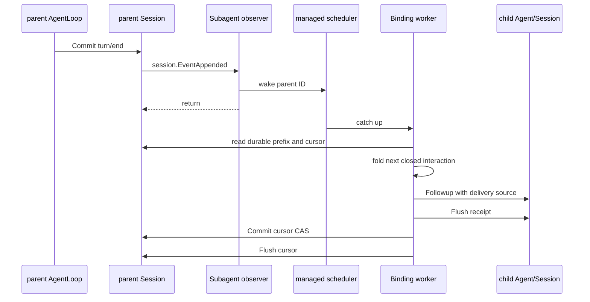

# Bound Parent Interaction 投递设计

> 状态：Accepted / Implemented。本文保留为interaction fold、receipt和cursor恢复的单一设计来源。

本文只说明Binding建立后，Bound如何读取用户与parent的完整交互，以及如何恢复receipt和cursor。Definition、Binding和激活分别以[需求](./parent-bound-requirements.zh-CN.md)、[配置管理](./bound-config-management.zh-CN.md)和[技术设计](./parent-bound-design.zh-CN.md)为准。

## 1. 原则

- Session不增加per-Session EventBus，也不保存listener registration。
- 既有`session.EventAppended`只在已提交事件后提供wakeup；通知可重复、合并或丢失。
- parent Session append-only log是interaction事实来源。
- Binding表达parent到child的观察关系，不引入通用Subscription、predicate或source selector。
- parent cursor和child receipt共同恢复delivery；不创建interaction projection event。
- 同一Binding串行，不同Binding并行。

## 2. 冻结上下文和delivery floor

Binding创建发生在parent Session唯一FIFO的队首。`bindingRegistration.Build(snapshot)`在该时刻计算并保存`ContextNextSeq`，它指向最后一个完整parent turn之后的位置；不需要占用parent Agent maintenance。

fresh child只复制：

```text
parentEvents[:ContextNextSeq]
```

这段prefix是模型上下文，不产生child Inbox任务。materialization即使延迟，也不能重新计算当前parent的最新完整prefix。

首次delivery cursor从Binding event后一位开始。fold允许跳过Binding创建与`ContextNextSeq`之间的维护事件，但不能把Binding之后闭合的新用户交互吞入seed。旧实现用child `SeedLength`与动态parent prefix取最大值的规则删除。

## 3. Wakeup与实际读取



observer不读取Session、不Followup、不Flush，也不启动裸goroutine。managed scheduler只负责parent路由、合并wakeup和任务生命周期；interaction含义由Binding worker内的纯fold解释。

## 4. Interaction fold

cursor使用half-open `NextSeq`。fold从cursor寻找下一条完整`turn/start ... turn/end`：

- 只有source kind为direct user的`user/message`使turn可投递；
- parent回复使用canonical `assistant/message`；
- relay保留direct user content和parent可见assistant content；
- reasoning、tool-call、tool-result、assistant chunk和内部协调消息全部过滤；
- 没有direct user输入的closed turn写`skipped` cursor，不生成child消息；
- 未闭合turn返回NeedMore，cursor不推进；
- cursor落在partial turn中时，该partial turn只能`skipped`，不能拼接成新任务；
- failed、aborted、blocked只保留稳定outcome kind，不复制provider error或原始event JSON。

因此child显式report触发的parent turn不会被再次投给同一child形成echo loop。

## 5. Receipt和cursor

投递消息使用`subagent-delivery` source，保存parent Session ID、parent turn、seq range和稳定outcome。承载receipt的child Session identity已经确定target child，不在source中重复child ID。

child Session中的`agent/inbox/spliced`是acceptance receipt。parent `subagent/bound-cursor`保存Binding name/child ID、expected previous `NextSeq`、new `NextSeq`、through turn和`delivered|skipped` disposition。

effect顺序固定为：

1. 从parent committed prefix fold current cursor和下一条closed interaction；
2. Flush读取所依赖的parent source prefix；
3. 在Binding mailbox内确认latest Definition enabled且resident epoch已应用该revision；
4. 扫描child exact receipt：不存在才Followup，存在一个则复用，多个视为invariant failure；
5. Flush child receipt；
6. 通过parent Session FIFO head上的WritePlan校验expected cursor并Commit；
7. Flush parent cursor。

若进程在child receipt durable后、parent cursor durable前崩溃，恢复只补cursor，不重复child Inbox acceptance。若Followup或child Flush失败，parent cursor不推进。

## 6. Disable、恢复和主动catch-up

disabled Binding保留cursor和backlog，不推进。重新启用、cold restore、revision replacement、SessionStarted reconcile和显式Send都会在epoch可用后主动catch up，所以正确性不依赖每个wakeup都被收到。

Binding worker跨resident epoch存在；Definition replacement不更换worker、Binding、child Session或cursor。parent Agent epoch被结构关闭时，scheduler可移除live路由，但durable Binding仍可在该用户Session下次恢复时重建worker。

## 7. 失败语义

- malformed Binding、cursor chain、parent turn或child receipt：停止该Binding catch-up并报告diagnostics，不猜测修复；
- parent source Flush失败：不产生child effect；
- child acceptance失败：不推进parent cursor；
- cursor提交冲突：重读durable prefix和receipt后重试；
- child nonresident、disabled或正在replacement：暂停并保留cursor；
- shutdown：停止新wakeup准入，取消并等待workers，再结算resident epochs。

该设计提供durable acceptance去重，不承诺exactly-once模型调用或Tool外部副作用。

## 8. 验证重点

- frozen context prefix和Binding后首个turn不会被seed吞掉；
- direct user + visible assistant relay，隐藏block过滤；
- report-only turn写skipped且不echo；
- receipt durable/cursor缺失的crash-window修复；
- disabled backlog在enable后按序catch up；
- 重复、合并或缺失wakeup不改变最终cursor；
- 多Binding并行、单Binding顺序一致；
- shutdown无worker泄露。

实现证据只记录在[08 实施进度](../../zh-CN/08-implementation-progress.md)。
