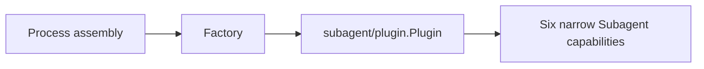

# Subagent Factory

本包是 Subagent Plugin 的静态构造边界。Factory 使用 canonical Plugin name `@deepseek-ai/dsh-subagent`，严格解码`boundDefinitions.path`和可选`journalMode`，然后构造尚未激活的`plugin.Plugin`。运行期数据库打开、Service解析、投影注册和模块启停仍由该Plugin拥有。

本包不打开数据库、不持有Runtime Service，也不注册具体spawn/fork SeedBuilder或Tool Consumer。配置只表达技术存储位置和journal策略；Definition业务字段通过`bound.Definitions`管理，不进入Plugin配置。

Factory 已进入默认静态Factory Catalog与默认Plugin specs；默认composition在Session数据库同目录使用独立`bound-definitions.sqlite`。这只装载Subagent core，不表示具体SeedBuilder或模型可见Tool已经挂载。

跨包契约见[领域设计](../docs/design.zh-CN.md)，实现证据见[08 实施进度](../../zh-CN/08-implementation-progress.md)。
