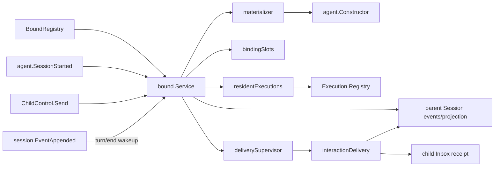

# Bound Subagent

本包实现独立`ModeBound`，拥有exact parent Session中的binding/config用例、child create/restore、resident Agent epoch、message admission、parent interaction delivery和failure containment。

`Service`只编排Bound用例。`materializer`拥有child创建、恢复、descriptor校验和scoped provision；`bindingSlots`拥有每个binding的runtime串行化和resident引用；`residentExecutions`拥有Execution发布、查询、中断、外部关闭观察和模块停止；`deliverySupervisor`拥有投递注册表、parent epoch清理与关闭边界。

`Bind`通过`bindingRegistration`在Session FIFO head基于最新event prefix校验child/title唯一性，并原子提交binding和config revision 1后Flush；它不创建child，也不维护per-parent mutex。`StartBindings`在parent publication之后逐binding调用`Start`；单child失败写materialization event并进入diagnostics，不否决parent。`UpdateConfig`先持久化完整revision，再用exact Agent epoch replacement更新resident child；cold child保持cold。`Send`、config replacement和interaction admission使用同一parent-child `bindingSlot`。

每个materialized binding拥有一个跨child epoch保留的`interactionDelivery`。现有`session.EventAppended`只在parent `turn/end`时由`deliverySupervisor`唤醒对应投递；投递从parent log纯fold direct user与canonical `assistant/message`，对report-only turn写`skipped` cursor。投递先形成child `agent/inbox/spliced` receipt并Flush，再向parent提交`subagent/bound-cursor`。receipt已存在但cursor缺失时只修复cursor，不重复Followup。该fold不注册`session/projection.Unit`，也没有interaction projection event。

关闭时先由`deliverySupervisor`取消并等待全部投递，再停止resident Executions；`Enabled=false`暂停cursor，重新启用后catch-up。交互调用链和恢复顺序见[Parent Interaction投递设计](../../docs/session-event-delivery.zh-CN.md)。

本包不拥有配置源、Plugin dependency lookup、System Prompt、Tools实现、通用Session EventBus或公开interaction projection，也不注销Extension。完整需求见[Bound需求](../../docs/parent-bound-requirements.zh-CN.md)，方法和调用链见[技术设计](../../docs/parent-bound-design.zh-CN.md)，config组合见[Bound Config管理](../../docs/bound-config-management.zh-CN.md)，实现证据见[08实施进度](../../../zh-CN/08-implementation-progress.md)。
