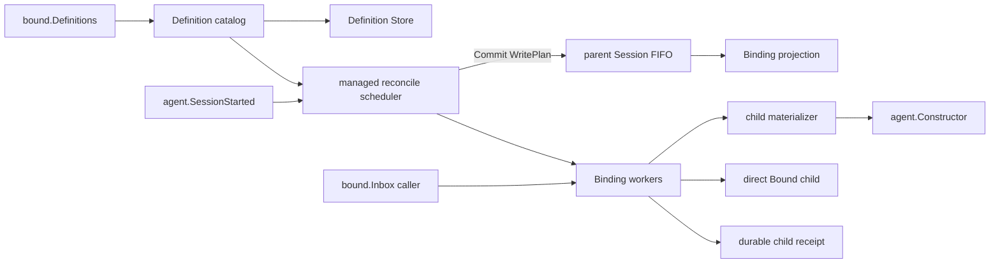

# Bound Subagent

> 状态：Accepted / Implemented。旧的per-parent config路径已删除。

本包拥有每个用户 Session 的 Bound 一致性、Binding worker、direct child create/restore、idle resident epoch、Definition replacement、显式Send、`Inbox.Deliver`与failure containment。Definition 的业务校验和revision也属于Bound能力；输入观察和checkpoint不属于本包，SQLite adapter只负责技术持久化。

`SessionStarted`只为用户Session请求reconcile。受管scheduler生成缺失Binding候选，再由`bindingRegistration`在parent Session FIFO队首的原子Snapshot上重新fold并在一个batch建立所有仍缺失Bindings。该路径不调用parent `RunMaintenance`，因此不会与`/compact`竞争Agent activity。Binding Flush后，不同worker可以并行materialize；任何child Session都不能进入reconcile，因此不会递归启动Bound。

Binding保存Definition name、稳定child Session ID和创建时冻结的`ContextNextSeq`。fresh child只复制该prefix，随后安装完整Bound system prompt、Tool restriction和Extensions，在child log保存完整Applied Definition并发布resident epoch。创建过程不提交InitialPrompt、不唤醒Inbox、不调用LLM；child保持idle直到新的parent interaction或显式Send。

每个Binding worker用mailbox串行处理Definition replacement、显式`Followup`、`deliveryCommand`和resident epoch；不同worker互不阻塞。registry mutex只保护短索引与关闭准入，不覆盖Session、Constructor或Agent I/O。worker跨多个exact resident epoch存在，不能与当前Execution混为一个对象。`residentEpoch`自己拥有`Starting/Active/Stopping/Stopped`、RunID、Terminal和关闭事务；它复制所需的Session、failure、event、parent和execution-index窄依赖，不回指`boundChild`，因此owner graph保持单向。

`Inbox.Deliver`只接收`Address + Input`。Service从parent projection解析真正的Binding和child ID，再把`deliveryCommand`送入该Binding mailbox。`handleDelivery`只收敛latest Definition和选择current child；投递逻辑按`InputID`查找已有child receipt，不存在才构造`subagent-delivery`消息并执行`Agent.Followup + Flush`。parent经`ChildControl.Send`发起的显式后续指令则映射为Bound内部`Followup`，不参与输入源的`InputID/Receipt`幂等协议。disabled时返回稳定错误而不接纳输入；backlog和重试由调用该Inbox的输入源持有。

本包不观察`session.EventAppended`，不fold parent turn，不拥有parent cursor，也不启动输入订阅。内置Session turn来源见[`subagent/bound/turnrelay`](../../bound/turnrelay/README.zh-CN.md)。

registry与scheduler使用由Bound Service拥有的独立lifecycle context，不能继承`Plugin.Apply`调用context中的Runtime标记、deadline或取消信号；`Service.Close`负责显式取消并等待这些后台工作。

Plugin关闭时先停止scheduler准入，取消并等待所有reconcile任务，再并行关闭Binding workers并停止resident epochs，最后关闭Definition Store。parent Agent结构关闭触发`CloseExternal`时，resident epoch先取消在途child再等待idle，但不重复Dispose由Agent lifecycle拥有的Handle。本包不拥有Web DTO、通用Session EventBus、System Prompt或Tools registry实现，也不创建公开interaction projection event。

完整需求见[Bound需求](../../docs/parent-bound-requirements.zh-CN.md)，主动调用链见[技术设计](../../docs/parent-bound-design.zh-CN.md)，Definition应用见[配置管理](../../docs/bound-config-management.zh-CN.md)，interaction恢复见[投递设计](../../docs/session-event-delivery.zh-CN.md)，测试矩阵与问题根因见[测试跟踪](../../docs/bound-test-tracking.zh-CN.md)，完成证据见[08实施进度](../../../zh-CN/08-implementation-progress.md)。
