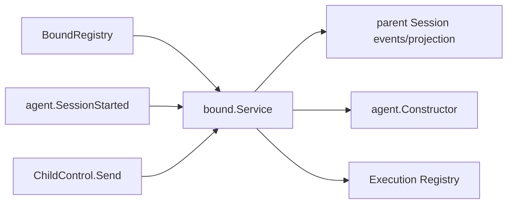

# Bound Subagent

本包实现独立`ModeBound`，拥有exact parent Session中的binding/config用例、child create/restore、resident Agent epoch、message admission和failure containment。

`Bind`原子提交binding和config revision 1并Flush，但不创建child。`StartBindings`在parent publication之后逐binding调用`Start`；单child失败写materialization event并进入diagnostics，不否决parent。`UpdateConfig`先持久化完整revision，再用exact Agent epoch replacement更新resident child；cold child保持cold。`Send`与config replacement使用同一parent-child operation lock。

本包不拥有配置源、Plugin dependency lookup、System Prompt或Tools实现，也不注销Extension。完整需求见[Bound需求](../../docs/parent-bound-requirements.zh-CN.md)，方法和调用链见[技术设计](../../docs/parent-bound-design.zh-CN.md)，config组合见[Bound Config管理](../../docs/bound-config-management.zh-CN.md)，实现证据见[08实施进度](../../../zh-CN/08-implementation-progress.md)。
