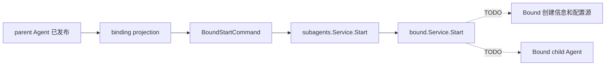

# Bound Subagent

本包拥有独立的 `ModeBound` 实现。Bound child 由 parent Session 中已经提交的 binding 识别；上游在 parent Agent 发布后构造 `BoundStartCommand`，统一 `subagents.Service` 再把命令分派给本包。

当前只实现 Mode、命令分派和明确的未实现失败。`Start` 尚未读取配置源、创建或恢复 child，也不会发布 `Execution`。因此 `Interrupt` 和 `Close` 当前没有可管理的 Bound 运行期资源。调用 Bound `Start` 的 parent publication observer 必须包含该错误，不能使 parent publication 失败。

Binding event、配置源、初始 prompt、恢复和运行期配置应用由 [Bound Subagent 技术设计](../../docs/parent-bound-design.zh-CN.md)负责；实现状态见[进度矩阵](../../../zh-CN/Subagent重构进度矩阵.md)。
