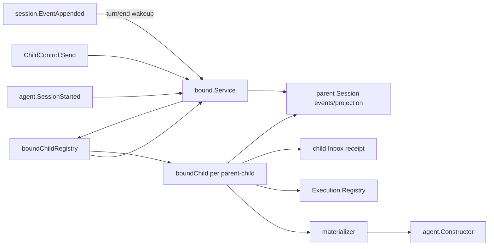

# Bound Subagent

本包实现独立`ModeBound`，拥有exact parent Session中的binding/config用例、child create/restore、resident Agent epoch、message admission、parent interaction delivery和failure containment。

`Service`只校验Bound入口并把请求路由到`boundChildRegistry`。registry只维护exact parent Agent epoch与child binding到`boundChild`的进程内索引和关闭边界。每个`boundChild`拥有自己的mailbox及该binding的current Execution、config replacement、message admission、interaction cursor恢复和failure containment；`materializer`只拥有child创建、恢复、descriptor校验和scoped provision。

`Bind`通过`bindingRegistration`在Session FIFO head基于最新event prefix校验child/title唯一性，并原子提交binding和config revision 1后Flush；它不创建child，也不创建`boundChild`。`StartBindings`在parent publication之后并发启动不同binding并等待各自收敛；单child失败写materialization event并进入diagnostics，不否决parent。`UpdateConfig`、`Start`、`Send`和interaction admission进入同一child mailbox，因此同一child串行、不同child并行。config revision先持久化，再替换resident exact Agent epoch；cold child保持cold。

每个materialized binding的`boundChild`跨child config epoch保留interaction恢复状态。现有`session.EventAppended`只在parent `turn/end`时由registry按parent ID合并唤醒；`boundChild`从parent log纯fold direct user与canonical `assistant/message`，对report-only turn写`skipped` cursor。投递先形成child `agent/inbox/spliced` receipt并Flush，再向parent提交`subagent/bound-cursor`。receipt已存在但cursor缺失时只修复cursor，不重复Followup。该fold不注册`session/projection.Unit`，也没有interaction projection event。

关闭时registry并行通知每个`boundChild`取消在途操作并停止自己的resident Execution；`Enabled=false`暂停cursor，重新启用后catch-up。Agent-owned`ClosingSignal`同时负责把explicit或structural child teardown桥接到Execution settlement。交互调用链和恢复顺序见[Parent Interaction投递设计](../../docs/session-event-delivery.zh-CN.md)。

本包不拥有配置源、Plugin dependency lookup、System Prompt、Tools实现、通用Session EventBus或公开interaction projection，也不注销Extension。完整需求见[Bound需求](../../docs/parent-bound-requirements.zh-CN.md)，方法和调用链见[技术设计](../../docs/parent-bound-design.zh-CN.md)，config组合见[Bound Config管理](../../docs/bound-config-management.zh-CN.md)，实现证据见[08实施进度](../../../zh-CN/08-implementation-progress.md)。
