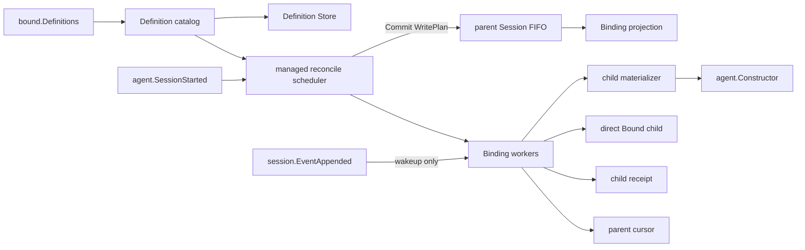

# Bound Subagent

> 状态：Accepted / Implemented。旧的per-parent config路径已删除。

本包拥有每个用户 Session 的 Bound 一致性、Binding worker、direct child create/restore、idle resident epoch、Definition replacement、显式Send、parent interaction delivery与failure containment。Definition 的业务校验和revision也属于Bound能力；SQLite adapter只负责技术持久化。

`SessionStarted`只为用户Session请求reconcile。受管scheduler生成缺失Binding候选，再由`bindingRegistration`在parent Session FIFO队首的原子Snapshot上重新fold并在一个batch建立所有仍缺失Bindings。该路径不调用parent `RunMaintenance`，因此不会与`/compact`竞争Agent activity。Binding Flush后，不同worker可以并行materialize；任何child Session都不能进入reconcile，因此不会递归启动Bound。

Binding保存Definition name、稳定child Session ID和创建时冻结的`ContextNextSeq`。fresh child只复制该prefix，随后安装完整Bound system prompt、Tool restriction和Extensions，在child log保存完整Applied Definition并发布resident epoch。创建过程不提交InitialPrompt、不唤醒Inbox、不调用LLM；child保持idle直到新的parent interaction或显式Send。

每个Binding worker用mailbox串行处理Definition replacement、Send、interaction和resident epoch；不同worker互不阻塞。registry mutex只保护短索引与关闭准入，不覆盖Session、Constructor或Agent I/O。worker跨多个exact resident epoch存在，不能与当前Execution混为一个对象。

`session.EventAppended`只提供轻量wakeup。worker从parent log纯fold direct user与canonical visible assistant message，过滤reasoning和Tool内容。投递先形成child Inbox receipt并Flush，再向parent提交cursor；receipt存在而cursor缺失时只补cursor。disabled保留Binding、cursor与backlog，重新启用并应用latest Definition后catch up。

Plugin关闭时先停止scheduler准入，取消并等待所有reconcile/activation任务，再并行关闭Binding workers并停止resident epochs，最后关闭Definition Store。本包不拥有Web DTO、通用Session EventBus、System Prompt或Tools registry实现，也不创建公开interaction projection event。

完整需求见[Bound需求](../../docs/parent-bound-requirements.zh-CN.md)，主动调用链见[技术设计](../../docs/parent-bound-design.zh-CN.md)，Definition应用见[配置管理](../../docs/bound-config-management.zh-CN.md)，interaction恢复见[投递设计](../../docs/session-event-delivery.zh-CN.md)，完成证据见[08实施进度](../../../zh-CN/08-implementation-progress.md)。
