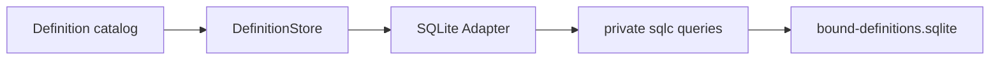

# Bound Definition SQLite Adapter

本包把`internal/bound.DefinitionStore`实现为独立SQLite/sqlc存储。它只保存每个稳定名称的latest完整Definition，不读取或写入Session数据库，也不拥有revision策略、Binding、reconcile或Agent生命周期。

`Open`验证数据库`application_id`、schema version和已存在表的归属，在独占初始化事务中建立schema，再应用明确的journal mode。`Load`在只读事务中取得一致快照并把repository-private sqlc row严格映射为公共`bound.Definition`。`Create`只接受revision 1；`Replace`只执行调用方已经决定的expected-revision CAS，并把零行更新区分为not found或revision conflict。

Definition使用严格JSON BLOB保存；payload中的名称和revision必须与索引列一致。sqlc生成包位于`internal/dbsql`，driver、row和query类型不会越过adapter边界。`Close`幂等释放数据库；上游必须先停止所有catalog、reconcile和worker调用。

全局Definition与运行顺序见[配置管理](../../../docs/bound-config-management.zh-CN.md)和[Bound技术设计](../../../docs/parent-bound-design.zh-CN.md)，完成证据见[08实施进度](../../../../zh-CN/08-implementation-progress.md)。
