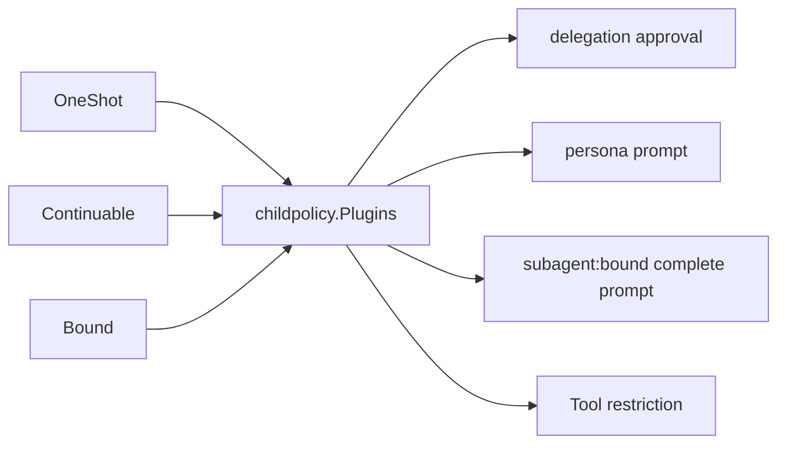

# Child Policy

本包把Subagent的delegation approval、persona、Bound完整system prompt和Tool restriction转换成child-scoped Plugin。OneShot与Continuable使用persona路径；Bound使用自己的complete prompt section。它只拥有这些policy adapter及其确定顺序。

fresh child可以写入delegation approval override；cold resume已从Session重放该durable policy，因此不会再次seed。persona、Bound完整prompt与Tool restriction在每个resident Agent Scope中重新安装。`subagent:bound`使用`Complete=true`，因此不会继承parent或root的模型身份section。

本包不组合Provisioner，不创建Agent，也不拥有Mode生命周期。模式专属provisioning分别位于`internal/oneshot`、`internal/continuable`和`internal/bound`。跨包契约见[Subagent 包说明](../../README.zh-CN.md)，实现证据见[08 实施进度](../../../zh-CN/08-implementation-progress.md)。
