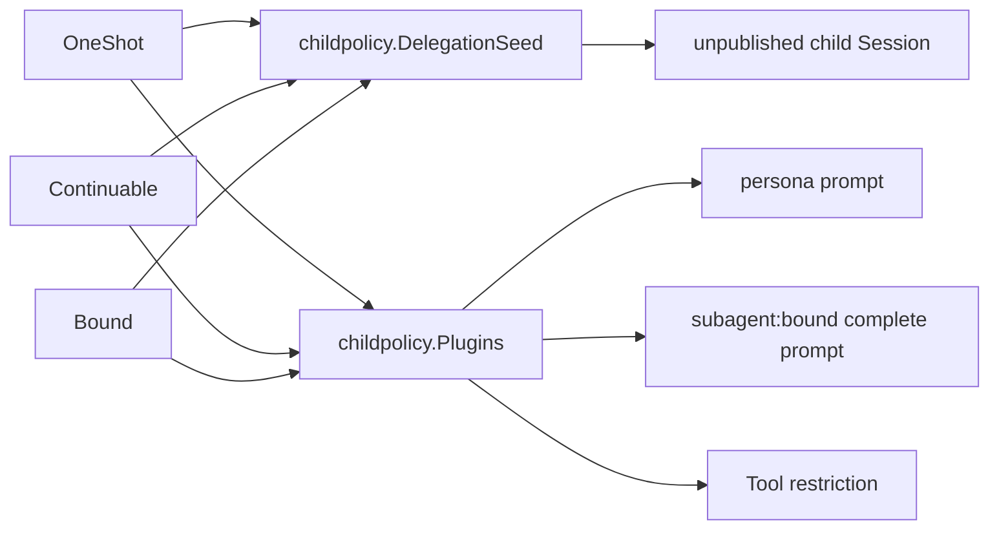

# Child Policy

本包拥有delegated child的共享policy装配边界。delegation approval是fresh child构造期的一次性durable seed；persona、Bound完整system prompt和Tool restriction是resident Agent Scope中的Plugin。OneShot与Continuable使用persona路径；Bound使用自己的complete prompt section。

`DelegationSeed`直接使用构造目标`agent.Scope.Agent()`取得尚未发布的child Session并写入approval override，不通过Plugin服务解析Agent，也不持有resident资源。cold resume已从Session重放该durable policy，因此不会再次seed。persona、Bound完整prompt与Tool restriction在每个resident Agent Scope中重新安装。`subagent:bound`使用`Complete=true`，因此不会继承parent或root的模型身份section。

本包不创建Agent，不决定fresh/resume，也不拥有Mode生命周期。模式owner分别在`internal/oneshot`、`internal/continuable`和`internal/bound`中决定是否组合一次性seed与resident Plugins。跨包契约见[Subagent 包说明](../../README.zh-CN.md)，实现证据见[08 实施进度](../../../zh-CN/08-implementation-progress.md)。
