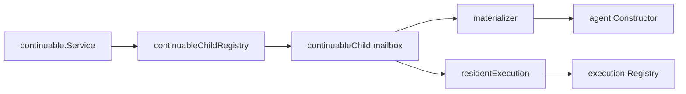

# Continuable

本包实现可冷恢复的 Continuable child。durable identity 是 child Session ID；每次 materialize 得到一个新的 `residentExecution` 和 RunID。

`continuableChildRegistry` 的 map 以 child Session ID 为 key、以该 durable child 的串行 `continuableChild` 为 value。mutex 只保护 membership 和关闭准入，不包围 Agent/Session I/O。每个 child mailbox 串行 Start、Resume、Interrupt 和 shutdown；不同 child 独立执行。

`residentExecution` 是一个 exact Agent 生命周期对应的 Mode 状态机。它直接拥有 `Starting/Active/Stopping/Stopped`、RunID、Terminal、Agent Handle、settlement watcher 和关闭结果，不嵌套共享 execution state，也不回指 `continuableChild`。关闭完成只把自身写入 child 拥有的 channel；child 在自己的 loop 中清除 current 并决定是否退休。

Settlement 只有在 Agent idle、Inbox 无 pending 且没有 runtime descendants 时触发。Continuable 会刷新 child Session、计算本次运行 Terminal、向仍 live 的 exact parent 发送 settlement message、发布 `subagent.Ended`，再移除 live index 和释放 Handle。cold resume 从 durable Descriptor 和 Session log 恢复，不再次调用 SeedBuilder。

创建/恢复组合 delegation、Persona、Tool restriction 和 common Extension Setup，不挂载 child Plugin。普通 resident message 在 exact parent 校验后直接进入 child Agent Inbox；只有 cold child 才走 materialize/resume。

跨包契约见[Subagent 包说明](../../README.zh-CN.md)，公共执行机制见[Execution 说明](../execution/README.zh-CN.md)，实现证据见[08 实施进度](../../../zh-CN/08-implementation-progress.md)。
