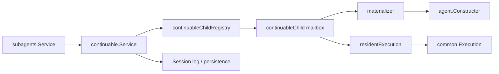

# Continuable

本包是 Continuable Subagent 的生命周期实现。它拥有 fresh create、durable child cold resume、per-child materialization 串行化、当前 turn 中断和 resident epoch settlement。

`Service`只准备Start输入并把Start、cold Resume和Interrupt路由给durable child owner；`materializer`拥有创建、恢复、descriptor校验和scoped provision。`continuableChildRegistry`的唯一mutex只保护child owner成员关系和关闭准入，不包围materialization、Agent调用、等待或终止工作。每个`continuableChild`使用自己的mailbox串行处理同一child的materialization与中断命令，不同child由不同goroutine并行处理；当前Execution结束且没有已接受命令后，child owner从registry精确退休，迟到调用会重新取得owner后重试。

`residentExecution`表示一个exact resident Agent epoch及其common `Execution`，直接拥有settlement观察和terminal transaction，不再通过slot、current wrapper和terminator wrapper互相穿透。Agent仍拥有exact epoch、运行父子关系、Inbox、状态和Scope。普通resident parent消息仍由统一`childExecutionControl`在校验exact parent后直接调用child Agent `Followup`；只有公共查询判断child已经cold时才调用Continuable Resume。cold resume不再次调用SeedBuilder，而是从authoritative descriptor和Session log重建，并在发布新Execution前原子接受首条消息；若查询后的并发变化已经使child resident，Resume仍在child mailbox中把消息交给该exact Agent。Settlement继续要求Agent idle、Inbox无pending且没有runtime descendants；descendant结束会唤醒parent resident execution重新检查。

本包不实现 child-to-parent report。report Tool 根据当前 child Agent 的 Session parent identity 查找 exact live parent，再直接使用 parent Agent 的 Inbox 能力；OneShot 与 Continuable 共用该路径。

关闭准入只由统一`subagents.Service`负责；Continuable `Close`关闭child registry准入，并行向各child mailbox请求停止当前Execution，仍只等待每个exact Agent进入Closing，不等待Agent Scope teardown。创建与恢复由`materializer`组合Mode-owned Provisioner：fresh安装delegation policy，fresh/cold都组合Persona、Tool restriction和common Extensions。跨包契约见[Subagent包说明](../../README.zh-CN.md)，实现证据见[08实施进度](../../../zh-CN/08-implementation-progress.md)。
