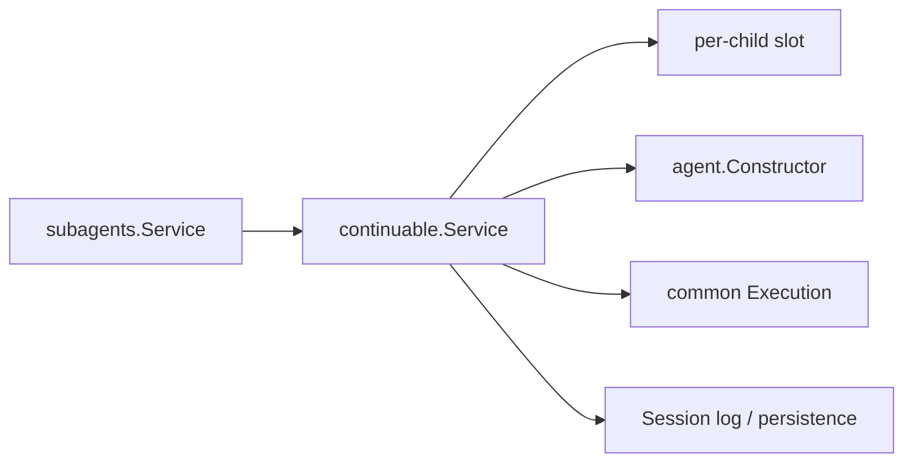

# Continuable

本包是 Continuable Subagent 的生命周期实现。它拥有 fresh create、durable child cold resume、per-child materialization 串行化、当前 turn 中断和 resident epoch settlement。

`childSlot` 只串行化同一 durable child 的 materialization；它不是第二套 Agent registry。每次 resident epoch 都使用 common `Execution`，Agent 仍拥有 exact epoch、运行父子关系、Inbox、状态和 Scope。resident 消息由统一 Service 直接调用 child `agent.Agent`；cold resume 不再次调用 SeedBuilder，而是从 authoritative descriptor 和 Session log 重建，并在发布新 Execution 前原子接受首条消息。并发恢复若先观察到已经 resident 的 exact child，也仍通过该 child Agent 的 `Followup` 收口。

本包不实现 child-to-parent report。report Tool 根据当前 child Agent 的 Session parent identity 查找 exact live parent，再直接使用 parent Agent 的 Inbox 能力；OneShot 与 Continuable 共用该路径。

关闭准入只由统一`subagents.Service`负责；Continuable `Close`只停止当前Executions，不维护第二套模块准入状态。创建与恢复由本包直接组合Mode-owned Provisioner：fresh安装delegation policy，fresh/cold都组合Persona、Tool restriction和common Extensions。跨包契约见[Subagent包说明](../../README.zh-CN.md)，实现证据见[08实施进度](../../../zh-CN/08-implementation-progress.md)。
