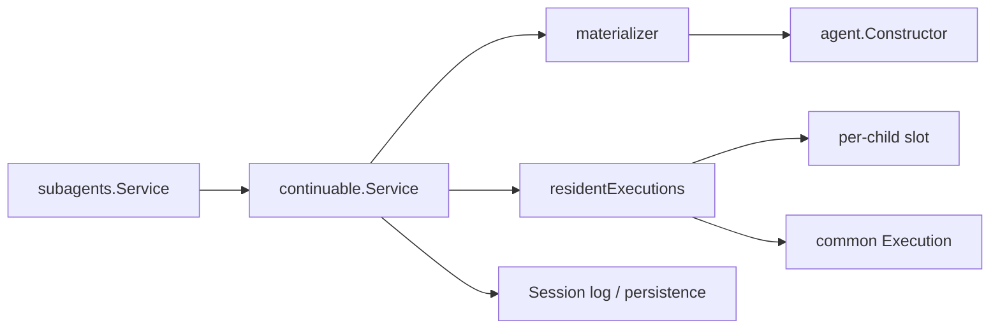

# Continuable

本包是 Continuable Subagent 的生命周期实现。它拥有 fresh create、durable child cold resume、per-child materialization 串行化、当前 turn 中断和 resident epoch settlement。

`Service`只编排Start、Resume和Interrupt用例；`materializer`拥有创建、恢复、descriptor校验和scoped provision；`residentExecutions`拥有per-child slot索引、Execution发布、settlement观察、interrupt与close。`childSlot`只串行化同一durable child的materialization；它不是第二套Agent registry。每次resident epoch都使用common `Execution`，Agent仍拥有exact epoch、运行父子关系、Inbox、状态和Scope。resident消息由统一Service直接调用child `agent.Agent`；cold resume不再次调用SeedBuilder，而是从authoritative descriptor和Session log重建，并在发布新Execution前原子接受首条消息。并发恢复若先观察到已经resident的exact child，也仍通过该child Agent的`Followup`收口。

本包不实现 child-to-parent report。report Tool 根据当前 child Agent 的 Session parent identity 查找 exact live parent，再直接使用 parent Agent 的 Inbox 能力；OneShot 与 Continuable 共用该路径。

关闭准入只由统一`subagents.Service`负责；Continuable `Close`委托`residentExecutions`停止当前Executions，不维护第二套模块准入状态。创建与恢复由`materializer`组合Mode-owned Provisioner：fresh安装delegation policy，fresh/cold都组合Persona、Tool restriction和common Extensions。跨包契约见[Subagent包说明](../../README.zh-CN.md)，实现证据见[08实施进度](../../../zh-CN/08-implementation-progress.md)。
