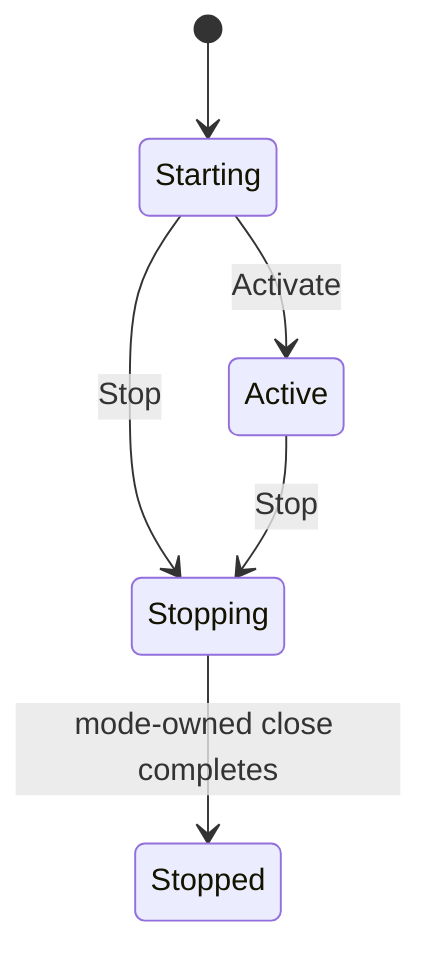
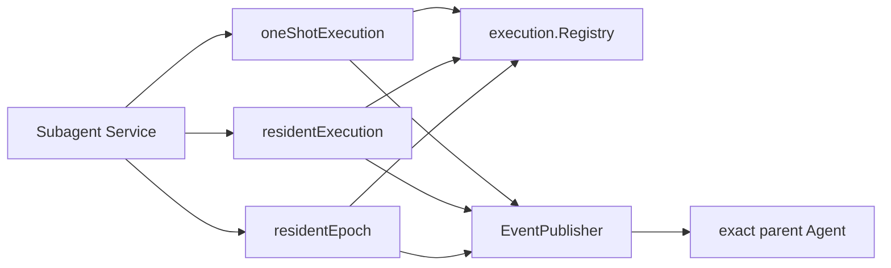

# Subagent Execution 公共机制

本包只保存 OneShot、Continuable 与 Bound 可以安全共享的无状态机制：Run ID/child Session ID 生成、live execution 索引、发布流程、事件发布端口、`Terminal` 复制和 assistant 输出选择。它不拥有任何 Mode 的状态机或终止事务。

跨包契约见[Subagent 包说明](../../README.zh-CN.md)，术语见[Subagent 术语](../../docs/terminology.zh-CN.md)，实施证据见[08 实施进度](../../../zh-CN/08-implementation-progress.md)。

## Mode 独立状态机

三个 Mode 都实现公共 `subagent.Execution`，但状态和关闭逻辑分别由 concrete owner 持有：

- OneShot：`oneshot.oneShotExecution`；
- Continuable：`continuable.residentExecution`；
- Bound：`bound.residentEpoch`。

每个对象自己保存 `RunID`、child Session ID、`ExecutionState`、完成信号、`Terminal` 和终止 error，并自己实现 `Activate`、`Stop`、`Wait`、`Result` 与 `Dispose`。不存在共享 `Execution` struct、`Terminator` callback 或 `Execution -> Terminator -> Execution` 循环。

三个 Mode 共享 `Starting/Active/Stopping/Stopped` 词汇，但不共享状态 owner：



状态含义：

- `Starting`：对象已构造，尚未发布到 live index；
- `Active`：已经发布，可以被公共控制入口查找；
- `Stopping`：第一次 `CloseCause` 已取得唯一关闭权；
- `Stopped`：Mode 已保存稳定 `Terminal` 和关闭 error。

## `ManagedExecution`

`ManagedExecution` 是 live index 消费的最小内部接口。它在公共 `subagent.Execution` 上增加 `Activate`、`Stop` 和 `StopAndWait`，用于统一发布、控制路由和模块关闭。接口只描述能力，不保存状态，也不把 Mode-specific 关闭行为提升为共享 owner。

## `Registry` map

`Registry.entries` 的 key 是 child Session ID，value 是该 child 当前已发布运行的 `Entry`。同一 child Session ID 同时最多有一个 live execution。

`Entry` 中各字段含义：

- `Execution`：当前 Mode concrete execution；
- `Mode`：供公共 Service 选择 OneShot、Continuable 或 Bound 控制入口；
- `Parent`：创建本次运行的 exact parent Agent；
- `Subject`：本次运行使用的 exact child Agent；
- `Closing`：child Agent 开始结构关闭时关闭的只读 channel。

`Publish` 检查 `Execution.ChildID() == Subject.ID()`，并只接受 `Active` execution。`Remove` 同时比较 child Session ID 和 execution identity，旧运行结束较晚时不会删除同 ID 的新运行。`List` 返回 detached snapshot，不承诺 map 顺序。

Registry 不是 durable child directory。进程重启后不会恢复这些 entries；持久 child 查询由 `internal/childdirectory` 拥有。

## 发布与组件事件

```text
Mode constructs complete execution
  -> Activate
  -> Registry.Publish
  -> EventPublisher.PublishStarted(exact parent, Started)
```

`EventPublisher` 把 `subagent.Started` / `subagent.Ended` 交给 exact parent Agent 的组件事件分发器。它不写 Session log，也不依赖 Plugin。唯一 Subagent Plugin 的 `eventGateway` 实现该端口，再由 Plugin driver 接到 Agent 的 `EventDispatcher`。

`subagent.Ended` 同时是 `agent.AgentClosingEvent`：parent 已进入 closing 后，该配对结束事实仍可在 exact Scope 关闭前发布。它仍是进程内组件事件，不是 Session event。

## `CloseCause` 与 `StopReason`

`CloseCause` 是 Mode 内部取得关闭权的原因：正常完成、Continuable idle settlement、interrupt、调用方 Dispose、模块关闭或 Agent 已开始结构关闭。各常量在 `close_cause.go` 中逐项注释。

`StopReason` 是调用方可见的最终分类，例如 `completed`、`aborted`、`error`、`max-tokens` 或 `refusal`。内部原因和最终分类用途不同，不能互换。

## 最终 assistant 输出

`SelectAssistantOutput(events)` 是纯函数：

1. 顺序解析本次运行片段中的 `assistant/message` 与 `assistant/chunk`；
2. 优先返回最后一个非空完整 assistant message；
3. 没有完整消息时拼接 text delta；
4. reasoning、Tool result 和其他事件不作为退化输出；
5. JSON、位置或内容类型无效时返回 error。

OneShot 和 Continuable 各自选择运行边界；本包不推断 Session slice，也不读取或写入 Session。

`CloneTerminal` 会复制 Output、Structured 和 Diagnostic，防止调用方修改后续读取者看到的结果。

## ownership DAG



Continuable resident 不回指 `continuableChild`；它只把完成值写入 child 拥有的 channel。Bound resident 不回指 `boundChild`。架构测试锁定 Mode 独立状态机、禁止共享 lifecycle owner，并禁止 resident-to-child owner back-reference。
