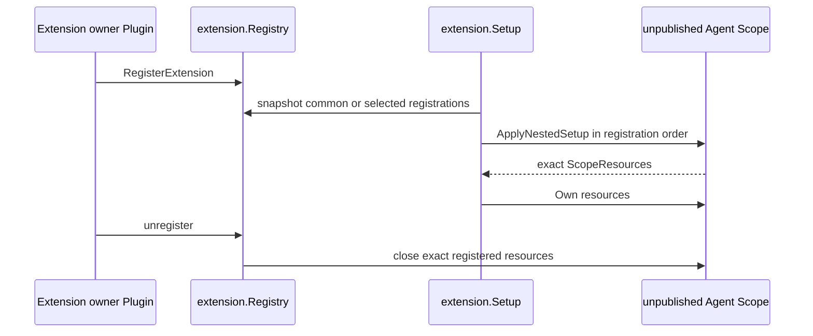

# Child Extension Registry

本包拥有 child `Extension` 的有序 registration，以及把 common 或 selected Extension 组合成普通 `agent.Setup` 的能力。它不参与 Plugin lifecycle，不创建 Agent，也不拥有 Subagent execution。

无名 registration 进入 common 集合；带 name 的 registration 只在 Bound Definition 显式选择时安装。`Registry.registrations` 保存有序 registration；每条 registration 自己保存当前 exact Agent Scope 的 `ScopeResources`，卸载时精确关闭，不修改 Plugin Runtime topology。

Setup 失败会逆序关闭本次已取得的 resources。registration removal 先标记 removed，再关闭其所有 live resources；与它并发但尚未完成的 Setup 会在 `ScopeCheck` 阶段失败并回滚。因此 Extension 删除和 Agent publication 不需要第二套 `Provisioner/Provisioning` 事务。

Extension 是 child-local contribution，不是 Plugin。Plugin 只在模块级注册/撤销 Extension；Agent Scope 才拥有每个 exact child 的 Tool、Prompt、Policy 或其他资源。

跨包契约见[Subagent 包说明](../../README.zh-CN.md)，术语见[Subagent 术语](../../docs/terminology.zh-CN.md)，实现证据见[08 实施进度](../../../zh-CN/08-implementation-progress.md)。
