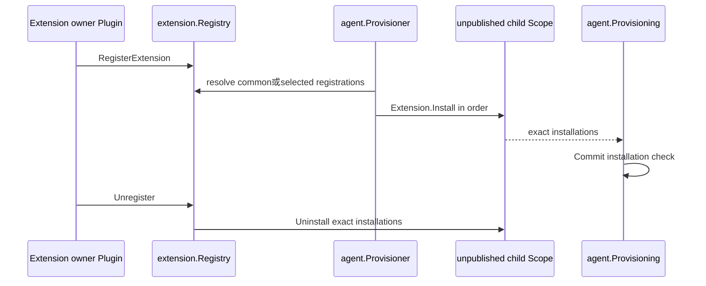

# Child Extension Registry

本包拥有`Extension`的有序registration，以及每个unpublished child Agent Scope的installation、publication commit复核和release。OneShot、Continuable与Bound共享同一Registry；common和selected是registration选择方式，不是新的生命周期Mode。

`Registry`同时实现公开`ExtensionRegistry`与只读`ExtensionDirectory`。前者只提供registration seam；后者只返回当前named registrations的detached descriptor，不包含common Extension，也不暴露安装对象。Registry不决定Extension内容，不参与Plugin lifecycle，也不创建或恢复Agent。

Extension 与当前 exact Agent epoch 一一安装，但不再称为 Activation Extension。Go 使用 `Extension` 表达 child-scoped contribution，使用 `Provisioner`/`Provisioning` 表达 Agent publication transaction。

无名registration进入common集合；`WithExtensionName`注册项只在Bound config按name选择时安装。Install失败会在返回前反序释放本次取得的partial installations。registration removal先标记removed，使尚未Commit的Provisioning失败，再释放该registration的resident installations。Registry不通知Bound，也不决定Agent epoch；当前Plugin shutdown先关闭所有child，再Clear Registry。

跨包契约见[领域设计](../../docs/design.zh-CN.md)，实现证据见[08 实施进度](../../../zh-CN/08-implementation-progress.md)。
