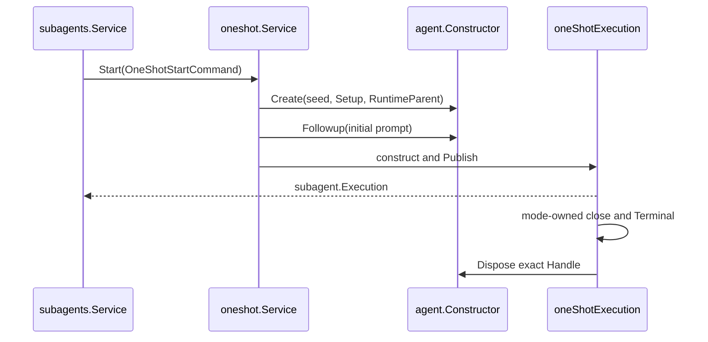

# OneShot

本包实现 OneShot Subagent。`Service` 构造 fresh child seed，通过 `agent.Constructor` 创建一个 exact Agent，原子接受初始消息并发布 `oneShotExecution`；该 execution 自己拥有状态、Terminal、结构化结果读取和 exact Handle 关闭。

`setup.go` 组合 Descriptor、Structured Output、delegation、Persona、Tool restriction 和 common Extensions。它们都是普通 Agent Setup/middleware，不构造 child Plugin。

`oneShotExecution` 使用 `Starting → Active → Stopping → Stopped`，并自己保存第一次关闭事务的结果。正常 idle 读取本次运行 Session event slice；interrupt、Dispose、模块关闭或 external Agent close 映射为对应 `CloseCause`。结束时发布组件事件 `subagent.Ended`、移除 live execution index，并在 Agent Registry 尚未接管结构关闭时释放 Handle。

本包不拥有 SeedBuilder registration、Continuable cold resume、后续消息、Plugin Runtime 或共享 execution state owner。

跨包契约见[Subagent 包说明](../../README.zh-CN.md)，公共执行机制见[Execution 说明](../execution/README.zh-CN.md)，实现证据见[08 实施进度](../../../zh-CN/08-implementation-progress.md)。
