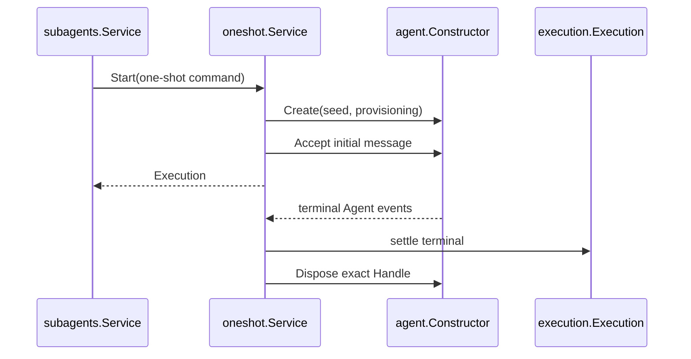

# OneShot

本包是 OneShot Subagent 的具体实现。`Service` 实现统一 Service 私有的 mode implementation 契约：构造 fresh child seed，创建 Agent，接受初始消息，发布 common `Execution`，选择 terminal output，并在 terminal 后自动释放 exact Agent Handle。

本包不拥有SeedBuilder registration、Continuable cold resume、后续消息或Plugin publication。它直接组合Mode-owned Provisioner：descriptor appender、结构化输出、delegation、Persona、Tool restriction和common Extensions。跨包契约见[Subagent包说明](../../README.zh-CN.md)，实现证据见[08实施进度](../../../zh-CN/08-implementation-progress.md)。
