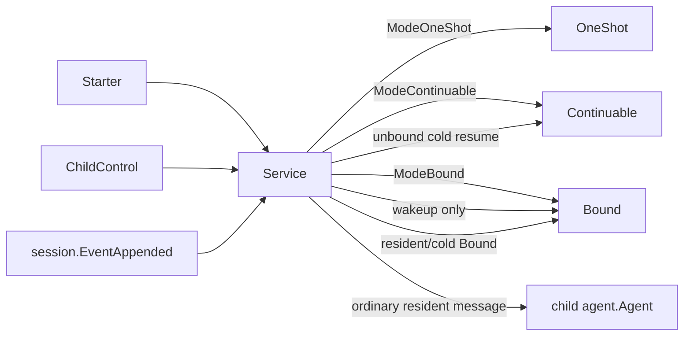

# Subagents Service

本包拥有统一的Subagent应用服务。`StartCommand`是封闭接口，`Service`只按具体`OneShotStartCommand`或`ContinuableStartCommand` variant分派显式启动。Bound不接受一次性StartCommand；它由全局Definition和用户Session reconcile启动，并通过同一个Service发布Definition管理与child控制能力。

Service拥有模块级准入状态、已准入调用计数和实现的逆序关闭。`childExecutionControl`单独拥有live Execution lookup、Send/Interrupt授权和Agent-disposed路由，避免`Service.Send`承载Mode业务。`Open`接收`Mode -> implementation`集合并验证三个Mode的完整接口。

本包只完成closed command dispatch、公共准入和能力转发；Definition、Binding、create/restore和epoch replacement均由Bound owner实现。

Plugin观察到现有`session.EventAppended`后调用`Service.SessionEventAppended`。Service只在admission-open期间把fact转给Bound的窄observer接口，不读取Session或解释event payload；Bound内部只对`turn/end`路由worker。`agent.Disposed`先让Bound同步停止exact parent workers，再完成公共Execution settlement。

ordinary resident child在校验exact parent后直接调用`Entry.Subject.Followup`。resident/cold Bound交给Bound，以便Definition revision和message admission串行；没有binding的cold child交给Continuable恢复。Service不拥有Mode-specific创建、恢复、terminal或child report规则。

`Close` 先从 accepting 转为 closing，等待已经取得准入的调用返回，再调用实现的 `Close`；重复关闭 join 同一结果。跨包契约见[Subagent 包说明](../../README.zh-CN.md)，实现证据见[08 实施进度](../../../zh-CN/08-implementation-progress.md)。
