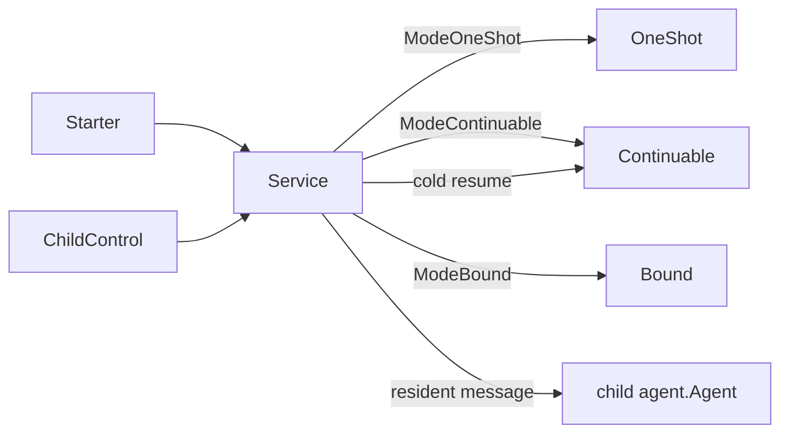

# Subagents Service

本包拥有统一的 Subagent 应用服务。`StartCommand` 是封闭接口，`Service` 按具体 `OneShotStartCommand`、`ContinuableStartCommand` 或 `BoundStartCommand` variant 分派。三个命令只保存各自模式输入，不共享一个大而全的可选字段结构。

Service 拥有模块级准入状态、已准入调用计数、公共 live Execution lookup、parent/ancestor authorization，以及实现的逆序关闭。`Open` 接收 `Mode -> implementation` 集合，并按 Mode 验证 `oneShot`、`continuable`、`bound` 完整接口；重复、未知或不完整 Mode 都拒绝打开。Continuable 的 `Start` 与 cold `Resume` 在同一个 `continuable` 接口中，不拆成额外 `starter` 或 `continuation` 接口。

Bound command 只含 exact live parent 和 binding 已确定的 child Session ID。`bound.Service.Start` 当前返回明确 TODO 错误；本包只验证并完成分派，不读取或猜测 Bound config。

resident OneShot 与 Continuable 都是普通 child Agent，`Send` 校验 exact parent 后直接调用 `Entry.Subject.Followup`，不读取或解释 Execution 状态，也不等待 `Stopping`；Agent 如何接受、排队或拒绝消息由 Agent 自己决定，Service 只返回投递错误。找不到 resident Execution 时，Service 才把 durable materialization 交给注册的 Continuable 实现；OneShot 不提供 cold resume。Service 不拥有 mode-specific 创建、恢复事务或 terminal 规则，也不承担 child-to-parent report。

`Close` 先从 accepting 转为 closing，等待已经取得准入的调用返回，再调用实现的 `Close`；重复关闭 join 同一结果。跨包契约见[技术方案](../../../zh-CN/Subagent架构与生命周期重构技术方案.md)，实现证据见[进度矩阵](../../../zh-CN/Subagent重构进度矩阵.md)。
