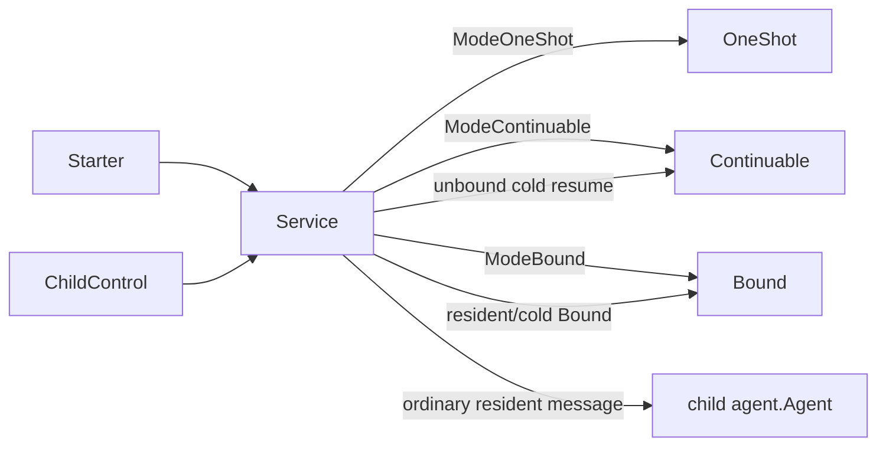

# Subagents Service

本包拥有统一的 Subagent 应用服务。`StartCommand` 是封闭接口，`Service` 按具体 `OneShotStartCommand`、`ContinuableStartCommand` 或 `BoundStartCommand` variant 分派。三个命令只保存各自模式输入，不共享一个大而全的可选字段结构。

Service拥有模块级准入状态、已准入调用计数和实现的逆序关闭。`childExecutionControl`单独拥有live Execution lookup、Send/Interrupt授权和Agent-disposed路由，避免`Service.Send`承载Mode业务。`Open`接收`Mode -> implementation`集合并验证三个Mode的完整接口。

Bound command只含exact live parent和binding已确定的child Session ID。本包只完成closed command dispatch；binding/config、create/restore和epoch replacement均由Bound owner实现。

ordinary resident child在校验exact parent后直接调用`Entry.Subject.Followup`。resident/cold Bound交给Bound，以便config和message admission串行；没有binding的cold child交给Continuable恢复。Service不拥有Mode-specific创建、恢复、terminal或child report规则。

`Close` 先从 accepting 转为 closing，等待已经取得准入的调用返回，再调用实现的 `Close`；重复关闭 join 同一结果。跨包契约见[Subagent 包说明](../../README.zh-CN.md)，实现证据见[08 实施进度](../../../zh-CN/08-implementation-progress.md)。
