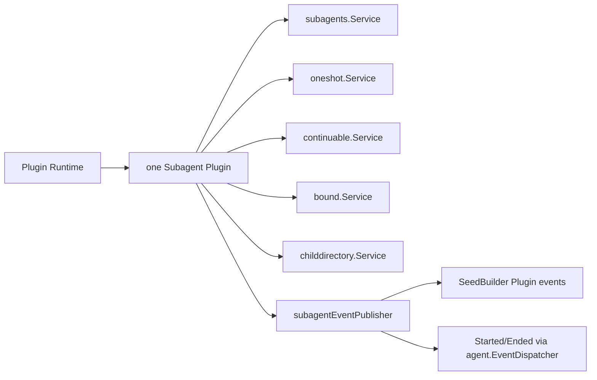

# Subagent Plugin adapter

本包只实现 Subagent 核心的唯一全局 Plugin。OneShot、Continuable、Bound、child Extension 和 execution 都是 ordinary business objects，不是 Plugin。

`Apply` 解析 Agent、Session、Projection、Approval、Persistence、Prompt/Tool Setup 等模块级依赖，打开独立 Bound Definition Store，注册 Projection，启用 ChildDirectory，构造三个 Mode Service，并在返回前开放统一 Service 准入与事件发布。任一步失败按已取得资源逆序回滚。

`subagentEventPublisher` 是 Plugin-neutral 的稳定业务端口，同时实现 SeedBuilder 注册事件与 Subagent Execution 生命周期事件所需的 `EventPublisher`。`SeedBuilderAdded/SeedBuilderRemoved` 进入 Plugin Runtime 事件链；`Started/Ended` 通过 `agent.EventDispatcher` 进入 exact parent Agent Scope。`plugin_event_publisher_worker.go` 是唯一 Plugin 消费者，负责把 typed publication request 送到这两个明确边界。Mode 不持有 Plugin；Plugin 也不为每个 Agent 或 Subagent 构造 child Plugin。

稳定 publisher 可跨同一 Plugin 对象的多次 `Apply → Dispose → Apply` 使用；每次 `Apply` 只创建一个 `eventPublisherRun`，它只保存本次发布 worker 的 stop/done 信号。`Dispose` 先关闭统一 Service 准入和三个 Mode execution，使配对 `Ended` 仍可发布；随后释放 ChildDirectory、Extension registrations、SeedBuilder 和 Projection，最后停止并等待本次 publication worker。`Apply` 未启动 publisher 就失败时，回滚不会等待不存在的 worker。该设计支持依赖替换后的同实例再激活，同时不在 Plugin callback 中修改 Runtime topology。

Bound Definition Store 只在 Bound Service 成功接管后转移关闭责任。Plugin 不解释 Descriptor、Definition revision、Terminal 或 parent-child 业务规则。

跨包契约见[Subagent 包说明](../README.zh-CN.md)，术语见[Subagent 术语](../docs/terminology.zh-CN.md)，实现证据见[08 实施进度](../../zh-CN/08-implementation-progress.md)。
