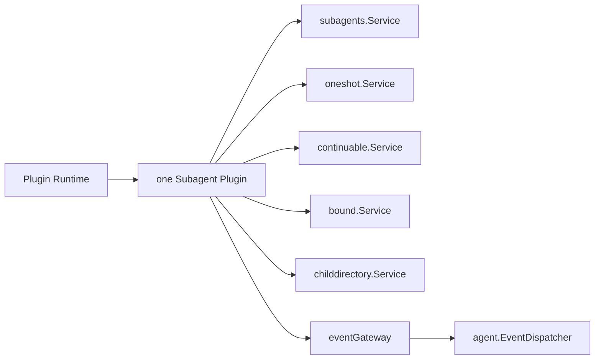

# Subagent Plugin adapter

本包只实现 Subagent 核心的唯一全局 Plugin。OneShot、Continuable、Bound、child Extension 和 execution 都是 ordinary business objects，不是 Plugin。

`Apply` 解析 Agent、Session、Projection、Approval、Persistence、Prompt/Tool Setup 等模块级依赖，打开独立 Bound Definition Store，注册 Projection，启用 ChildDirectory，构造三个 Mode Service，最后开放统一 Service 准入。任一步失败按已取得资源逆序回滚。

`eventGateway` 是 Plugin-neutral typed queue，实现各 Mode 消费的 `EventPublisher`。`plugin_event_driver.go` 由唯一 Plugin 驱动 queue，并调用 `agent.EventDispatcher` 把 `Started/Ended` 发布到 exact parent Scope。Mode 不持有 Plugin；Plugin 也不为每个 Agent 或 Subagent 构造 child Plugin。

`Dispose` 先关闭统一 Service 准入和三个 Mode execution。此时 `Ended` 仍可通过 gateway 发布；待业务 execution 收敛后才停止 gateway，再释放 ChildDirectory、Extension registrations、SeedBuilder 和 Projection。该顺序保证 parent closing 阶段仍能收到 child 的配对 `Ended`，且不在 Plugin callback 中修改 Runtime topology。

Bound Definition Store 只在 Bound Service 成功接管后转移关闭责任。Plugin 不解释 Descriptor、Definition revision、Terminal 或 parent-child 业务规则。

跨包契约见[Subagent 包说明](../README.zh-CN.md)，术语见[Subagent 术语](../docs/terminology.zh-CN.md)，实现证据见[08 实施进度](../../zh-CN/08-implementation-progress.md)。
