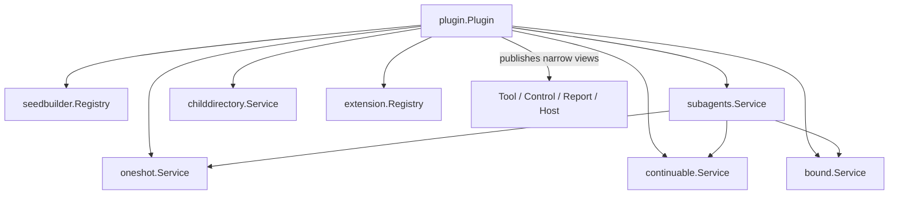

# Subagent Plugin

`plugin.Plugin`是Subagent领域的composition owner。它解析Agent、Session、Approval和Projection能力，打开私有Bound Definition数据库，构造普通Go业务对象，并发布`SeedBuilderRegistry`、`Starter`、`ChildControl`、`ExtensionRegistry`、`ChildDirectory`和`bound.Definitions`。本包不拥有Subagent用例、Definition决策或Plugin Runtime。

Apply依次解析依赖、打开独立的`bound-definitions.sqlite` adapter、注册Projection、启用ChildDirectory、构造OneShot/Continuable/Bound三个Mode Service，并打开统一Service准入。Definition Store的关闭责任只在Bound Service成功接管后转移；任一步失败都会按已取得资源的逆序回滚。各Mode自己组合child-local Provisioner；Plugin只注入approval、common Extension Provisioner和`boundExtensions`窄adapter，不解释descriptor或Definition。

Plugin同时观察`agent.SessionStarted`、`agent.Disposed`与现有`session.EventAppended`：第一个为direct用户Session请求Definition-to-Binding reconcile，不能否决parent publication；第二个同步停止exact parent workers并完成Execution settlement；第三个只把committed `turn/end`作为无I/O wakeup转给Bound。Plugin不读取parent log、不调用child Followup、不推进cursor。完整业务调用链只在[Bound技术设计](../docs/parent-bound-design.zh-CN.md)和[Parent Interaction投递设计](../docs/session-event-delivery.zh-CN.md)维护。

Dispose先`service.Close`；Bound在内部依次停止reconcile scheduler、并行关闭Binding workers和resident Executions、关闭Definition Store，随后Plugin停用ChildDirectory、`extensions.Clear`、清理SeedBuilder并释放Projection handle。跨包契约见[Subagent包说明](../README.zh-CN.md)，实现证据见[08实施进度](../../zh-CN/08-implementation-progress.md)。
