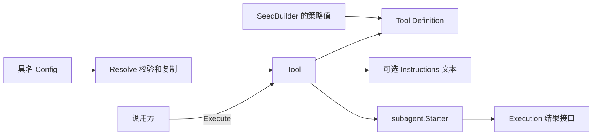

# Subagent Delegation Tool

本包把配置指定的 SeedBuilder 映射为可供模型调用的委派工具。`Tool` 是纯业务对象，只持有已复制的 Settings 和 `subagent.Starter`；已经删除 Plugin、Factory、Prompt 注册句柄和事件监听。目标契约见[模块设计](../../../zh-CN/actor-design/19-delegation-config.md)，[历史实施进度](../../../zh-CN/08-implementation-progress.md)不代表本轮 Actor 完成度。

## 模块内职责与主要对象

| 文件 | 对象或接口 | 职责 |
| --- | --- | --- |
| [config.go](config.go) | Config、Settings、DepthLimit | 严格 JSON 解码、默认值、校验、配置映射和可变输入复制 |
| [tool.go](tool.go) | Tool | 根据上下文策略生成独立定义、提供可选提示文本、执行委派及渲染结果 |
| [tool_test.go](tool_test.go) | 工具行为测试 | 前台/后台路由、构造约束、提示文本和定义隔离 |
| [config_test.go](config_test.go)、[config_decode_test.go](config_decode_test.go) | 配置行为测试 | 联合数值、显式空过滤列表及严格解码 |

`New(Settings, Starter)` 返回已校验的 Tool，不需要额外激活。`Definition(ParentContextPolicy)` 返回工具定义和 error；只消费 SeedBuilder 的策略值，不接收整个 Builder。非法策略明确拒绝，返回的参数和输出 schema 字节独立。

`Instructions()` 返回可选固定文本：启用 continuable 后台模式时建议默认后台委派，其他情况为空。Tool 不向 Prompt 注册；后续发布路径负责将说明交给 Prompt 消费，保持既有 `tool:<toolName>` 和 order=116.5 的呈现要求。

## 依赖关系

Tool 不拥有工具目录、Prompt 状态或 SeedBuilder 生命周期。Builder 的可用性、定义发布及撤销应进入 Tool Runtime/Registry 的更新批次，不能在工具内恢复注册监听器。业务实现也不直接持有 Actor、Grain 或地址表。

## 执行交互

前台 OneShot 先调用 Starter.Start，再等待 Execution.Wait，成功后用 Execution.Result 读取保存结果。OneShot 的终态资源释放由其实现负责，Tool 不执行第二次 Dispose。

Continuable 后台调用在初始消息被接受后返回 durable child ID。当前不包含 Jobs，因此显式后台 OneShot 返回错误，不静默切换模式。取消、子 Agent 生命周期及业务关闭仍由 Starter/Execution 实现负责；Tool 不建立额外队列或运行状态。

当前 Execute 仍通过进程内 Agent 与 Starter 接口调用。它尚未改成 Actor 异步请求，不能由本包测试推断父子 Actor 的关闭顺序已经完成。

## 配置与验证边界

DecodeConfig 严格解码单个 JSON 对象并返回 Settings；保留 canonical `provider`、`provider-managed`、默认后台策略及显式空 allow/deny 的语义。它拒绝未知字段、重复字段、非对象、多个 JSON 值，以及无损 JSON 规则禁止的负零或不可表示数字。Config.Resolve 不创建工具或子 Agent；New 再次校验以覆盖直接 Go 构造。

测试覆盖原前台/后台路由、构造失败、配置复制、上下文策略描述、定义字节隔离和严格解码。生产 Registry 发布、Prompt 指令消费与 Agent Actor 装配仍待接入，旧组合目录条目已删除，没有过渡 Plugin 适配。

工具定义的执行与呈现由具名工具对象直接实现，不再使用 tools 的函数适配器。此项清理保留现有参数、结果和错误语义；不代表所属模块的 Actor 生命周期已全部迁移。
