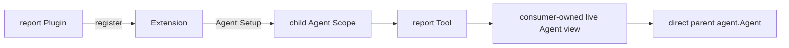

# Subagent Report

本包注册一个 child Extension。Extension 在 unpublished OneShot 或 Continuable child Scope 中安装 child-local `report` Tool 与提示词；Tool 根据当前 exact child Agent 的 Session parent identity 查找 exact live parent，并直接使用 parent Agent 的 Inbox 能力投递自包含内容。

`quiet` 调用 parent Agent 的 `Inject`；`next-step` 调用 `Steer`。report 不结束 child turn，也不向祖先广播。host Plugin 只拥有模块级 Extension registration；`extension.go` 实现普通 `agent.Setup`，通过 `ScopeEditor` 注册 Tool 和 Prompt section，返回的资源由 exact child Scope 持有。`reportTool` 只负责 schema、parent identity 校验和 Agent Inbox 调用，不参加 Plugin 生命周期，也不 mount child Plugin。

跨包契约见[Subagent 包说明](../../README.zh-CN.md)，实现证据见[08 实施进度](../../../zh-CN/08-implementation-progress.md)。
