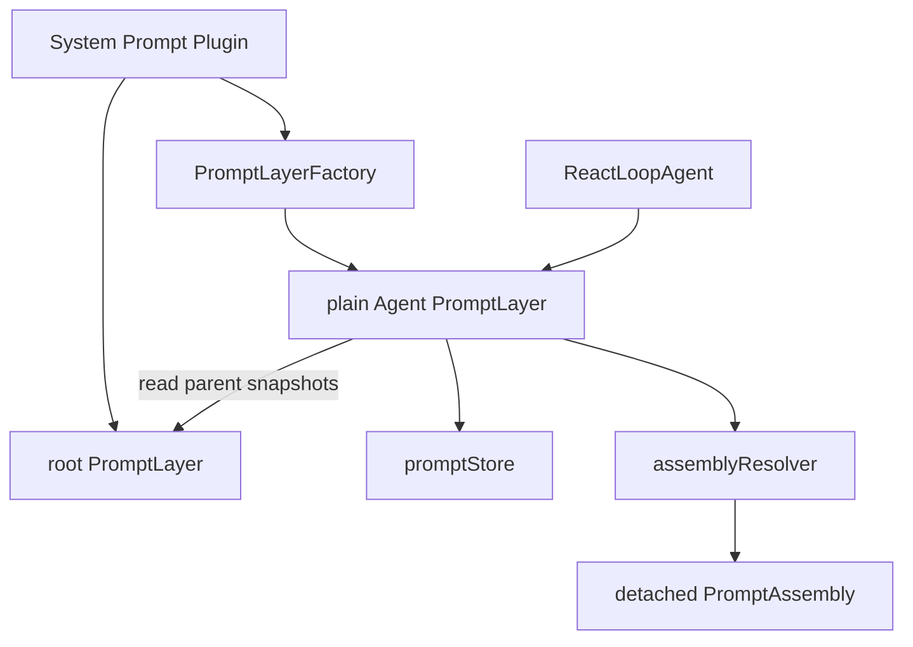

# System Prompt

`systemprompt` 是 Prompt section、runtime context、变量、Tool schema 和 assembly 的 owner。稳定契约见[11 System Prompt Registry 与 Assembly](../zh-CN/11-system-prompt-registry-and-assembly.md)，完成证据见[08 实施进度](../zh-CN/08-implementation-progress.md)。

## Plugin adapter 与业务 Layer

`PromptLayer` 是普通业务对象，拥有一个 prompt layer 的 entry、assembly middleware 和 parent view。`PromptLayerFactory.NewLayer` 为 exact Agent 创建 child layer；child 只单向引用 root `layerSource` 和全局 effect port，不持有或实现 Plugin。

根 `Registry` 是模块 Plugin adapter：它嵌入 root `PromptLayer`，发布 `Assembler`、`PromptRegistry` 和 `PromptLayerFactory`，并把 `system-prompt/assemble` Waterfall 与 `system-prompt/change` Event 接到 Plugin Runtime。

`NewOverlay` 仍供确有独立模块 Plugin 生命周期的静态组合使用；Agent-local Prompt、Persona、变量和 suppressor 必须通过普通 `PromptLayer`/`agent.Setup` 安装，不创建 per-Agent overlay Plugin。

## 注册与 assembly

`PromptLayer` 提供 section、context、variable、Tool provider、runtime-context suppressor 和 assembly middleware 的精确 Handle。Handle 绑定 entry identity；旧 Handle 不能删除后来注册的同名 entry。Layer close 会逆序/幂等释放自己的资源，不影响 parent 或 sibling。

每次 assembly 固定 root-to-current layer snapshot，在锁外求值 provider，并依次完成 variable、section、context、Tool schema、middleware 和最终严格插值。失败返回整体错误，不返回半成品。`AssembleContext` 不包含 Plugin Context、Scope 或存储对象。

Store 只拥有 entry membership 和不可变快照，不缓存一次 assembly 的业务结果。Tools、Agent Loop、LLM、Session 和模板脚本不属于本包。
