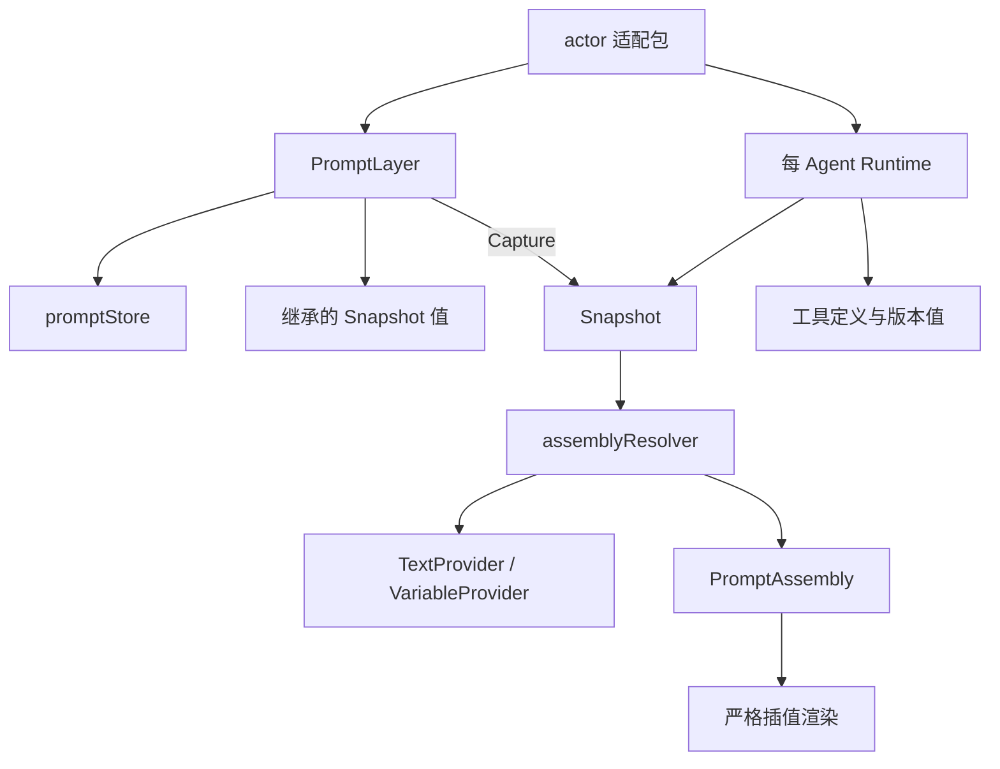
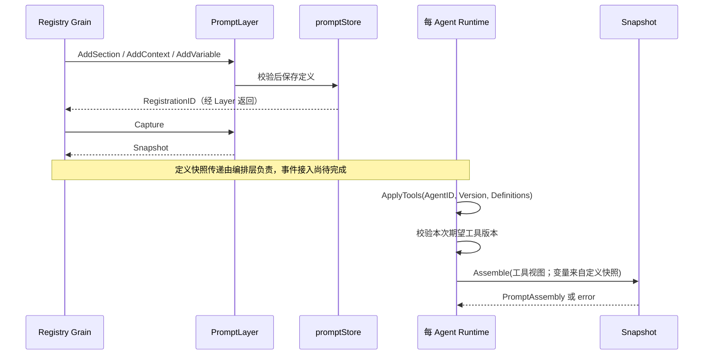

# System Prompt

`systemprompt` 负责 Prompt 定义、定义快照和组装算法，以及每个 Agent 的工具定义消费视图。框架调度由 [actor 适配包](actor/README.zh-CN.md) 负责。目标契约与实施状态以 [Prompt 模块设计](../zh-CN/actor-design/17-prompt-module.md) 为准；[历史实施进度](../zh-CN/08-implementation-progress.md) 不代表 Actor 重构完成度。

## 模块内职责划分

本包按配置、注册状态、每 Agent 状态、组装和渲染划分职责，保持在同一业务包内，不为每个对象建立子目录。

| 职责 | 实现文件 | 输入、输出与边界 |
| --- | --- | --- |
| 配置与公开契约 | [config.go](config.go)、[types.go](types.go) | 严格解码、校验和复制配置；定义具名输入、输出及提供者接口，不负责创建 Actor |
| 局部定义注册 | [layer.go](layer.go)、[layer_constructor.go](layer_constructor.go)、[store.go](store.go) | 构造内置定义，处理注册、删除、基线设置和关闭；注册表保存条目身份与顺序，不求值提供者 |
| 定义快照 | [snapshot.go](snapshot.go) | 固定定义集合并提供组装入口；不读取实时注册表，按普通变量定义求值 |
| 每 Agent 消费状态 | [runtime.go](runtime.go) | 应用工具定义及版本，维护 Agent 隔离，校验期望版本后调用快照组装；不负责工具实例或消息投递 |
| 组装与工具展示 | [assembly.go](assembly.go)、[tool_order.go](tool_order.go) | 求值定义、选择覆盖结果、处理 Complete/抑制及工具 schema；配置语法检查与实际工具名称检查分阶段执行，不改变工具可执行配置 |
| 文本渲染 | [render.go](render.go) | 将 `PromptAssembly` 严格插值为系统文本或运行上下文文本；不注册定义、不重新调用提供者 |

调用方向为：注册状态生成快照；每 Agent Runtime 消费快照和工具视图；快照调用组装算法；渲染消费组装结果。后面的步骤不反向修改前面的状态。框架生命周期和异步调度集中在 `actor` 子包。

## 主要对象职责

| 对象 | 职责与持有的数据 | 边界 |
| --- | --- | --- |
| `PromptLayer` | 管理局部 section、运行上下文、变量和上下文抑制项；保存继承的定义快照 | 不持有父层对象、Plugin 或框架身份；基线只能通过 `SetBase` 显式更新 |
| `promptStore` | 保存注册 ID 到条目的映射、局部定义及注册顺序；变更后生成快照 | 不执行提供者，不缓存一次组装的结果 |
| `RegistrationID` | 标识一次注册，供 `Remove` 精确删除 | 只是值，不持有 owner；重复删除无操作，同名重新注册分配新 ID |
| `Snapshot` | 固定各层定义集合与工具展示顺序，提供本次组装的定义输入 | 后续增删和关闭不改变已捕获集合；提供者仍在每次组装时求值 |
| `Runtime` | 保存 AgentID、Prompt 定义快照、已应用的工具定义与版本；校验版本后组装 | 不创建工具实例，不查询 Registry，不管理订阅或并发任务 |
| `assemblyResolver` | 求值变量、选择 section、处理 Complete 和上下文抑制、校验并排列工具 schema | 仅处理本次输入，不修改注册状态 |
| `TextProvider` / `VariableProvider` | 由具体业务提供文本或变量值 | 定义快照持有接口引用，不会复制提供者的内部状态；实现必须适合快照求值 |
| `PromptAssembly` | 承载组装后的 section、运行上下文、工具 schema 和变量 | `RenderPrompt` / `RenderContextSnapshot` 执行严格单次插值，生成最终文本 |

## 依赖关系

业务包不依赖 GoAkt。`llm.ToolSchema` 是工具 schema 的值契约，`session` 仅提供 Runtime 使用的 SessionID 身份类型。Tools Registry 拥有工具配置和有效定义的发布权；本包的 `ToolDefinitions` 是消费视图，不是第二个工具注册中心。

图中表示调用或持有关系。子层保存父层某一时刻的快照，不回调父层读取最新定义。工具实例、Agent 执行循环、模型调用及 Session 持久化均由其他模块负责。

## 交互流程

注册时，调用方提交具名定义，`PromptLayer` 校验后交由 `promptStore` 保存并分配 ID。删除时按 ID 查找并移除对应条目；不存在的 ID 不影响同名的新注册。`Capture` 返回固定定义集合，`Close` 清空局部注册，不清空其他层，也不改写已捕获快照。

`Runtime.ApplyTools` 拒绝其他 Agent 的数据和非法新集合，忽略旧或重复版本，验证通过后整体替换。空工具集合也必须有明确版本。组装只使用 Runtime 已消费的工具视图，调用方不能通过组装请求替换工具集合。

组装失败返回 error，不输出可继续调用模型的半成品；运行上下文被抑制时直接跳过相应提供者。纯 Runtime 不管理锁、队列或取消任务，由所属 Grain 串行调用并捕获任务输入。`promptStore` 已移除内部锁，其注册、Capture 和关闭统一由 owner 串行调用。

## 当前验证与未完成部分

本包已迁移旧 Plugin/Middleware 测试，覆盖内置文本、变量插值、同名覆盖、Complete、上下文抑制、注册身份、工具排序与快照隔离。`go test -race -count=1 ./systemprompt/...` 和 `go vet ./systemprompt/...` 已通过。

真实 PubSub 订阅、AgentCreating 初始化、Session/Approval 数据输入，以及 AgentLoop 等生产调用方仍待接入。当前包级验证不代表整个 Agent Actor 重构已完成。

Prompt 保留普通变量机制。当前默认模板没有引用 provider/model，不自动注入这两个变量，也不为此订阅模型配置事件。模型选择由模型配置与 LLM 调用流程负责，参见 [原始证据与边界](../zh-CN/actor-design/17-prompt-module.md#模型关联的原始证据与边界)。

PromptAssembly.Clone 返回可独立持有的组装结果，复制 sections、contexts、variables 和工具 schema，并沿用工具 schema 的已有分离校验。执行 owner 使用它保存某一步的输入，不引用 Prompt Runtime 或其可变注册配置。

PromptAssembly 只表示提示词及工具数据，不含会话历史。RenderPrompt 只渲染 Sections；RenderContextSections 返回上下文内容，不自行写入 user/message。AgentLoop 决定上下文消息的生成与提交，并从 Session.Surface 构造模型对话。
