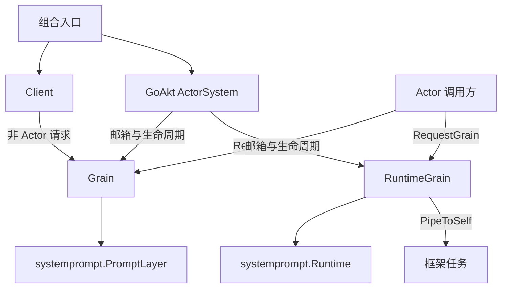
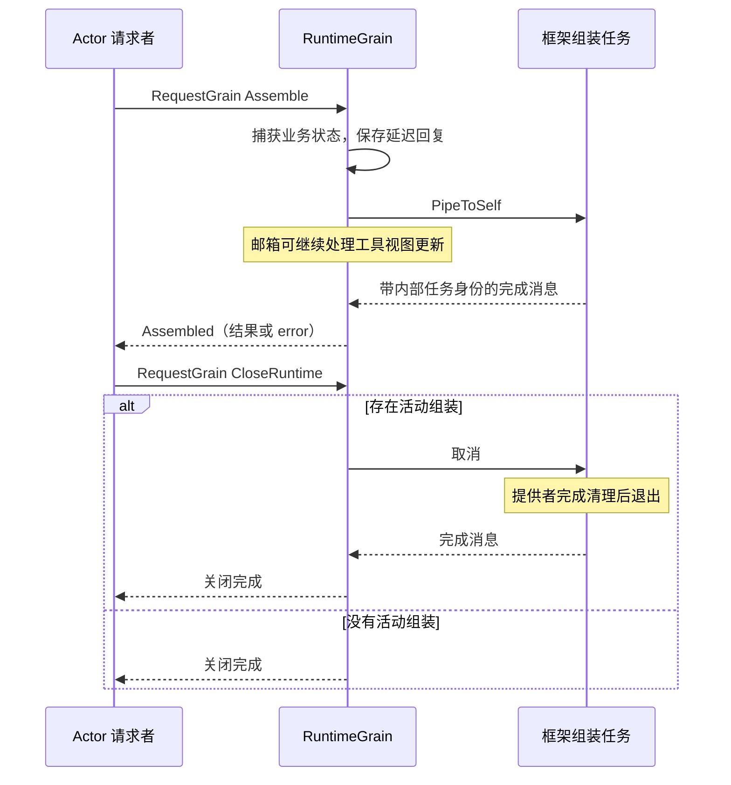

# Prompt Actor 适配

本包将 [systemprompt 业务对象](../README.zh-CN.md) 接入 GoAkt。框架负责身份、邮箱、消息请求和任务调度；业务包负责定义、工具视图与组装规则。目标契约见 [Prompt 模块设计](../../zh-CN/actor-design/17-prompt-module.md)，通信约束见 [消息机制](../../zh-CN/actor-design/06-messaging-and-tasks.md)。

## 模块内职责划分

| 职责 | 实现文件 | 边界 |
| --- | --- | --- |
| 共享注册消息 | [messages.go](messages.go) | 定义初始化、注册、删除及快照请求；具名注册命令映射到业务方法，不保存状态 |
| 共享注册调度 | [grain.go](grain.go) | 串行调用 `PromptLayer`，维护发布版本并回复；不执行组装任务，不重复保存注册映射 |
| 每 Agent 消息 | [runtime_messages.go](runtime_messages.go) | 定义工具视图应用、组装、取消和关闭的输入输出；不混入共享注册操作 |
| 每 Agent 任务调度 | [runtime_grain.go](runtime_grain.go) | 调用纯 Runtime，捕获任务输入，使用 PipeToSelf 和延迟回复完成组装；只维护在途任务及关闭所需状态 |
| 非 Actor 访问入口 | [client.go](client.go) | 将外部调用转为共享注册 Grain 请求，检查回复类型并返回业务结果；Actor 间调用不经过 Client |

共享注册 Grain 和每 Agent RuntimeGrain 是独立 owner：前者维护可捕获的定义集合，后者维护某个 Agent 已应用的视图及在途任务。它们不互相持有业务对象；跨 owner 的定义传递应使用快照消息。订阅适配尚未实现，不在现有 Grain 内暗含一个订阅器或第二份目录。

## 主要对象职责

| 对象 | 职责与持有的数据 | 上下游契约 |
| --- | --- | --- |
| `Grain` | 持有共享注册 `PromptLayer` 与快照版本，串行处理定义增删 | 接收 `Initialize`、具名注册命令、`Remove` 和 `Prepare`；返回注册 ID、完成结果或版本化快照 |
| `RuntimeGrain` | 持有一个 Agent 的纯 `Runtime`，调度组装并管理在途回复、取消和关闭 | 接收 `InitializeRuntime`、`ApplyTools`、`Assemble`、`CancelAssembly` 和 `CloseRuntime` |
| `assembly` | 保存一次在途组装的内部身份、业务请求 ID、延迟回复及取消函数 | 只属于 RuntimeGrain，不承担业务配置或工具定义的所有权 |
| `Client` | 为非 Actor 调用方提供共享注册 Grain 的请求入口 | 绑定 ActorSystem 与稳定名称；不保存注册表或注销句柄；Actor 调用方直接使用 `RequestGrain` |
| 消息及结果类型 | 用具名字段表达注册、更新、组装和关闭契约 | 普通失败使用 `error`；框架的 `any` 边界留在适配内部 |

`Grain` 不执行动态提供者，避免求值阻塞共享注册。`RuntimeGrain` 一次只接受一个组装，忙时明确返回 `ErrBusy`，不维护额外业务队列。工具更新可在组装期间进入邮箱，当前任务仍使用开始时捕获的旧视图。

## 依赖关系

业务对象不持有 Grain、Client 或 ActorSystem 的反向引用。注册身份映射仅由业务层保存，Grain 不维护第二份注册目录。RuntimeGrain 当前通过显式消息取得定义与工具视图；Tools Registry 的事件适配尚未接入。

## 注册交互

组合入口初始化注册 Grain 后，注册命令调用 `PromptLayer`，成功返回 `RegistrationID` 并增加版本。`Remove` 按 ID 删除，只有实际删除才增加版本。`Prepare` 返回当前版本及定义快照，不运行提供者。非 Actor 的 `Client.Assemble` 在取得快照后于注册邮箱之外求值；Agent 目标路径使用每 Agent RuntimeGrain。

## 组装与关闭交互

组装必须通过异步 `RequestGrain` 发起。`DeferResponse` 对 `AskGrain` 不建立延迟回复，错误入口返回 `ErrAsyncRequest` 且不创建任务。内部任务身份与业务请求 ID 分开，完成消息必须匹配当前任务才可结束原回复。

`CancelAssembly` 的确认只表示取消命令已处理，不表示提供者已经退出。正常关闭取消活动组装并等待完成，期间拒绝工具更新及新组装；已关闭后重复关闭幂等成功。强制框架停用只取消工作并结束待回复，不能作为正常业务排空的证据。

## 当前验证与未完成部分

真实 GoAkt 测试覆盖异步组装期间的工具更新、前后请求视图隔离、错误同步入口、注册删除幂等，以及提供者清理结束前不确认关闭。测试请求 Actor 显式配置异步重入。包级竞态测试与 vet 已通过。

PubSub 订阅与注销、AgentCreating 授权、Session/Approval 数据请求及生产 AgentLoop 集成仍待完成。上述测试不证明旧身份重新激活防护或完整 Agent/Session 关闭链已实现。[历史实施进度](../../zh-CN/08-implementation-progress.md) 仅作为迁移证据索引，不沿用旧架构完成度。
