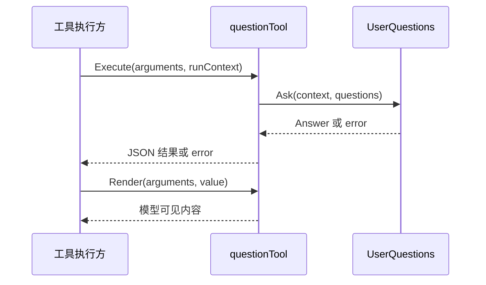

# 用户问答工具

本包提供模型可调用的 ask_user_question，负责参数映射和答案呈现。工具定义接口归 [Tools Actor 方案](../zh-CN/actor-design/08-tools-implementation.md)；[历史实施进度](../zh-CN/08-implementation-progress.md)不代表当前 Actor 迁移完成度。

## 对象与模块内职责

| 对象 | 职责 |
| --- | --- |
| questionTool | 持有 UserQuestions 接口，实现 Execute 与 Render；解码工具参数、请求答案并输出规范 JSON 和文本 |
| newDefinition | 验证依赖，构造 canonical 名称、参数及输出 schema |
| Plugin | 现存旧装配入口，注册和移除定义；尚待 Actor 生命周期迁移 |
| factory | 现存静态 Plugin 构造入口；不拥有问答状态 |

questionTool 不维护等待列表、不调度 Agent、不负责答案投递关联；这些职责归 UserQuestions 及其提供者。执行沿用调用 context，保留结构化 UserQuestionError。渲染压紧规范 JSON，不改变答案字段。

本次删除函数适配包装，由具名对象直接实现工具接口。测试直接注册业务定义，覆盖固定 schema、参数映射、上下文传播、答案呈现、无提供者错误和定义移除；UserQuestions 的旧 Plugin 提供路径仍在测试中使用。因此本模块只完成工具对象清理，不宣称已接通生产 Actor 问答链路。
