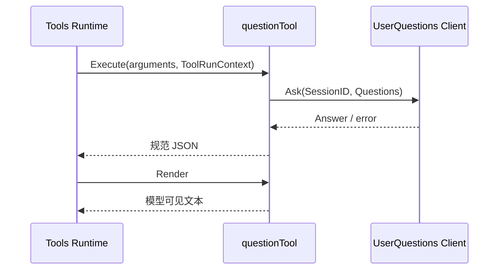

# 用户问答工具

本包实现 canonical 工具 ask_user_question。它只负责模型参数与 UserQuestions 请求之间的映射，以及答案 JSON 的呈现。设计见[用户问答方案](../zh-CN/actor-design/36-workspace-userquestions.md)，工具生命周期归 [Tools Actor](../zh-CN/actor-design/08-tools-implementation.md)。

| 对象 | 职责与依赖 |
| --- | --- |
| NewDefinition | 显式接收最窄的 UserQuestions.Ask 接口，构造原名称、描述、参数与输出 schema |
| questionTool | 实现 Executor 和 OutputRenderer；从 ToolExecution 读取 SessionID，沿用工具 context |
| Tools Registry / Runtime | 注册定义、构造每 Agent 工具实例、调度执行和取消；不归本包重复实现 |

本包没有等待列表、Provider 登记、Agent 对象类型断言或 Actor 状态。取消由执行 context 传递到 UserQuestions。UserQuestionError 保持结构化错误类与错误码。原 Plugin 和 Factory 已删除；composition 将 NewDefinition 的结果交给现有 Tools 注册路径。

测试保留固定 schema、参数映射、context 传播、答案呈现、无 Provider 错误和工具定义移除覆盖。

工具执行测试通过 [execution.Scheduler 与 Call](../tools/execution/README.zh-CN.md) 验证参数、结构化回答与结果渲染；不再构造 ToolLayer 或本地注册句柄。Actor 测试使用同一执行业务路径调用真实 UserQuestions Grain。
