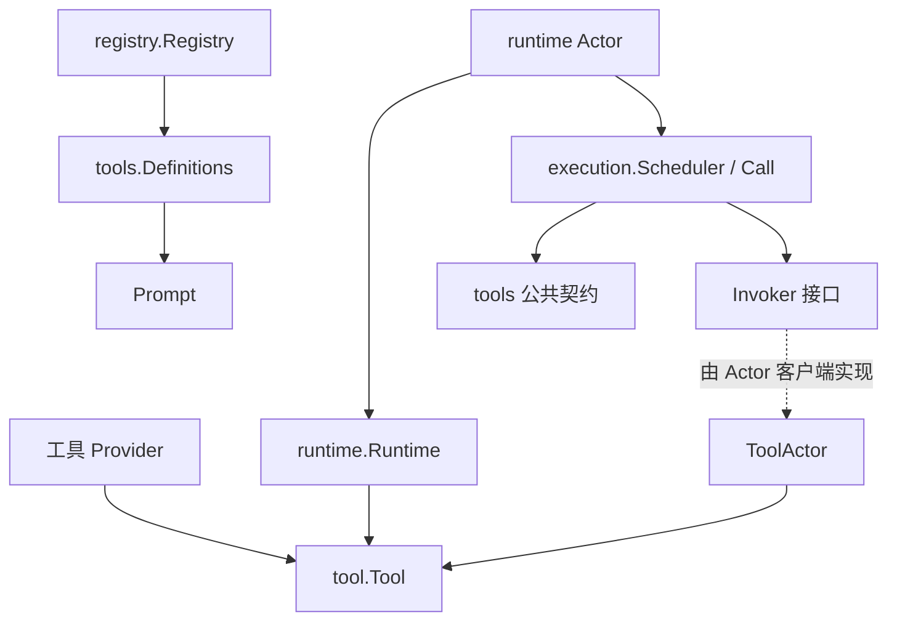

# Tools

`tools` 根包定义跨模块使用的工具契约：定义与描述、调用输入、策略接口、结果与事件。它不保存工具目录，不管理 Actor，也不驱动一次调用。

## 模块与主要对象

| 模块 | 主要对象 | 职责 |
| --- | --- | --- |
| 根包 | ToolDefinition、Descriptor、Contract | 工具体与元数据契约、Schema 编译和校验；Contract 的校验规则供初始化与执行共享 |
| 根包 | ToolExecution、Invocation、BodyResult | 策略可见的调用数据、工具体输入及其输出；不携带调度状态 |
| 根包 | 策略接口、结果和事件 | 前置评估、执行中间件、后置审查、只读结果通知 |
| [registry](registry/README.zh-CN.md) | Registry | 全局默认配置与 Agent 覆盖、完整定义发布、每个 Schema 的版本 |
| [runtime](runtime/README.zh-CN.md) | Runtime、Update | 每个 Agent 的实例集合、准备、发布、切换及资源清理 |
| [tool](tool/README.zh-CN.md) | Tool | 单个工具实现、候选与当前资源、实现身份和工具体执行 |
| [execution](execution/README.zh-CN.md) | Scheduler、Call | 固定工具描述与策略；一次调用的评估、审批续接、派发和结果处理 |

## 依赖和交互

Registry 管理配置与定义；Runtime 管理对应实例。执行时，Runtime Actor 读取已确认工具的 Descriptor 和独立实现 Identity，构造 Scheduler。Call 保留实际执行输出；Actor 只投递阶段任务、接收结果和传递取消。公共 ToolExecution 没有执行状态，策略不能将调用数据当作调度句柄。

工具体退出后返回 BodyResult，执行模块完成输出校验、渲染、后置策略和最终结果。BodyResult 不是 Session 持久化确认；结果何时写入 Session 由上游流程负责。

取消需要传递给工具体并等待实际退出。投递失败或回复不确定使用 error 保留执行责任，不伪造普通工具失败结果。工具配置更新和关闭必须等待已有调用释放，不能提前释放其借用的实现资源。

旧 ToolLayer、分层 Registry、Store、注册句柄、本地构造与专属配置已删除，不保留兼容入口。原分层测试删除；策略、审批、取消、校验和结果处理测试位于执行模块。暂缓迁移的 subagent 和旧 assembly 不作为保留旧 API 的理由。

目标契约见 [Actor Tools 设计](../zh-CN/actor-design/08-tools-implementation.md)，集成问题和验证边界见 [集成记录](../zh-CN/actor-design/40-integration-findings.md)。本次不宣称完成 AgentLoop 主驱动、审批 Actor 接线或动态工具更新屏障。
